# 🏨 Hotel Management System — Project Design Document & Specification

> ## โครงงานระบบบริหารจัดการโรงแรมหลังบ้าน (Internal Hotel Operations & Back-Office)
> สถาปัตยกรรม Microservices บน Serverless Stack (Cloudflare Workers, D1, Queues/QStash) รวม 105 APIs  
> ออกแบบเฉพาะสำหรับ**ระบบบริหารจัดการภายในโรงแรมขนาดเล็ก 5–10 ห้อง (Boutique Hotel / Poshtel)**  
> รองรับ 3 บทบาทหลักของทีมปฏิบัติการ: **Front Desk Staff & Cashier, Housekeeping Staff, Manager / Admin**

---

## 🤖 สำหรับ AI Assistant — อ่านก่อนเริ่มงานทุกครั้ง

> ไฟล์นี้ (`README.md`) คือเอกสาร Spec ภาพรวมของโปรเจกต์ **อย่าเริ่มเขียนโค้ดหรือแก้ไขอะไรจากไฟล์นี้โดยตรง** ให้ไปอ่านไฟล์ใน `docs/` ก่อนเสมอ

| กำลังจะทำอะไร | ไปอ่านไฟล์นี้ก่อน |
|---|---|
| เริ่มงานครั้งแรก / ไม่รู้จะทำอะไร | `docs/skill.md` ← **เริ่มที่นี่เสมอ** |
| ทำไมถึงออกแบบแบบนี้ / เหตุผล Architecture | `docs/design.md` |
| ทำ UI, สี, component, Status Badge | `docs/designsystem.md` |
| หาว่าไฟล์วางอยู่ที่ไหนใน repo | `docs/structure.md` |
| ดู Service Architecture, Sequence Diagram, 105 APIs | `docs/systemdesign.md` |
| ดูแผนแบ่งงาน, ใครรับผิดชอบ service ไหน, Phase | `docs/อ่านก่อนทำงาน.md` |
| Setup เครื่อง, คำสั่ง dev/migrate/deploy | `docs/How to Install and Command.md` |

**กฎเหล็กสำหรับ AI:**
- อ่าน `docs/skill.md` ก่อนทำงานทุกครั้ง — มีกฎเหล็ก 5 ข้อที่ห้ามฝ่าฝืน
- ห้าม query ข้าม D1 database ของ service อื่น
- ทุกการเปลี่ยนสถานะสำคัญต้องใช้ Outbox Pattern เสมอ
- TypeScript ใช้ `camelCase`, SQL/D1 ใช้ `snake_case`, Drizzle map ให้อัตโนมัติ
- Frontend ใช้ **React + Vite** (ไม่ใช่ Next.js)

---

## 📚 สารบัญ (Table of Contents)

1. [🤼 ผู้จัดทำ (Contributors)](#1-ผู้จัดทำ-contributors)
2. [💭 หลักการและเหตุผล (Rationale & Problem Statement)](#2-หลักการและเหตุผล-rationale--problem-statement)
3. [🗃️ วัตถุประสงค์ของโครงงาน (Objectives)](#3-วัตถุประสงค์ของโครงงาน-objectives)
4. [📑 ขอบเขตของระบบและความต้องการ (System Scope & Requirements)](#4-ขอบเขตของระบบและความต้องการ-system-scope--requirements)
5. [🧑‍💻 แนวทางของการพัฒนาตาม SDLC (System Development Life Cycle)](#5-แนวทางของการพัฒนาตาม-sdlc-system-development-life-cycle)
6. [🧰 สแตกเทคโนโลยี (Tech Stack)](#6-สแตกเทคโนโลยี-tech-stack)
7. [👥 การแบ่งหน้าที่และความรับผิดชอบ (Team Roles & Responsibilities)](#7-การแบ่งหน้าที่และความรับผิดชอบ-team-roles--responsibilities)
8. [🗺️ แผนการดำเนินงาน 12 สัปดาห์ (Project Timeline)](#8-แผนการดำเนินงาน-12-สัปดาห์-project-timeline)
9. [🎨 Brand Identity & Design System (Color Palette & Status-Color)](#9-brand-identity--design-system)
10. [👥 ข้อมูลกลุ่มผู้ใช้งานจำลอง (User Personas)](#10-ข้อมูลกลุ่มผู้ใช้งานจำลอง-user-personas)
11. [🧩 ผังการใช้งานระบบ (Use Case Diagram)](#11-ผังการใช้งานระบบ-use-case-diagram)
    *   [🏃 แผนภาพกิจกรรมการทำงานหลัก (Activity Diagrams - 4 Flows พร้อม Swimlane)](#111-แผนภาพกิจกรรมการทำงานหลัก-activity-diagrams)
12. [🏗️ แผนภาพคลาส (Class Diagram)](#12-แผนภาพคลาส-class-diagram)
13. [🖥️ สถาปัตยกรรมระบบ (System Architecture & Event-Driven Patterns)](#13-สถาปัตยกรรมระบบ-system-architecture--event-driven-patterns)
14. [🔄 วงจรชีวิตสถานะห้องพัก (Room Lifecycle State Machine)](#14-วงจรชีวิตสถานะห้องพัก-room-lifecycle-state-machine)
15. [🔁 แผนผังลำดับการทำงานหลัก (Sequence Diagrams - 6 Flows)](#15-แผนผังลำดับการทำงานหลัก-sequence-diagrams)
16. [📋 รายการ API ทั้งหมด (105 Microservice Endpoints)](#16-รายการ-api-ทั้งหมด-105-microservice-endpoints)
17. [🗄️ โครงสร้างฐานข้อมูลและผังความสัมพันธ์ (Database Schema & ER Diagrams)](#17-โครงสร้างฐานข้อมูลและผังความสัมพันธ์-database-schema--er-diagrams)
18. [🎯 การออกแบบหน้าจอ (UI Prototype & Wireframe)](#18-การออกแบบหน้าจอ-ui-prototype--wireframe)
19. [⚙️ การทดสอบการยอมรับของผู้ใช้ (User Acceptance Testing: UAT)](#19-การทดสอบการยอมรับของผู้ใช้-user-acceptance-testing-uat)
20. [🖼️ ผลลัพธ์ที่คาดว่าจะได้รับ (Expected Outcomes)](#20-ผลลัพธ์ที่คาดว่าจะได้รับ-expected-outcomes)

---

## 1. 🤼 ผู้จัดทำ (Contributors)

*   **67118456 นายเขตโสภณ อินอุตออน** — PM + Infra/DevOps Lead
*   **67095474 นายธีรภัทร เนียมสุวรรณ** — System Analyst (SA) + Backend Developer
*   **67096366 นายปวริศ ธรรมวงษ์** — Tester/QA Lead + Backend Developer

---

## 2. 💭 หลักการและเหตุผล (Rationale & Problem Statement)

ระบบจองโรงแรมทั่วไปที่พบเห็นได้บ่อยในตลาด (เช่น Booking.com, Agoda) มักเน้นมุมมอง **"ฝั่งลูกค้า" (B2C)** เช่น การค้นหาห้องพัก เปรียบเทียบราคา ชำระเงิน และรอรับการยืนยัน ซึ่งฟังก์ชันหลังบ้านส่วนใหญ่เป็นเพียง CRUD พื้นฐาน

โครงงานนี้จึงเลือกมุมมองที่ตอบโจทย์เฉพาะเจาะจง คือมุมมอง **"ฝั่งเจ้าของและพนักงานปฏิบัติการโรงแรมขนาดเล็ก 5–10 ห้อง" (B2B / Small-Scale Hotel Operations)** ซึ่งเป็นระบบแกนหลักหลังบ้าน (Back-Office Operating System):
ในโรงแรมขนาดเล็ก 5–10 ห้อง (Boutique Hotel / Poshtel / เกสต์เฮาส์) จะไม่มีเคาน์เตอร์การเงินหรือพนักงานบัญชีแยกต่างหาก แต่พนักงานต้อนรับเพียงคนเดียวจะทำหน้าที่ควบทั้งการต้อนรับและงานแคชเชียร์แบบครบวงจร (Front Desk Staff & Cashier) ประสานงานร่วมกับแม่บ้าน (Housekeeping) และผู้บริหาร (Manager / Admin) แบบ Real-time ตลอด 24 ชั่วโมง:

1.  **State Machine ของห้องพักมีความซับซ้อนและหมุนเวียนต่อเนื่อง:** สถานะห้องพักในโรงแรมมีวงจรชีวิตที่ชัดเจน (`ว่าง` → `จองแล้ว` → `เข้าพัก` → `เช็คเอาท์` → `รอทำความสะอาด` → `พร้อมใช้` หรือ `ส่งซ่อมบำรุง`) การเปลี่ยนสถานะในแต่ละจังหวะต้องควบคุมด้วย Business Logic ที่รัดกุมเพื่อป้องกันการจองซ้อน (Double Booking)
2.  **ตอบโจทย์ Use Case จริงในธุรกิจที่มีการส่งต่องานข้ามแผนก:** เมื่อลูกค้าเช็คเอาท์ แผนกต้อนรับ/แคชเชียร์จะดำเนินการหักลบเงินมัดจำ คิดค่ามินิบาร์ และออกใบเสร็จ ระบบจะแจ้งแผนกแม่บ้านเข้าทำความสะอาดทันที และส่งข้อมูลสถิติไปยังผู้บริหารเพื่อนำไปวิเคราะห์ Occupancy Rate โดยกระบวนการเหล่านี้ไม่ควรหยุดชะงักหากระบบใดระบบหนึ่งทำงานช้า
3.  **เป็นกรณีศึกษาที่สะท้อนศักยภาพของ Microservices Architecture อย่างแท้จริง:** ความเชื่อมโยงข้ามแผนกนี้เปิดโอกาสให้ประยุกต์ใช้แนวคิดระดับสูง เช่น **Database-per-Service** (แยกฐานข้อมูลอิสระ 6 ก้อน), **Outbox Pattern** (ป้องกันข้อมูลสูญหายขณะส่งข้อความข้าม Service) และ **Asynchronous Event Bus** ผ่าน Cloudflare Queues / Upstash QStash ที่ทำงานแบบ Decoupled ไร้การพึ่งพากันโดยตรง

---

## 3. 🗃️ วัตถุประสงค์ของโครงงาน (Objectives)

1.  เพื่อออกแบบและพัฒนาระบบบริหารจัดการโรงแรมหลังบ้านด้วยสถาปัตยกรรม **Microservices Architecture** ครอบคลุม 6 เซอร์วิสหลัก และมีจำนวน API รวม 105 Endpoints
2.  เพื่อพัฒนาระบบจัดการวงจรชีวิตห้องพัก (Room Lifecycle & State Machine) งานจอง งานเช็คอิน/เช็คเอาท์ งานทำความสะอาด ระบบบิล และระบบรายงานสถิติแบบ Real-time
3.  เพื่อประยุกต์ใช้แพตเทิร์นสถาปัตยกรรมระดับสูง ได้แก่ **Database-per-Service**, **Outbox Pattern**, และ **Asynchronous Event-Driven Messaging (Pub/Sub & Fan-out)** บน Serverless Infrastructure
4.  เพื่อศึกษาการทำงานของ Cloudflare Workers, D1 (Serverless SQLite), และ Queues ในการพัฒนาระบบที่รองรับการ Deploy แยกกันได้อย่างอิสระ (Independent Deployability) และมีความทนทานสูง (Resilience)

---

## 4. 📑 ขอบเขตของระบบและความต้องการ (System Scope & Requirements)

*(หมายเหตุ: รวบรวมขอบเขตของระบบและรายการความต้องการใช้งานเข้าด้วยกัน เพื่อความกระชับและขจัดความซ้ำซ้อนตามหลัก Clean Documentation)*

### ผู้ใช้งานระบบ (Actors)
*   **พนักงานต้อนรับและแคชเชียร์ (Front Desk Staff & Cashier):** รวมหน้าที่ต้อนรับและการเงินเข้าด้วยกันสำหรับโรงแรมขนาดเล็ก (5–10 ห้อง) — เช็คห้องว่าง, จัดการการจองล่วงหน้า, เช็คอิน, เช็คเอาท์, รับ Walk-in, ขยายเวลาพัก, อัปเกรดห้อง, จัดการบิลค่าห้องและมินิบาร์, บันทึกการชำระเงิน, หักเงินมัดจำ, ออกใบเสร็จ/ใบกำกับภาษี, คืนเงิน (ไม่มี Role พนักงานบัญชีแยกต่างหาก) พร้อมสิทธิ์ **Read-Only สำหรับสมุดเบอร์ติดต่อ Outsource ฉุกเฉิน** เพื่อโทรเรียกช่างซ่อมบำรุงด่วน (แอร์เสีย, ส้วมตัน, ท่อแตก) ได้ทันทีเมื่อแขกร้องเรียน
*   **พนักงานแม่บ้าน (Housekeeping Staff):** รับมอบหมายงานทำความสะอาด, เปลี่ยนสถานะงาน, ตรวจสอบสภาพห้อง, รายงานสิ่งของชำรุด พร้อมสิทธิ์ **Read-Only สำหรับสมุดเบอร์ช่าง Outsource เฉพาะทาง** เพื่อประสานงานซ่อมหน้างานควบคู่กับการเปิดใบงาน Issue
*   **ผู้จัดการ / ผู้ดูแลระบบ (Manager / Admin):** กำหนดสิทธิ์และบัญชีผู้ใช้, จัดการข้อมูลประเภทห้องและราคา, ดูรายงานสถิติ Occupancy Rate และสรุปรายได้ โดย **Admin เป็นผู้มีสิทธิ์ Full CRUD จัดการ Master Data ข้อมูลคู่ค้าและช่าง Outsource ภายนอก** (เพิ่ม, แก้ไข, ระงับการใช้งาน `is_active = 0`) เพื่อป้องกันข้อมูลเบอร์โทรศัพท์สูญหายหรือถูกแก้ไขโดยไม่ได้รับอนุญาต

### ความสามารถหลักของระบบ (Core System Requirements)
1.  **ระบบสิทธิ์ และการยืนยันตัวตน (Auth & User Management):** สมัครสมาชิก, ล็อกอินด้วย JWT, รีเฟรชโทเค็น, รีเซ็ตรหัสผ่าน, กำหนดสิทธิ์แบบ Role-Based Access Control (RBAC 4 Roles)
2.  **ระบบห้องพักและสิ่งอำนวยความสะดวก (Room Inventory Management):** จัดการห้องพัก, ประเภทห้อง (Standard, Deluxe, Suite, Presidential), ชั้น, สิ่งอำนวยความสะดวก และประวัติการเปลี่ยนแปลง
3.  **ระบบวงจรชีวิตสถานะห้องพัก (Room Lifecycle State Machine):** จัดการและควบคุมการเปลี่ยนสถานะของห้องพักทั้ง 7 สถานะอย่างเป็นระบบตามเงื่อนไขทางธุรกิจ
4.  **ระบบการจองห้องพัก (Reservation Management):** สร้างการจองล่วงหน้า, ปรับเปลี่ยนวันเข้าพัก, ยกเลิกการจอง, บันทึกประวัติแขก (Guest Profiles) และรองรับการ Walk-in
5.  **ระบบเช็คอินและเช็คเอาท์ (Check-in & Check-out Operations):** ตรวจสอบสิทธิ์การเข้าพัก, บันทึกเวลาเช็คอินจริง, กระจายคำสั่งเช็คเอาท์ (Fan-out) ไปยังฝ่ายแม่บ้านและการเงิน
6.  **ระบบขยายเวลาพักและอัปเกรดห้อง (Extend Stay & Room Upgrade):** ปรับปรุงรายละเอียดการจองขณะเข้าพัก พร้อมคำนวณส่วนต่างค่าห้องพักอัตโนมัติ
7.  **ระบบงานแม่บ้าน งานทำความสะอาด และจัดการคู่ค้า Outsource (Housekeeping, Maintenance & Outsource Management):** ระบบสร้างงานทำความสะอาดอัตโนมัติหลังเช็คเอาท์, มอบหมายงานตามกะ/โซน, บันทึกเวลาเริ่มและเสร็จสิ้น, รายงานปัญหาห้องชำรุดส่งซ่อมบำรุง, และบริหารสมุดรายชื่อเบอร์ติดต่อช่าง/คนสวน/คู่ค้าภายนอก (Outsource Contacts) จำแนกตามหมวดหมู่งานและระดับความฉุกเฉิน
8.  **ระบบรายงานปัญหาห้องพัก (Room Issue & Maintenance Reporting):** แจ้งปัญหาห้องชำรุด สิ่งของสูญหาย หรือปัญหาความสะอาด พร้อมส่งต่อสถานะไปยังฝ่ายซ่อมบำรุง
9.  **ระบบบิลและค่าบริการเสริม (Billing & Folio Management):** บันทึกค่าห้อง, บริการเสริม (มินิบาร์, ซักรีด, รูมเซอร์วิส), ค่าปรับ และส่วนลดพิเศษ
10. **ระบบชำระเงินและเอกสารทางการเงิน (Payment & Invoicing):** บันทึกการชำระเงินหลายช่องทาง (เงินสด, โอน, บัตร, QR), ออกใบเสร็จ, ออกใบแจ้งหนี้ และส่งอีเมล
11. **ระบบรายงานและวิเคราะห์ข้อมูลเชิงลึก (Analytics & Reporting):** อัตราการเข้าพัก (Occupancy Rate), สถิติรายได้รายวัน/รายเดือน, ประสิทธิภาพแม่บ้าน, ส่งออกข้อมูล PDF/CSV
12. **ระบบ Event Bus และความสอดคล้องของข้อมูล (Event-Driven Consistency):** รับ-ส่ง Event ข้าม Service ผ่าน Cloudflare Queues โดยใช้ Outbox Pattern

### ฟังก์ชันที่อยู่นอกเหนือขอบเขต (Out-of-Scope)
*   ระบบจองห้องพักสาธารณะสำหรับลูกค้าทั่วไปผ่านเว็บไซต์ (Customer-Facing Public Booking)
*   การเชื่อมต่อ Payment Gateway ตัดบัตรเครดิตจริง (ใช้ระบบจำลอง Mock Sandbox)
*   ระบบงานบุคคล (HR) เต็มรูปแบบ เช่น การคิดเงินเดือน (Payroll) หรือการลางานของพนักงาน
*   การรองรับหลายสาขาพร้อมกัน (Multi-Property / Multi-Branch) มุ่งเน้นการจัดการสำหรับ 1 โรงแรม

---

## 5. 🧑‍💻 แนวทางของการพัฒนาตาม SDLC (System Development Life Cycle)

| ขั้นตอน (Phase) | รายละเอียดโดยย่อ (Brief Description) |
|---|---|
| **1. Planning** | ร่วมกันระบุปัญหาการดำเนินงานหลังบ้านของโรงแรม กำหนดขอบเขตโครงการ สถาปัตยกรรม Microservices และประเมินความเป็นไปได้ในการใช้ Cloudflare Serverless Stack |
| **2. Analysis** | วิเคราะห์กระบวนการทางธุรกิจ (Business Process) วงจรชีวิตห้องพัก ออกแบบ Use Case Diagram และจัดทำข้อกำหนดความต้องการระบบ (SRS) เชิงฟังก์ชัน 105 APIs |
| **3. Design** | ออกแบบ System Architecture, State Machine, Class Diagram, Sequence Diagram (5 Flows), โครงสร้างฐานข้อมูล D1 6 ก้อน (ER Diagram) และ Design System |
| **4. Development** | พัฒนา Backend Microservices บน Cloudflare Workers ด้วย TypeScript และ Drizzle ORM พัฒนา API Gateway เชื่อมต่อ Queues และพัฒนาหน้าจอ React + Tailwind CSS |
| **5. Testing** | ดำเนินการทดสอบระบบด้วย Postman (Functional Test), ทดสอบ Event-Driven ข้ามเซอร์วิส และทำการทดสอบการยอมรับของผู้ใช้งาน (Manual UAT) ตามบทบาท |
| **6. Deployment** | นำระบบขึ้นสู่สภาพแวดล้อม Cloudflare Edge จริง ผ่าน Wrangler CLI และ GitHub Actions CI/CD Pipeline |
| **7. Maintenance** | ติดตามการทำงาน (Monitoring) ผ่าน Cloudflare Dashboard จัดการ Dead-Letter Queue (DLQ) เมื่อมี Event ล้มเหลว และแก้ไขจุดบกพร่องตามผล UAT |

---

## 6. 🧰 สแตกเทคโนโลยี (Tech Stack)

| หมวดหมู่ | เทคโนโลยี | รายละเอียดและเหตุผลการเลือกใช้ |
|---|---|---|
| **Programming Language** | TypeScript | ใช้ทั้งฝั่ง Backend และ Frontend เพื่อความปลอดภัยของข้อมูล (Type Safety), ลดข้อผิดพลาดขณะรันไทม์ และสื่อสาร Data Model ได้แม่นยำ |
| **Serverless Compute** | Cloudflare Workers | รันไทม์ประสิทธิภาพสูงที่ Edge ทั่วโลก ทำงานแบบ V8 Isolates บูตเร็วในระดับมิลลิวินาที ประหยัดค่าใช้จ่ายและรองรับโหลดได้ทันที |
| **API Gateway** | Cloudflare Workers | จุดรับคำขอหลัก ทำหน้าที่เป็น Reverse Proxy, ถอดรหัส/ตรวจสอบ JWT, Rate Limiting, CORS Handling และ Route ไปยัง Microservices |
| **Database** | Cloudflare D1 (SQLite-based) | Serverless Relational Database แยก 1 ก้อนต่อ 1 เซอร์วิส (รวม 6 DBs) ตอบสนองเร็วผ่าน Edge และเป็นไปตามหลัก Database-per-Service |
| **ORM / Query Builder** | Drizzle ORM | Type-safe ORM น้ำหนักเบา ไม่มี Native Bindings จึงทำงานร่วมกับ Workers Runtime ได้อย่างสมบูรณ์แบบ แตกต่างจาก Prisma ที่มีปัญหากับ Edge |
| **Caching & Fast KV** | Cloudflare KV | แคชความเร็วสูงสำหรับเก็บสถานะ Session, สิทธิ์การใช้งานของ Role และ System Configurations |
| **Message Queue** | Cloudflare Queues | ระบบคิวข้อความแบบ Asynchronous Pub/Sub รับประกันการส่งข้อมูลอย่างน้อยหนึ่งครั้ง (At-Least-Once Delivery), มี Auto-Retry และ Dead-Letter Queue (DLQ) |
| **Frontend Framework** | React + Vite + TypeScript | พัฒนาในรูปแบบ Single Page Application (SPA) เพื่อความลื่นไหลในการใช้งานหลังบ้านของพนักงาน |
| **Styling & UI Components** | Tailwind CSS | Utility-First CSS สำหรับตกแต่งหน้าจออย่างรวดเร็วและเป็นระเบียบ พร้อมสร้าง Status-Color Design System |
| **Frontend Hosting** | Cloudflare Workers (Static Assets) | โฮสต์ไฟล์ Static ของ Frontend บน Workers Stack เดียวกัน ทำให้จัดการ Deploy ง่ายผ่าน `wrangler deploy` |
| **API Documentation** | OpenAPI / Swagger | บันทึกข้อกำหนดและเอกสารสเปกของทั้ง 105 APIs สำหรับใช้อ้างอิงและทดสอบระบบ |
| **Testing Tools** | Postman | ใช้ทดสอบ Functional API ราย Endpoint และทดสอบกระบวนการ Integration ข้ามเซอร์วิส |
| **DevOps & CI/CD** | GitHub Actions + Wrangler CLI | ระบบตรวจทานโค้ดอัตโนมัติและสั่ง Deploy ระบบขึ้น Cloudflare โดยอัตโนมัติเมื่อ Merge โค้ด |

---

## 7. 👥 การแบ่งหน้าที่และความรับผิดชอบ (Team Roles & Responsibilities)

| สมาชิก | บทบาทเสริม (Role) | Service Backend ที่รับผิดชอบ | จำนวน API | หน้าจอ Frontend | ภาระงานหลักอื่น ๆ |
|---|---|---|:---:|---|---|
| **คน A (เขตโสภณ)** | **PM + Infra/DevOps Lead** | • API Gateway<br/>• Auth/User (12)<br/>• Report/Analytics (14) | **26** + Gateway | **Manager & Admin Portal** (`/admin`)<br/>• KPI Dashboard<br/>• User Management<br/>• Outsource Contacts Management (Admin UI)<br/>• Export Reports | วางโครงสร้าง Monorepo, ติดตั้ง Cloudflare Stack (6 D1, KV, R2), ออกแบบ API Gateway & RBAC, ติดตั้ง Upstash QStash Event Broker, ดูแล Master Data Outsource (Admin UI), CI/CD Deploy Pipeline |
| **คน B (ธีรภัทร)** | **SA Lead + Core Dev** | • Reservation (24)<br/>• Billing (16) | **40** | **Front Desk & Cashier Portal** (`/front-desk`)<br/>• Room Matrix Grid (5–10 ห้อง)<br/>• Check-in / Check-out<br/>• Cashier & Split Screen Invoices<br/>• Quick Emergency Contact Drawer | System Analyst, วิเคราะห์ State Machine, ออกแบบ D1 Schemas & Outbox Pattern, กำหนด Event Contracts (`packages/events`), ดูแล Flow เงินมัดจำ/มินิบาร์/คิดเงิน และช่องทางติดต่อช่างด่วน |
| **คน C (ปวริศ)** | **QA Lead + Core Dev** | • Room Inventory (18)<br/>• Housekeeping (21) | **39** | **Housekeeping Portal** (`/housekeeping`)<br/>• Cleaning Kanban Board<br/>• Task Execution & Inspection<br/>• Report Room Issue<br/>• Outsource Contacts CRUD & Quick Contact Dialog | ออกแบบ Test Plan / 24 UAT Test Cases, ทำ Automated Postman Collection, ดูแล D1 Schema และ APIs งานแม่บ้านและ Outsource Contacts, ควบคุม State เปลี่ยนผ่านงานแม่บ้านและผังห้อง |

---

## 8. 🗺️ แผนการดำเนินงาน 12 สัปดาห์ (Project Timeline)

| สัปดาห์ (Week) | ระยะงาน (Phase) | รายละเอียดกิจกรรม |
|:---:|---|---|
| **1** | **System & Infra Setup** | วางโครงสร้าง Repo กลาง, ออกแบบ DB Schema เบื้องต้น, ตั้งค่า Cloudflare Workers / D1 / Queues, วาง Auth Pattern และตกลง API Contract |
| **2 – 5** | **Backend Development** | พัฒนา Microservices ทั้ง 6 ตัวแยกกันตามที่ได้รับมอบหมาย สื่อสาร Contract ข้าม Service เป็นประจำทุกสัปดาห์ |
| **6** | **Backend Integration & Queue Testing** | รวม Service เข้าผ่าน API Gateway, ทดสอบ Event-Driven ผ่าน Cloudflare Queues ตาม Flow จริง (จอง → เช็คอิน → แม่บ้าน → เช็คเอาท์ → บิล → รายงาน) |
| **7 – 9** | **Frontend Development** | พัฒนาหน้าจอตามส่วนงานของตนเอง โดยใช้ Design System และ Layout กลางร่วมกัน |
| **10** | **End-to-End Integration** | เชื่อมต่อส่วนหน้าบ้านเข้ากับ API จริงทั้งหมด และทดสอบ User Flow จากต้นจนจบ |
| **11** | **Bug Fixing & Documentation** | แก้ไขข้อผิดพลาดของระบบ, ปรับแต่งหน้าจอ UI, จัดทำเอกสารฉบับสมบูรณ์ (OpenAPI, README, System Diagram) |
| **12** | **Buffer & Presentation** | ซ้อมการสาธิตระบบ (Demo Flow), จัดเตรียมสไลด์ และเตรียมพร้อมการนำเสนอโครงงาน |

---

## 9. 🎨 Brand Identity & Design System

แนวคิดการออกแบบ: **"Operational Clarity & Status-First"**  
อ้างอิงแนวคิดจากระบบปฏิบัติการชั้นนำระดับโลก โดยให้ความสำคัญกับ **ความรวดเร็วในการรับรู้สถานะ (Cognitive Load Reduction)** พนักงานหน้างานต้องมองเห็นและเข้าใจสถานะของห้องพัก งานแม่บ้าน หรือยอดเงินได้ทันทีโดยไม่ต้องเสียเวลาอ่านตัวหนังสือละเอียด

| บทบาทสี | ชื่อสี | Hex Code | บริบทการใช้งาน |
|---|---|---|---|
| **Base Background** | Warm Off-White | `#FAFAF9` | พื้นหลังหลักของทุกหน้าจอ ให้ความสบายตาตลอดกะการทำงาน |
| **Surface / Card** | Pure White | `#FFFFFF` | การ์ดข้อมูล, ตาราง, โมดอล และแผงควบคุม |
| **Text Primary** | Slate Ink | `#1E293B` | ตัวหนังสือหลัก, หัวข้อ, รหัสห้องพัก, ยอดเงิน |
| **Text Muted** | Slate Grey | `#64748B` | ป้ายกำกับรอง, คำอธิบายย่อย, วันที่และเวลา |
| **Border / Divider** | Light Grey | `#E2E8F0` | เส้นแบ่งตาราง, กรอบ Input, เส้นคั่นส่วนเนื้อหา |
| **Primary Accent** | Vibrant Orange | `#F97316` | ปุ่ม Action หลัก (CTA), แถบเมนูที่เลือก, การไฮไลต์สำคัญ (ใช้โทนเดียวทั้งระบบ) |
| **Status: รอดำเนินการ** | Neutral Slate | `#94A3B8` | งานแม่บ้านรอ Assign, บิลแบบร่าง (Draft) |
| **Status: ยืนยันแล้ว** | Sky Blue | `#3B82F6` | ห้องพักสถานะ `reserved`, การจองที่รอเข้าพัก |
| **Status: สำเร็จ / พร้อม** | Emerald Green | `#22C55E` | ห้อง `available` หรือ `occupied`, งานเสร็จสิ้น, บิลชำระแล้ว (`paid`) |
| **Status: กำลังดำเนินการ**| Amber Gold | `#F59E0B` | ห้อง `cleaning`, งานทำความสะอาดกำลังดำเนินการ (`in_progress`) |
| **Status: ปัญหา / แจ้งเตือน**| Crimson Red | `#EF4444` | ห้อง `maintenance` หรือ `out_of_order`, การจองยกเลิก, งานค้างเกินเวลา |

---

## 10. 👥 ข้อมูลกลุ่มผู้ใช้งานจำลอง (User Personas)

### 🧑‍💼 Persona 1 — Front Desk Staff & Cashier: "ฟ้า" (พนักงานต้อนรับและแคชเชียร์)
*   **อายุ:** 24 ปี | ประสบการณ์ 2 ปี | **เป้าหมาย:** ให้บริการเช็คอิน-เช็คเอาท์แขก พร้อมคิดเงิน ออกบิล และจัดการเงินมัดจำได้อย่างรวดเร็ว ถูกต้องในจุดเดียวสำหรับโรงแรมขนาดเล็ก (5–10 ห้อง)
*   **Pain Points:**
    *   ช่วงเวลาเร่งด่วน (Peak Hour 12:00 - 14:00) มักสับสนว่าห้องไหนทำความสะอาดเสร็จแล้วจริง ทำให้แขกต้องยืนรอนาน
    *   การคำนวณค่าใช้จ่ายเสริม (มินิบาร์, ค่าปรับเช็คเอาท์เลท) และการหักลบเงินมัดจำในระบบเดิมต้องคิดเลขด้วยมือ เสี่ยงต่อการคิดเงินผิดพลาด
*   **Needs & Motivations:**
    *   หน้าจอแสดงสถานะห้องพักแบบ Real-time ที่อัปเดตทันทีเมื่อแม่บ้านทำความสะอาดเสร็จโดยไม่ต้องกด Refresh
    *   ฟังก์ชันเช็คอิน/เช็คเอาท์ใน 1 คลิก พร้อมออกใบสรุปค่าใช้จ่ายล่วงหน้า (Invoice Preview) ที่รวมภาษี ส่วนลด และหักเงินมัดจำอัตโนมัติ

---

### 🧹 Persona 2 — Housekeeping Supervisor: "สมศักดิ์" (หัวหน้าแผนกแม่บ้าน)
*   **อายุ:** 38 ปี | ประสบการณ์ 8 ปี | **เป้าหมาย:** จัดสรรงานทำความสะอาดให้แม่บ้านอย่างทั่วถึง และเคลียร์ห้องพักให้พร้อมขายเร็วที่สุด
*   **Pain Points:**
    *   เมื่อแขกเช็คเอาท์ มักไม่ได้รับแจ้งเตือนทันที ต้องรอให้ฟร้อนท์โทรศัพท์มาบอก ทำให้การเข้าทำความสะอาดล่าช้า
    *   เมื่อพบสิ่งของชำรุดในห้องพัก การเขียนรายงานใส่กระดาษมักสูญหาย และฝ่ายช่างไม่ได้รับเรื่องในทันที
*   **Needs & Motivations:**
    *   ระบบที่สร้างงานทำความสะอาดอัตโนมัติเมื่อแขกเช็คเอาท์ และสามารถกดมอบหมายงานให้แม่บ้านรายคนตามชั้น/โซนได้
    *   ฟังก์ชันถ่ายรูปและกด "Report Issue" รายงานปัญหาห้องพักไปยังฝ่ายช่างได้ทันทีจากมือถือหรือแท็บเล็ต

---

### 📊 Persona 3 — Hotel General Manager: "วิชัย" (ผู้จัดการทั่วไป)
*   **อายุ:** 45 ปี | ผู้บริหารระดับสูง | **เป้าหมาย:** ติดตามผลประกอบการ ภาพรวมอัตราการเข้าพัก และควบคุมต้นทุนการดำเนินงาน
*   **Pain Points:**
    *   ในโรงแรมขนาดเล็กเดิมที่ไม่มีระบบรวมศูนย์ ผู้จัดการต้องรอรวบรวมข้อมูลสิ้นวัน ทำให้ไม่สามารถตัดสินใจปรับราคาห้องพักได้ทันต่อสถานการณ์
    *   ไม่มีข้อมูลเชิงลึกว่าห้องพักประเภทใดสร้างรายได้สูงสุด หรือแม่บ้านคนใดมีประสิทธิภาพในการทำงานดีที่สุด
*   **Needs & Motivations:**
    *   Dashboard รายงานผลประกอบการแบบ Real-time ที่แสดง Occupancy Rate, รายได้รวม และสถิติการเช็คอิน/เช็คเอาท์ประจำวัน
    *   ความสามารถในการ Export รายงานออกมาเป็นไฟล์ PDF และ CSV ได้ในคลิกเดียวเพื่อนำไปประชุมผู้บริหาร

---

## 11. 🧩 ผังการใช้งานระบบ (Use Case Diagram)

```mermaid
flowchart LR

    %% Actors
    Staff(["👤 Hotel Staff\n(abstract)"])
    FD(["👤 Front Desk Staff\n(รวม Cashier & Billing)"])
    HK(["👤 Housekeeping Staff"])
    MGR(["👤 Manager / Admin"])

    %% Actor Generalization
    FD  -.->|"<<generalize>>"| Staff
    HK  -.->|"<<generalize>>"| Staff
    MGR -.->|"<<generalize>>"| Staff

    %% Shared Use Cases
    subgraph SharedUC["Common Staff Operations"]
        direction TB
        UC_Login(("Login / Logout"))
        UC_ViewProfile(("View / Update Profile"))
        UC_ResetPwd(("Reset Password"))
    end

    Staff --- UC_Login
    Staff --- UC_ViewProfile
    Staff --- UC_ResetPwd

    %% Front Desk Use Cases
    subgraph FrontDeskUC["Front Desk Operations"]
        direction TB
        UC_ViewRooms(("Check Room Status"))
        UC_CreateRes(("Create Reservation / Walk-in"))
        UC_CheckIn(("Process Check-in"))
        UC_CheckOut(("Process Check-out"))
        UC_ExtendStay(("Extend Stay / Upgrade Room"))
        UC_CancelRes(("Cancel Reservation"))
        UC_QuickEmergency(("Quick Emergency Outsource Contact"))
    end

    FD --- UC_ViewRooms
    FD --- UC_CreateRes
    FD --- UC_CheckIn
    FD --- UC_CheckOut
    FD --- UC_ExtendStay
    FD --- UC_CancelRes
    FD --- UC_QuickEmergency

    UC_CheckIn -.->|"<<include>>"| UC_ViewRooms
    UC_ExtendStay -.->|"<<extend>>"| UC_CheckIn
    UC_CheckOut -.->|"<<include>>"| UC_ViewRooms

    %% Housekeeping Use Cases
    subgraph HousekeepingUC["Housekeeping Operations"]
        direction TB
        UC_ViewTasks(("View Cleaning Tasks"))
        UC_AssignTask(("Assign Task to Staff"))
        UC_CompleteTask(("Mark Task Complete"))
        UC_ReportIssue(("Report Room Issue"))
        UC_ManageSchedule(("Manage Staff Schedule"))
        UC_QuickTechnician(("Quick Technician Contact"))
    end

    HK --- UC_ViewTasks
    HK --- UC_AssignTask
    HK --- UC_CompleteTask
    HK --- UC_ReportIssue
    HK --- UC_ManageSchedule
    HK --- UC_QuickTechnician

    UC_CompleteTask -.->|"<<include>>"| UC_ViewTasks
    UC_ReportIssue -.->|"<<extend>>"| UC_CompleteTask

    %% Billing Use Cases
    subgraph BillingUC["Billing & Payment Operations"]
        direction TB
        UC_CreateBill(("Generate Bill / Folio"))
        UC_AddCharge(("Add Extra Service Charges"))
        UC_ProcessPayment(("Process Payment"))
        UC_IssueInvoice(("Issue Receipt / Invoice"))
        UC_ProcessRefund(("Process Refund"))
    end

    FD --- UC_CreateBill
    FD --- UC_AddCharge
    FD --- UC_ProcessPayment
    FD --- UC_IssueInvoice
    FD --- UC_ProcessRefund

    UC_ProcessPayment -.->|"<<include>>"| UC_CreateBill
    UC_IssueInvoice -.->|"<<extend>>"| UC_ProcessPayment
    UC_AddCharge -.->|"<<include>>"| UC_CreateBill

    %% Manager / Admin Use Cases
    subgraph AdminUC["Manager & Admin Operations"]
        direction TB
        UC_AdminDashboard(("View KPI Dashboard"))
        UC_ManageUsers(("Manage User Accounts & Roles"))
        UC_ManageRoomTypes(("Manage Room Types & Rates"))
        UC_ManageOutsource(("Manage Outsource Master Data (CRUD)"))
        UC_ViewReports(("Generate Occupancy & Revenue Reports"))
        UC_ExportReports(("Export Reports (PDF/CSV)"))
    end

    MGR --- UC_AdminDashboard
    MGR --- UC_ManageUsers
    MGR --- UC_ManageRoomTypes
    MGR --- UC_ManageOutsource
    MGR --- UC_ViewReports
    MGR --- UC_ExportReports

    UC_ExportReports -.->|"<<include>>"| UC_ViewReports
    UC_ViewReports -.->|"<<include>>"| UC_AdminDashboard
```

---

## 11.1 🏃 แผนภาพกิจกรรมการทำงานหลัก (Activity Diagrams)

Activity Diagrams จำลองลำดับขั้นตอนการปฏิบัติงานจริง (Business Workflows) พร้อมการแบ่งบทบาทความรับผิดชอบ (Swimlanes / Partitions) เพื่อใช้สำหรับอธิบายและสาธิตกระบวนการทำงานในขั้นตอนการทดสอบรวมระบบ (System Integration Demo):

### 1. โฟลว์การแจ้งซ่อมบำรุงและประสานงานคู่ค้า Outsource (Room Issue & Emergency Outsource Maintenance)
> **เป้าหมาย:** แสดงกระบวนการตั้งแต่พบสิ่งของหรืออุปกรณ์ชำรุด การบันทึกปัญหา การติดต่อช่าง Outsource ภายนอกด่วน 24 ชม. ผ่าน Quick Emergency Drawer การล็อคสถานะห้องเป็น `maintenance` ไปจนถึงการตรวจรับงานและคืนสถานะห้องพร้อมขาย

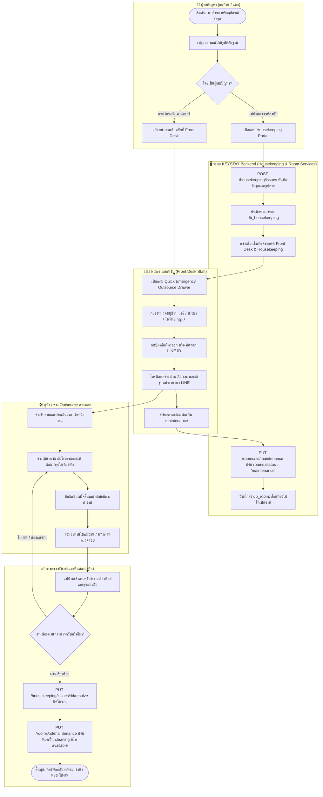

---

### 2. โฟลว์กระบวนการเช็คอินและการรับ Walk-in (Front Desk Check-in & Walk-in Integration Flow)
> **เป้าหมาย:** แสดงขั้นตอนการเช็คอินของแขกที่มีการจองล่วงหน้าเปรียบเทียบกับ Walk-in การตรวจเอกสาร การเก็บมัดจำ และการปรับสถานะห้องพักแบบเรียลไทม์

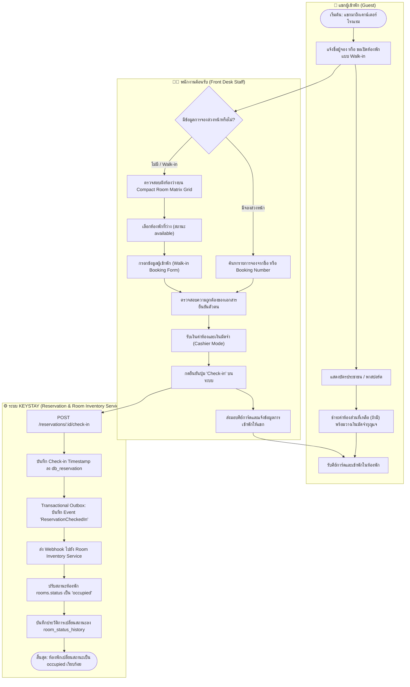

---

### 3. โฟลว์กระบวนการเช็คเอาท์ คิดเงิน และกระจายงานแม่บ้าน (Check-out, Cashier & 1:4 Fan-out Flow)
> **เป้าหมาย:** แสดงขั้นตอนการคืนห้องพัก การคิดเงินมินิบาร์ การหักลบเงินมัดจำ การปิดบิล และการกระจาย Event แบบ Fan-out 1:4 ไปยัง 4 เซอร์วิสอัตโนมัติ

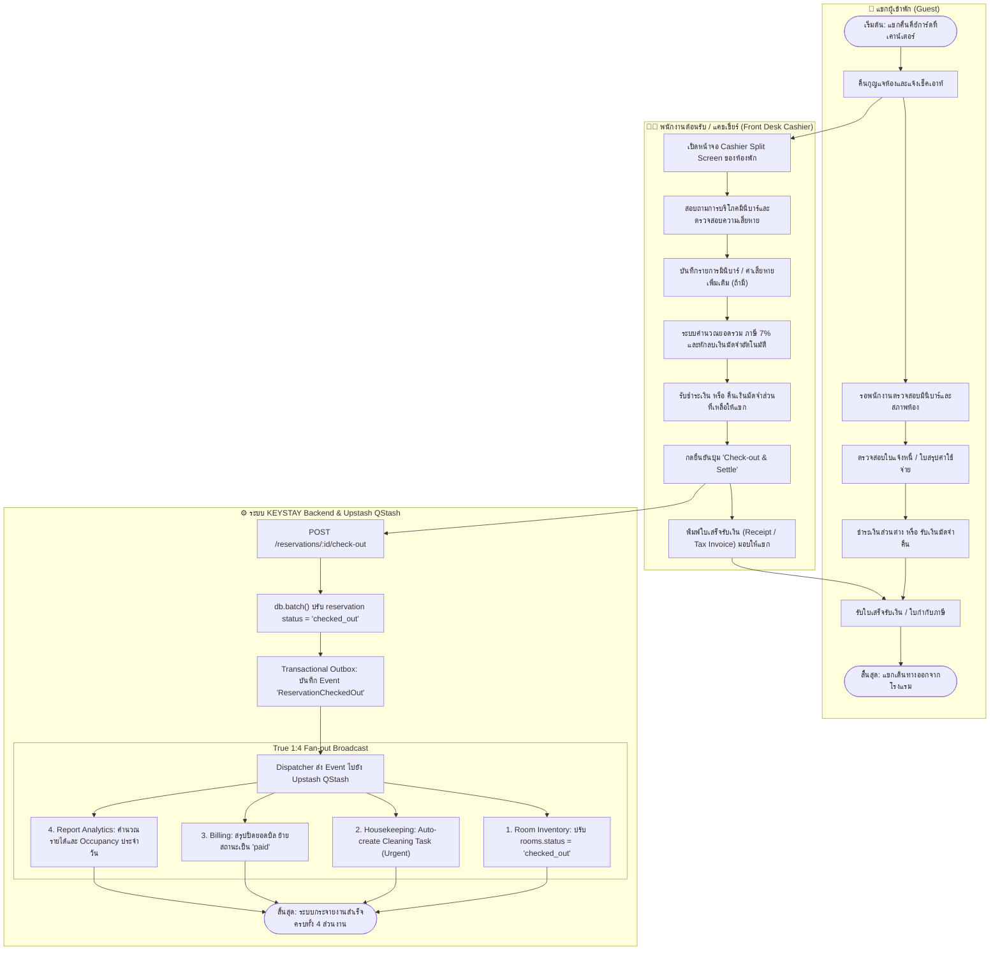

---

### 4. โฟลว์การบริหารจัดการข้อมูลคู่ค้า Outsource (Admin Outsource Vendor Management Flow)
> **เป้าหมาย:** แสดงกระบวนการที่ผู้ดูแลระบบ (Admin) บริหารจัดการ Master Data ช่าง/คู่ค้าภายนอก (CRUD) และผลกระทบทันทีต่อหน้าจอ Front Desk & Housekeeping

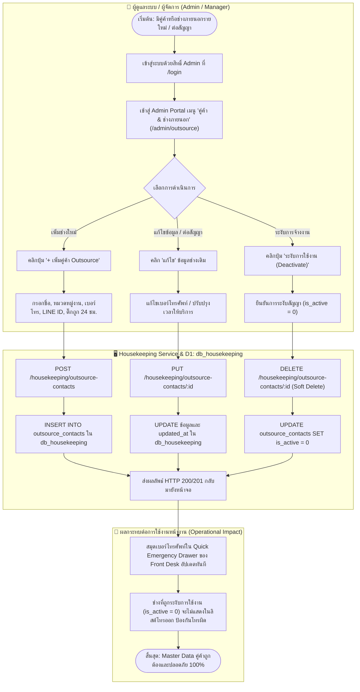

---

---

## 12. 🏗️ แผนภาพคลาส (Class Diagram)

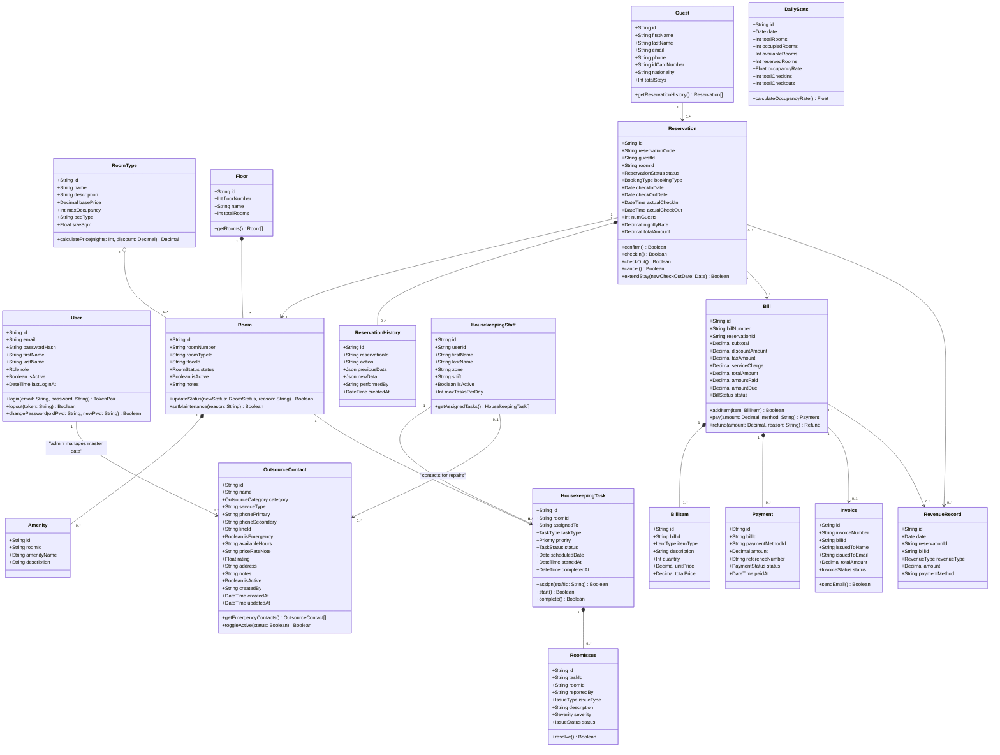

---

## 13. 🖥️ สถาปัตยกรรมระบบ (System Architecture & Event-Driven Patterns)

### 1. แผนผังสถาปัตยกรรมระดับระบบ (System Architecture Flowchart)

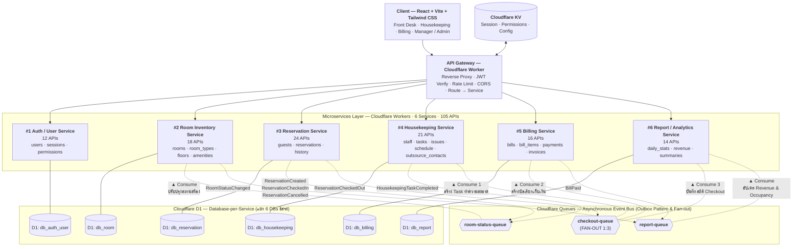

### 2. รูปแบบความสอดคล้องของข้อมูล (Outbox Pattern Implementation)
เพื่อรับประกันความถูกต้องของข้อมูลข้าม Service โดยไม่ต้องทำ Distributed Locking ระบบกำหนดให้ทุก Action สำคัญบันทึกข้อมูลหลักพร้อม Event ลงตาราง `outbox_events` ภายใต้ Transaction ก้อนเดียวกันเสมอ:

```sql
BEGIN TRANSACTION;
UPDATE main_table SET status = 'new_status' WHERE id = ?;
INSERT INTO outbox_events (id, event_type, aggregate_id, aggregate_type, payload, status, created_at)
VALUES (lower(hex(randomblob(16))), 'EventName', ?, 'Type', ?, 'pending', CURRENT_TIMESTAMP);
COMMIT;
```

### 3. ตารางความสัมพันธ์ Event Bus ข้ามเซอร์วิส (Cross-Service Event Mapping)

| # | Event Name | Producer Service | Trigger Endpoint | บันทึกใน Outbox DB | Cloudflare Queue | Consumer Service | การตอบสนองของ Consumer |
|:---:|---|---|---|---|---|---|---|
| 1 | `ReservationCreated` | Reservation | `POST /reservations`<br/>`POST /walk-in` | `db_reservation` | `room-status-queue` | Room Inventory | เปลี่ยนสถานะห้องเป็น `reserved` |
| 2 | `ReservationCheckedIn` | Reservation | `POST /reservations/:id/check-in` | `db_reservation` | `room-status-queue` | Room Inventory | เปลี่ยนสถานะห้องเป็น `occupied` |
| 3 | `ReservationCheckedOut` | Reservation | `POST /reservations/:id/check-out` | `db_reservation` | `checkout-queue`<br/>*(Fan-out)* | • Housekeeping<br/>• Billing<br/>• Report | **Housekeeping:** สร้าง Task ทำความสะอาด<br/>**Billing:** สร้างบิลเรียกเก็บเงิน<br/>**Report:** บันทึกสถิติการเช็คเอาท์ |
| 4 | `ReservationCancelled` | Reservation | `POST /reservations/:id/cancel` | `db_reservation` | `room-status-queue` | Room Inventory | คืนสถานะห้องเป็น `available` |
| 5 | `HousekeepingTaskCompleted` | Housekeeping | `PUT /housekeeping/tasks/:id/complete` | `db_housekeeping` | `room-status-queue` | Room Inventory | ปรับสถานะห้องเป็น `available` พร้อมใช้งาน |
| 6 | `BillPaid` | Billing | `POST /bills/:id/pay` | `db_billing` | `report-queue` | Report | รวมยอด Revenue เข้าสถิติประจำวัน |
| 7 | `RoomStatusChanged` | Room Inventory | `PUT /rooms/:id/status` | `db_room` | `report-queue` | Report | คำนวณและอัปเดต Occupancy Rate แบบ Real-time |

### 4. แผนภาพการติดตั้งระบบจริง (UML Deployment Diagram)

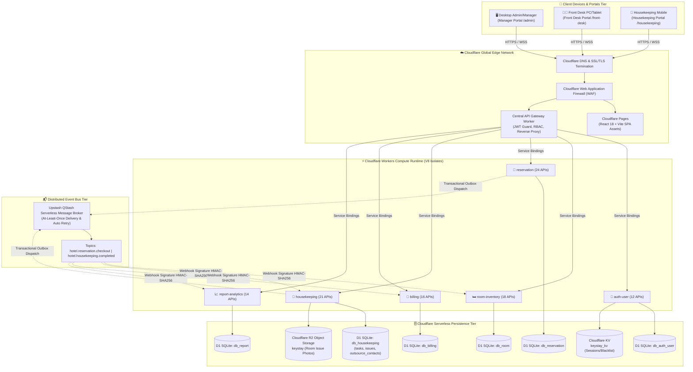

---

## 14. 🔄 วงจรชีวิตสถานะห้องพัก (Room Lifecycle State Machine)

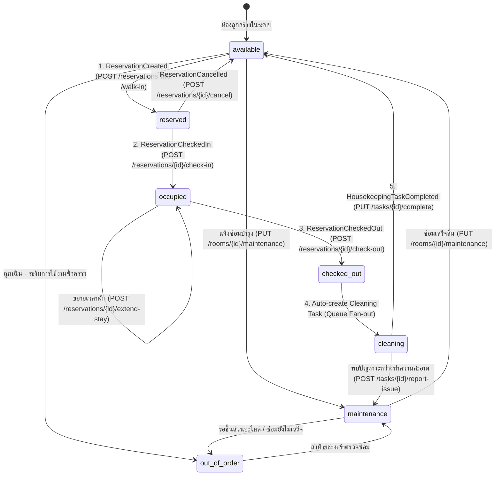

---

## 15. 🔁 แผนผังลำดับการทำงานหลัก (Sequence Diagrams)

### Flow #1: การจองห้องพักล่วงหน้า (Advance Booking Flow)
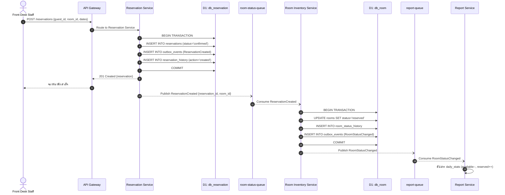

### Flow #2: การเช็คอินเข้าพัก (Check-in Flow)
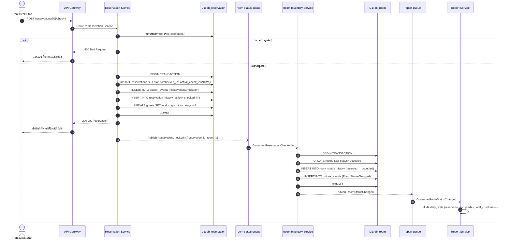

### Flow #3: การเช็คเอาท์และกระจายงานแบบ Fan-out (Check-out Fan-out Flow)
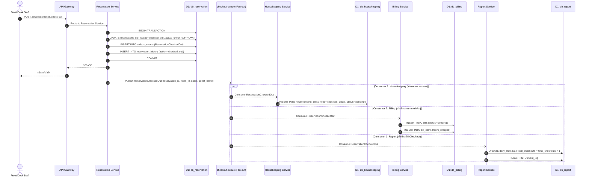

### Flow #4: แม่บ้านทำความสะอาดเสร็จสิ้น (Housekeeping Complete Flow)
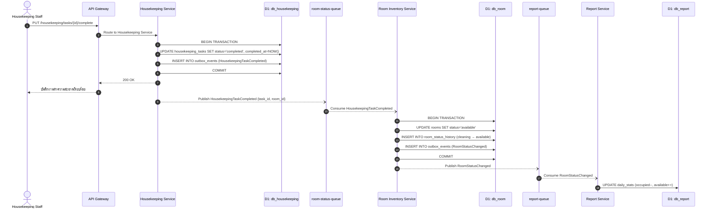

### Flow #5: ชำระเงินและสรุปรายงานรายได้ (Bill Payment Flow)
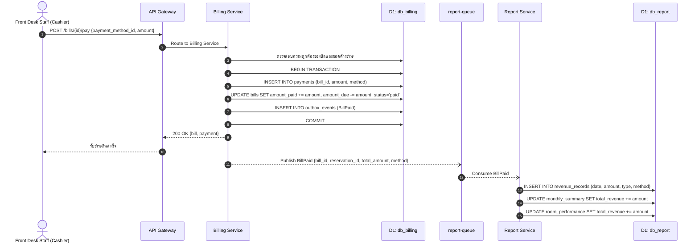

### Flow #6: การแจ้งซ่อมห้องพักและประสานงานช่าง Outsource ฉุกเฉิน (Room Issue & Emergency Outsource Maintenance Flow)
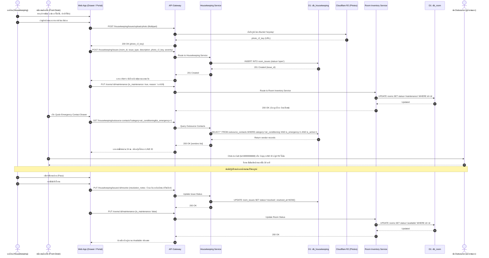

---

## 16. 📋 รายการ API ทั้งหมด (105 Microservice Endpoints)

### 🔐 Service #1: Auth/User Service (12 APIs)
1. `POST /register` — ลงทะเบียนผู้ใช้งานใหม่
2. `POST /login` — ล็อกอินเข้าสู่ระบบและรับ JWT
3. `POST /logout` — ออกจากระบบและยกเลิก Session
4. `POST /refresh-token` — ขอ Refresh Token ใหม่
5. `GET /users` — ดึงรายชื่อผู้ใช้งานทั้งหมด
6. `GET /users/:id` — ดึงข้อมูลผู้ใช้รายบุคคล
7. `PUT /users/:id` — แก้ไขข้อมูลผู้ใช้งาน
8. `DELETE /users/:id` — ปิดการใช้งานผู้ใช้ (Soft Delete)
9. `PUT /users/:id/role` — เปลี่ยนบทบาทและหน้าที่ผู้ใช้
10. `GET /users/:id/permissions` — ดูรายการสิทธิ์ของผู้ใช้
11. `POST /forgot-password` — ขอกู้คืนรหัสผ่าน
12. `POST /reset-password` — ตั้งรหัสผ่านใหม่

### 🛏️ Service #2: Room Inventory Service (18 APIs)
13. `GET /rooms` — รายการห้องพักทั้งหมด
14. `GET /rooms/:id` — ข้อมูลห้องพักรายห้อง
15. `POST /rooms` — เพิ่มห้องพักใหม่
16. `PUT /rooms/:id` — แก้ไขรายละเอียดห้องพัก
17. `DELETE /rooms/:id` — ลบหรือระงับการใช้ห้องพัก
18. `GET /rooms/:id/status` — ดึงสถานะปัจจุบันของห้อง
19. `PUT /rooms/:id/status` — ปรับปรุงสถานะห้องพัก
20. `GET /room-types` — รายการประเภทห้องพักทั้งหมด
21. `POST /room-types` — เพิ่มประเภทห้องพักใหม่
22. `PUT /room-types/:id` — แก้ไขประเภทห้องพักและราคา
23. `DELETE /room-types/:id` — ลบประเภทห้องพัก
24. `GET /rooms/available` — ค้นหาห้องว่างตามช่วงเวลา
25. `GET /floors` — รายชื่อชั้นทั้งหมดในโรงแรม
26. `GET /floors/:id/rooms` — รายการห้องพักประจำชั้น
27. `PUT /rooms/:id/maintenance` — ปรับห้องเข้าโหมดซ่อมบำรุง
28. `GET /rooms/:id/history` — ดูประวัติการเปลี่ยนสถานะห้อง
29. `POST /rooms/:id/amenities` — เพิ่มสิ่งอำนวยความสะดวกในห้อง
30. `DELETE /rooms/:id/amenities/:amenityId` — ลบสิ่งอำนวยความสะดวก

### 📋 Service #3: Reservation Service (24 APIs)
31. `GET /reservations` — รายการการจองทั้งหมด
32. `GET /reservations/:id` — รายละเอียดการจองรายรายการ
33. `POST /reservations` — สร้างการจองห้องพักล่วงหน้า
34. `PUT /reservations/:id` — แก้ไขข้อมูลการจอง
35. `DELETE /reservations/:id` — ลบข้อมูลการจอง
36. `POST /reservations/:id/check-in` — ดำเนินการเช็คอินเข้าพัก
37. `POST /reservations/:id/check-out` — ดำเนินการเช็คเอาท์คืนห้อง
38. `POST /reservations/:id/cancel` — ขอยกเลิกการจอง
39. `PUT /reservations/:id/modify-dates` — เปลี่ยนแปลงวันเข้าพัก/ออก
40. `GET /reservations/by-guest/:guestId` — ประวัติการจองตามรายชื่อแขก
41. `GET /reservations/by-room/:roomId` — ประวัติการจองตามห้องพัก
42. `GET /reservations/today-checkins` — รายการที่ต้องเช็คอินวันนี้
43. `GET /reservations/today-checkouts` — รายการที่ต้องเช็คเอาท์วันนี้
44. `POST /guests` — บันทึกประวัติแขกใหม่
45. `GET /guests` — รายชื่อแขกทั้งหมดในระบบ
46. `GET /guests/:id` — ข้อมูลแขกรายบุคคล
47. `PUT /guests/:id` — แก้ไขข้อมูลประวัติแขก
48. `DELETE /guests/:id` — ลบข้อมูลแขก
49. `POST /reservations/:id/extend-stay` — ขอขยายเวลาเข้าพัก
50. `POST /reservations/:id/upgrade-room` — ขออัปเกรดประเภทห้องพัก
51. `GET /reservations/calendar` — ข้อมูลตารางการจองแบบปฏิทิน
52. `POST /walk-in` — สร้างการจองและเช็คอินแบบ Walk-in
53. `GET /reservations/:id/invoice-preview` — ดูตัวอย่างบิลล่วงหน้า
54. `POST /reservations/:id/apply-discount` — ใช้โค้ดหรือบันทึกส่วนลด

### 🧼 Service #4: Housekeeping Service (21 APIs)
55. `GET /housekeeping/tasks` — รายการงานทำความสะอาดทั้งหมด
56. `GET /housekeeping/tasks/:id` — ข้อมูลงานทำความสะอาดรายรายการ
57. `POST /housekeeping/tasks` — สร้างงานทำความสะอาดด้วยมือ
58. `PUT /housekeeping/tasks/:id` — แก้ไขรายละเอียดงาน
59. `DELETE /housekeeping/tasks/:id` — ลบงานทำความสะอาด
60. `PUT /housekeeping/tasks/:id/assign` — มอบหมายงานให้พนักงานแม่บ้าน
61. `PUT /housekeeping/tasks/:id/complete` — บันทึกว่าทำความสะอาดเสร็จแล้ว
62. `GET /housekeeping/rooms-to-clean` — รายชื่อห้องที่ต้องทำความสะอาด
63. `GET /housekeeping/staff-assignments` — สรุปงานที่แม่บ้านแต่ละคนถืออยู่
64. `GET /housekeeping/staff` — รายชื่อพนักงานแม่บ้านทั้งหมด
65. `POST /housekeeping/staff` — เพิ่มพนักงานแม่บ้านเข้าระบบ
66. `PUT /housekeeping/staff/:id` — แก้ไขข้อมูลพนักงานแม่บ้าน
67. `GET /housekeeping/staff/:id/tasks` — รายการงานของแม่บ้านรายคน
68. `PUT /housekeeping/staff/:id/zone` — กำหนดโซนหรือชั้นที่รับผิดชอบ
69. `POST /housekeeping/tasks/:id/report-issue` — แจ้งปัญหา/สิ่งของชำรุด
70. `GET /housekeeping/schedule` — ตารางกะการทำงานของแม่บ้าน
71. `GET /housekeeping/outsource-contacts` — ดึงรายชื่อผู้ติดต่อคู่ค้า/ช่าง Outsource ทั้งหมด (รองรับฟิลเตอร์ category, is_emergency)
72. `GET /housekeeping/outsource-contacts/:id` — ดึงข้อมูลผู้ติดต่อ Outsource รายบุคคล/บริษัท
73. `POST /housekeeping/outsource-contacts` — เพิ่มข้อมูลคู่ค้า/ช่าง Outsource ใหม่ (เฉพาะ Admin)
74. `PUT /housekeeping/outsource-contacts/:id` — แก้ไขข้อมูลช่างและเงื่อนไขการติดต่อ (เฉพาะ Admin)
75. `DELETE /housekeeping/outsource-contacts/:id` — ระงับการใช้งานช่าง/คู่ค้า (Soft Delete: `is_active = 0`, เฉพาะ Admin)

### 🧾 Service #5: Billing Service (16 APIs)
76. `GET /bills` — รายการบิลทั้งหมด
77. `GET /bills/:id` — ข้อมูลบิลรายใบ
78. `POST /bills` — สร้างบิลใหม่
79. `PUT /bills/:id` — แก้ไขข้อมูลบิล
80. `POST /bills/:id/items` — เพิ่มรายการค่าใช้จ่ายเสริม (มินิบาร์/ซักรีด)
81. `DELETE /bills/:id/items/:itemId` — ลบรายการค่าใช้จ่าย
82. `POST /bills/:id/pay` — บันทึกการชำระเงิน
83. `GET /bills/:id/receipt` — พิมพ์/ดูใบเสร็จรับเงิน
84. `GET /bills/by-reservation/:reservationId` — ค้นหาบิลจากการจอง
85. `POST /bills/:id/refund` — ดำเนินการคืนเงิน
86. `POST /bills/:id/discount` — เพิ่มส่วนลดท้ายบิล
87. `GET /payment-methods` — ช่องทางการชำระเงินที่เปิดรับ
88. `POST /payment-methods` — เพิ่มช่องทางการชำระเงิน
89. `GET /invoices` — รายการใบแจ้งหนี้ทั้งหมด
90. `GET /invoices/:id` — ดูใบแจ้งหนี้รายใบ
91. `POST /invoices/:id/send-email` — ส่งใบแจ้งหนี้ให้แขกทางอีเมล

### 📊 Service #6: Report/Analytics Service (14 APIs)
92. `GET /reports/occupancy-rate` — สถิติอัตราการเข้าพัก (Occupancy Rate)
93. `GET /reports/revenue-daily` — รายงานสรุปรายได้รายวัน
94. `GET /reports/revenue-monthly` — รายงานสรุปรายได้รายเดือน
95. `GET /reports/revenue-by-room-type` — รายงานรายได้แยกตามประเภทห้อง
96. `GET /reports/top-rooms` — รายการห้องพักที่ทำรายได้สูงสุด
97. `GET /reports/avg-stay-duration` — จำนวนคืนที่เข้าพักเฉลี่ย
98. `GET /reports/cancellation-rate` — อัตราการยกเลิกการจอง
99. `GET /reports/housekeeping-performance` — รายงานประสิทธิภาพงานแม่บ้าน
100. `GET /reports/checkin-checkout-stats` — สถิติจำนวนเช็คอินและเช็คเอาท์
101. `GET /reports/guest-demographics` — สถิติสัญชาติและกลุ่มผู้เข้าพัก
102. `GET /dashboard/summary` — ข้อมูลสรุปภาพรวมสำหรับ Dashboard
103. `GET /reports/export/pdf` — ส่งออกรายงานเป็นไฟล์ PDF
104. `GET /reports/export/csv` — ส่งออกรายงานเป็นไฟล์ CSV
105. `GET /reports/custom` — ดึงข้อมูลรายงานแบบกำหนดช่วงเวลาเอง

---

## 17. 🗄️ โครงสร้างฐานข้อมูลและผังความสัมพันธ์ (Database Schema & ER Diagrams)

สถาปัตยกรรมใช้รูปแบบ **Database-per-Service** แยกฐานข้อมูล Cloudflare D1 อิสระ 6 ก้อน ไม่มีการสร้าง Foreign Key ข้ามก้อน แต่ใช้ Soft Reference ผ่าน UUID และมีตาราง `outbox_events` ในทุกก้อนที่ส่ง Event:

### 1. Auth/User Service (`db_auth_user`)
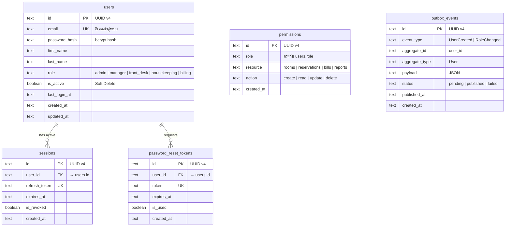

### 2. Room Inventory Service (`db_room`)
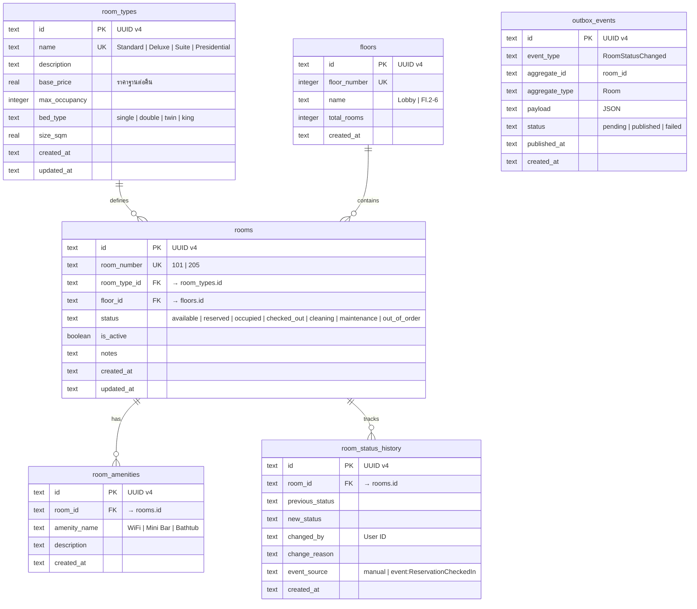

### 3. Reservation Service (`db_reservation`)
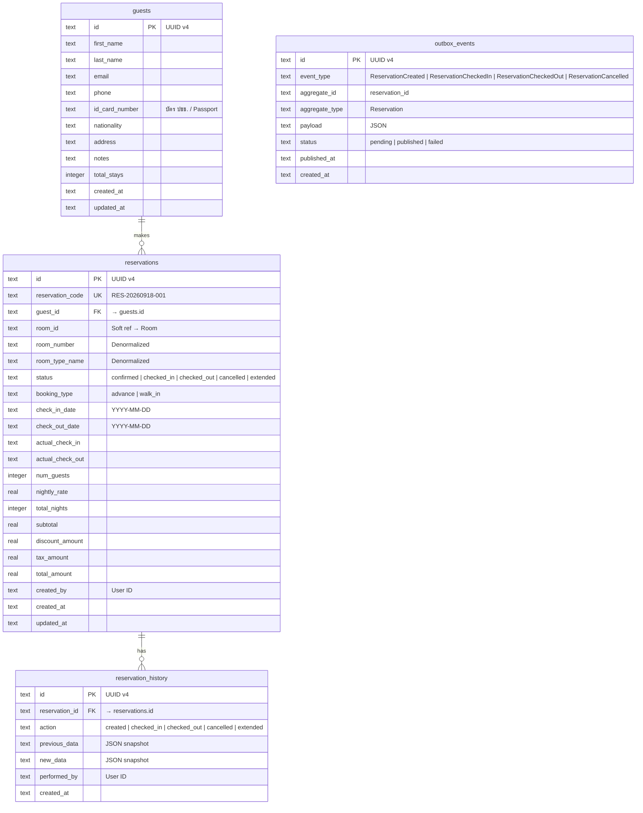

### 4. Housekeeping Service (`db_housekeeping`)
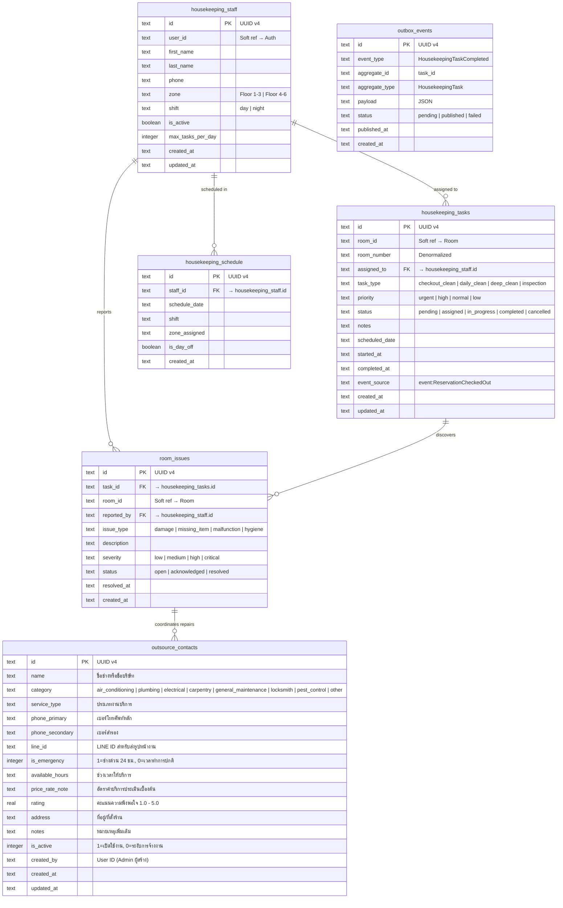

### 5. Billing Service (`db_billing`)
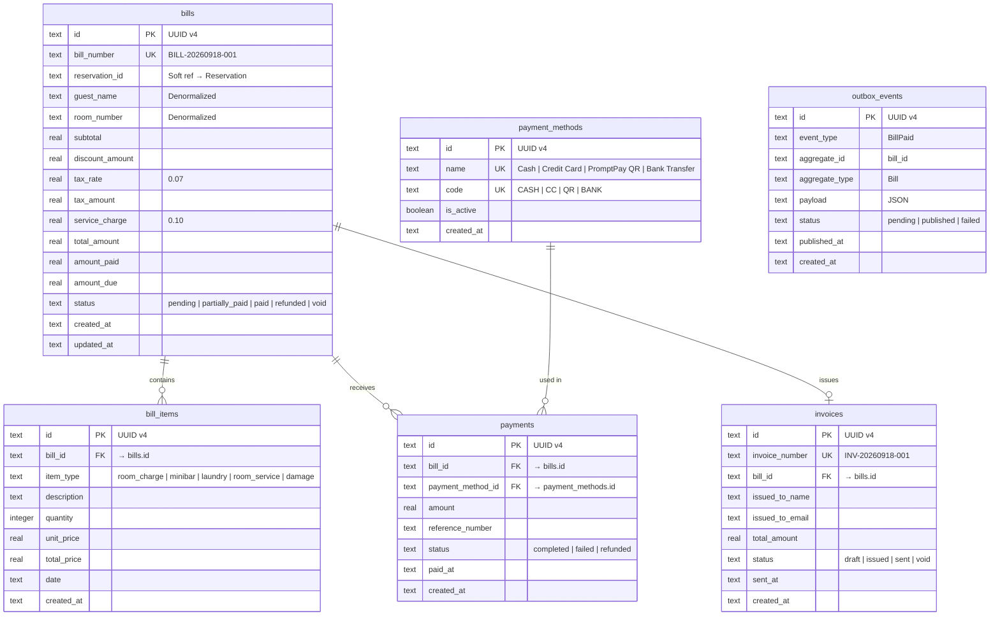

### 6. Report/Analytics Service (`db_report`)
```mermaid
erDiagram
    daily_stats {
        text id PK "UUID v4"
        text date UK "YYYY-MM-DD"
        integer total_rooms
        integer occupied_rooms
        integer available_rooms
        integer reserved_rooms
        integer maintenance_rooms
        real occupancy_rate "occupied / total * 100"
        integer total_checkins
        integer total_checkouts
        integer total_cancellations
        integer total_walk_ins
        text created_at
        text updated_at
    }
    revenue_records {
        text id PK "UUID v4"
        text date "YYYY-MM-DD"
        text reservation_id "Soft ref → Reservation"
        text bill_id "Soft ref → Billing"
        text room_type_name
        text revenue_type "room_charge | service | refund"
        real amount
        text payment_method
        text created_at
    }
    monthly_summary {
        text id PK "UUID v4"
        text year_month UK "YYYY-MM"
        real total_revenue
        real net_revenue
        real avg_occupancy_rate
        integer total_reservations
        real cancellation_rate
        real avg_stay_duration
        integer total_guests
        text created_at
        text updated_at
    }
    room_performance {
        text id PK "UUID v4"
        text room_id "Soft ref → Room"
        text room_number
        text room_type_name
        text year_month "YYYY-MM"
        integer total_bookings
        integer total_nights_sold
        real total_revenue
        text created_at
        text updated_at
    }
    housekeeping_performance {
        text id PK "UUID v4"
        text staff_id "Soft ref → Housekeeping"
        text staff_name
        text year_month
        integer tasks_completed
        real avg_completion_minutes
        integer issues_reported
        text created_at
        text updated_at
    }
    event_log {
        text id PK "UUID v4"
        text event_type
        text source_service
        text payload "JSON"
        boolean processed
        text processed_at
        text created_at
    }
```

### 7. ผังความสัมพันธ์ฐานข้อมูลภาพรวมทั้งระบบ (Global Conceptual ERD - Unified Architecture)
> **วัตถุประสงค์:** แสดงภาพรวมของ Entity ทั้ง 6 Microservices ในผังเดียว พร้อมเส้นโยงความสัมพันธ์ทางตรรกะ (Logical Soft Reference) ระหว่างโดเมน เพื่อให้อาจารย์และผู้ประเมินเห็นภาพความเชื่อมโยงของข้อมูลทั้งระบบอย่างชัดเจน

```mermaid
erDiagram
    %% Service 1: Auth
    users {
        text id PK "UUID"
        text email UK
        text role "admin | manager | front_desk | housekeeping"
    }

    %% Service 2: Room
    rooms {
        text id PK "UUID"
        text room_number UK
        text room_type_id FK
        text status "available | reserved | occupied | checked_out | cleaning | maintenance | out_of_order"
    }
    room_types {
        text id PK "UUID"
        text name "Standard | Deluxe | Suite | Presidential"
        real base_price
    }

    %% Service 3: Reservation
    guests {
        text id PK "UUID"
        text first_name
        text last_name
        text phone
    }
    reservations {
        text id PK "UUID"
        text booking_number UK
        text guest_id FK "→ guests.id"
        text room_id "Soft ref → rooms.id"
        text check_in_date
        text check_out_date
        text status "confirmed | checked_in | checked_out | cancelled"
    }

    %% Service 4: Housekeeping & Facility Maintenance
    housekeeping_tasks {
        text id PK "UUID"
        text room_id "Soft ref → rooms.id"
        text task_type "checkout_clean | daily_clean | deep_clean"
        text status "pending | assigned | in_progress | completed"
    }
    room_issues {
        text id PK "UUID"
        text room_id "Soft ref → rooms.id"
        text issue_type "damage | malfunction | plumbing | electrical"
        text severity "low | medium | high | critical"
        text status "open | acknowledged | resolved"
    }
    outsource_contacts {
        text id PK "UUID"
        text name "ชื่อช่างหรือชื่อบริษัท"
        text category "air_conditioning | plumbing | electrical | carpentry | locksmith | other"
        text phone_primary
        integer is_emergency "1=ช่างด่วน 24 ชม., 0=ปกติ"
        integer is_active "1=ใช้งาน, 0=ระงับ"
        text created_by "Soft ref → users.id (Admin)"
    }

    %% Service 5: Billing
    bills {
        text id PK "UUID"
        text bill_number UK
        text reservation_id "Soft ref → reservations.id"
        real total_amount
        real deposit_deducted
        real amount_due
        text status "pending | paid | void"
    }
    bill_items {
        text id PK "UUID"
        text bill_id FK "→ bills.id"
        text item_type "room_charge | minibar | damage"
        real total_price
    }
    payments {
        text id PK "UUID"
        text bill_id FK "→ bills.id"
        real amount
        text payment_method "cash | promptpay | credit_card"
    }

    %% Service 6: Report
    daily_stats {
        text id PK "UUID"
        text date UK "YYYY-MM-DD"
        real occupancy_rate
        integer total_checkins
        integer total_checkouts
    }

    %% Cross-Service Logical & Physical Relationships
    room_types ||--o{ rooms : "defines"
    guests ||--o{ reservations : "books"
    rooms ||--o{ reservations : "allocated in"
    reservations ||--o{ bills : "generates financial bill"
    bills ||--o{ bill_items : "contains"
    bills ||--o{ payments : "settled by"
    rooms ||--o{ housekeeping_tasks : "cleaned by"
    rooms ||--o{ room_issues : "reported on"
    room_issues ||--o{ outsource_contacts : "repairs coordinated with"
    users ||--o{ outsource_contacts : "admin manages master data"
    reservations ||--o{ daily_stats : "aggregates into"
```

---

## 18. 🎯 การออกแบบหน้าจอ (UI Prototype & Wireframe)

หน้าจอระบบแบ่งออกเป็น 3 ส่วนการทำงานหลักตามบทบาทของผู้ใช้งาน โดยทำงานบน Layout กลางร่วมกัน:

1.  **Front Desk Operations Portal:**
    *   **Room Status Grid & List:** แสดงสถานะห้องพักทั้ง 7 สถานะด้วยสีเฉพาะตัวแบบ Real-time พร้อมฟังก์ชันกรองตามชั้นและประเภทห้อง
    *   **Quick Booking / Walk-in Modal:** ฟอร์มสร้างการจองและเช็คอินแบบด่วนในหน้าเดียว พร้อมตรวจสอบห้องว่างทันที
    *   **Check-in & Check-out Action Drawer:** แผงควบคุมด้านข้างสำหรับตรวจบัตรประชาชน มอบหมายคีย์การ์ด และดูตัวอย่างใบแจ้งหนี้ (Invoice Preview)
    *   **Quick Emergency Outsource Drawer:** แผงลิ้นชักด้านข้างสำหรับค้นหาและโทรติดต่อช่าง Outsource ฉุกเฉิน 24 ชม. (แอร์เสีย, ประปาแตก, ไฟฟ้าลัดวงจร) พร้อมปุ่มคลิกโทรออกและคัดลอกเบอร์/LINE ID เพื่อแก้ปัญหาเฉพาะหน้าให้แขกได้ทันท่วงที
2.  **Housekeeping Management Portal:**
    *   **Task Kanban Board:** บอร์ดแบ่งสถานะงานทำความสะอาด (รอมอบหมาย → กำลังทำ → เสร็จสิ้น)
    *   **Staff Assignment Modal:** มอบหมายงานตามชั้นและโซนความรับผิดชอบ
    *   **Report Issue Form:** แบบฟอร์มแจ้งห้องชำรุดพร้อมระบุระดับความรุนแรง (Low, Medium, High, Critical)
    *   **Quick Technician Contact Modal:** ป็อปอัปค้นหาเบอร์ช่างเฉพาะทางเพื่อประสานงานซ่อมหน้างานควบคู่กับการเปิดใบงานแจ้งชำรุด (Report Issue)
3.  **Manager / Executive Dashboard:**
    *   **KPI Cards:** การ์ดตัวเลขสรุป Occupancy Rate วันนี้, รายได้รวมประจำวัน, ห้องพร้อมขาย และจำนวนเช็คอิน/เช็คเอาท์
    *   **Revenue & Occupancy Trend Charts:** กราฟเส้นและกราฟแท่งแสดงแนวโน้มอัตราการเข้าพักและรายได้ย้อนหลัง 30 วัน
    *   **Outsource Master Data Management Table:** ตารางบริหารจัดการคู่ค้าและช่าง Outsource (Full CRUD: เพิ่ม/แก้ไข/ระงับการจ้าง `is_active = 0`) และกำหนดหมวดหมู่/แท็กช่างด่วน
    *   **Export Center:** ปุ่มคลิกเดียวสำหรับดาวน์โหลดรายงานภาพรวมในรูปแบบ PDF และ CSV

---

## 19. ⚙️ การทดสอบการยอมรับของผู้ใช้ (User Acceptance Testing: UAT)

**โครงงาน:** Hotel Management System (Microservice Architecture สำหรับโรงแรมขนาดเล็ก 5–10 ห้อง)  
**รูปแบบการทดสอบ:** Manual UAT & Functional Integration Testing ผ่าน Postman และ UI Prototype  
**กลุ่มผู้ทดสอบ:** Front Desk Staff & Cashier, Housekeeping Staff, Hotel Manager / Admin

### ตารางกรณีทดสอบ (UAT Test Cases)

#### 🧑‍💼 1. Front Desk Staff (UAT-FD)
| รหัสทดสอบ | ฟีเจอร์ที่ทดสอบ | ขั้นตอนการทดสอบ | ผลลัพธ์ที่คาดหวัง | ผลลัพธ์จริง | สถานะ |
|---|---|---|---|---|:---:|
| **UAT-FD01** | Check Room Status | เปิดหน้า Room Grid เลือกฟิลเตอร์ชั้น 2 | แสดงห้องพักชั้น 2 พร้อมสีสถานะถูกต้องตาม State Machine | แสดงห้องชั้น 2 ถูกต้อง พร้อมสีสถานะชัดเจน | **Pass** |
| **UAT-FD02** | Create Advance Booking | จองห้อง Deluxe ล่วงหน้า 3 วัน ระบุชื่อแขก | ระบบสร้างการจอง บันทึกลง DB และส่ง Event ปรับสถานะห้องเป็น `reserved` | การจองสร้างสำเร็จ สถานะห้องเปลี่ยนเป็น reserved | **Pass** |
| **UAT-FD03** | Check-in Success | เลือกรายการจองที่ confirmed แล้วกด "Check-in" | สถานะการจองเปลี่ยนเป็น `checked_in` ห้องเปลี่ยนเป็น `occupied` | เช็คอินสำเร็จ ข้อมูลอัปเดตทั้งสองเซอร์วิส | **Pass** |
| **UAT-FD04** | Check-in Invalid | พยายามเช็คอินรายการจองที่ถูกยกเลิกไปแล้ว | ระบบปฏิเสธพร้อมแสดงข้อความ "ไม่สามารถเช็คอินได้" | ระบบแจ้งเตือนปฏิเสธตามที่คาดหวัง | **Pass** |
| **UAT-FD05** | Check-out Fan-out | กด "Check-out" ห้องที่เข้าพักอยู่ | ระบบเปลี่ยนสถานะห้อง ส่ง Event Fan-out ให้แม่บ้านสร้าง Task และการเงินสร้างบิล | งานแม่บ้านและบิลถูกสร้างขึ้นโดยอัตโนมัติ | **Pass** |
| **UAT-FD06** | Walk-in Booking | ทำรายการ Walk-in แขกที่หน้าเคาน์เตอร์ | สร้างการจองและเช็คอินสำเร็จในขั้นตอนเดียว ห้องเปลี่ยนเป็น `occupied` | ทำรายการสำเร็จในขั้นตอนเดียว | **Pass** |
| **UAT-FD07** | Quick Emergency Outsource Contact | เปิด Quick Emergency Contact Drawer กรองหมวด 'แอร์' และ 'ประปา' | แสดงรายชื่อช่างด่วน 24 ชม. พร้อมปุ่มโทรออกและ LINE ID ทันที | ค้นหาและคัดลอกข้อมูลช่างฉุกเฉินได้ในคลิกเดียว | **Pass** |

#### 🧹 2. Housekeeping Staff (UAT-HK)
| รหัสทดสอบ | ฟีเจอร์ที่ทดสอบ | ขั้นตอนการทดสอบ | ผลลัพธ์ที่คาดหวัง | ผลลัพธ์จริง | สถานะ |
|---|---|---|---|---|:---:|
| **UAT-HK01** | Auto Task Creation | ตรวจสอบหน้ารายการงานหลังมีห้องเช็คเอาท์ | ปรากฏ Task ทำความสะอาดประเภท `checkout_clean` สถานะ `pending` | Task ใหม่ปรากฏขึ้นทันทีหลังเช็คเอาท์ | **Pass** |
| **UAT-HK02** | Assign Task | หัวหน้าแม่บ้านเลือกงานและมอบหมายให้แม่บ้านรายคน | Task อัปเดตสถานะเป็น `assigned` พร้อมระบุชื่อผู้รับผิดชอบ | มอบหมายงานสำเร็จและแสดงในบอร์ด | **Pass** |
| **UAT-HK03** | Complete Cleaning | แม่บ้านกด "Complete" หลังทำความสะอาดเสร็จ | Task อัปเดตเป็น `completed` และห้องพักในระบบคืนสถานะเป็น `available` | ห้องพักกลับมาเป็น available พร้อมขายทันที | **Pass** |
| **UAT-HK04** | Report Issue | แจ้งสิ่งของชำรุด (ก๊อกน้ำรั่ว) ระดับ High | ระบบบันทึก Issue และปรับสถานะห้องเป็น `maintenance` | ห้องถูกปรับเป็น maintenance และปิดรับการจอง | **Pass** |
| **UAT-HK05** | Quick Outsource Contact for Repairs | เปิดสมุดเบอร์ช่างจากหน้างานห้องชำรุด ค้นหาช่างประปา/ไฟ | แสดงเบอร์ติดต่อและเวลาให้บริการ เพื่อโทรนัดช่างเข้าหน้างานควบคู่กับ Report Issue | แสดงข้อมูลช่างเฉพาะทางถูกต้องและโทรออกได้ | **Pass** |
| **UAT-HK06** | View Shift Schedule | เปิดหน้าตารางกะการทำงานของพนักงานแม่บ้าน | แสดงตารางการเข้าเวร โซน และชั้นที่รับผิดชอบอย่างชัดเจน | ตารางงานแสดงผลครบถ้วนตามกะ | **Pass** |

#### 🧾 3. Front Desk Cashiering & Billing (UAT-BL — ดำเนินการโดย Front Desk Staff)
| รหัสทดสอบ | ฟีเจอร์ที่ทดสอบ | ขั้นตอนการทดสอบ | ผลลัพธ์ที่คาดหวัง | ผลลัพธ์จริง | สถานะ |
|---|---|---|---|---|:---:|
| **UAT-BL01** | Auto Bill Creation | ตรวจสอบรายการบิลหลังมีห้องเช็คเอาท์ | พบใบแจ้งหนี้ใหม่ที่รวมค่าห้องตามจำนวนคืน พร้อมภาษี 7% ถูกต้อง | บิลถูกสร้างอัตโนมัติพร้อมคำนวณภาษีถูกต้อง | **Pass** |
| **UAT-BL02** | Add Extra Item | เพิ่มรายการค่ามินิบาร์ 250 บาทลงในบิล | ยอดรวมของบิลอัปเดตเพิ่มขึ้น 250 บาท พร้อมบันทึกประวัติ | ยอดรวมอัปเดตถูกต้องตามรายการที่เพิ่ม | **Pass** |
| **UAT-BL03** | Payment Processing | รับชำระเงินเต็มจำนวนด้วยบัตรเครดิต | สถานะบิลเปลี่ยนเป็น `paid` ยอดคงค้างเป็น 0 และส่ง Event ไปยัง Report | ชำระเงินสำเร็จ บันทึกลงประวัติเรียบร้อย | **Pass** |
| **UAT-BL04** | Issue Receipt | กดปุ่มออกใบเสร็จรับเงินสำหรับบิลที่จ่ายแล้ว | แสดงหน้าใบเสร็จรับเงินพร้อมเลขอ้างอิงและรายละเอียดครบถ้วน | ใบเสร็จแสดงผลถูกต้องสมบูรณ์ | **Pass** |
| **UAT-BL05** | Process Deposit Refund | คืนเงินมัดจำค่ากุญแจ/ห้องพักให้แขกเมื่อตรวจห้องผ่าน | ยอดมัดจำถูกหักลบและบันทึกสถานะการคืนเงินถูกต้อง | การคืนเงินบันทึกสำเร็จและยอดบัญชีตรง | **Pass** |

#### 📊 4. Manager / Admin (UAT-MGR)
| รหัสทดสอบ | ฟีเจอร์ที่ทดสอบ | ขั้นตอนการทดสอบ | ผลลัพธ์ที่คาดหวัง | ผลลัพธ์จริง | สถานะ |
|---|---|---|---|---|:---:|
| **UAT-MGR01**| View KPI Dashboard | เข้าหน้า Dashboard ผู้บริหาร | แสดง Occupancy Rate, รายได้รวม และยอดเช็คอิน/เอาท์ตรงตามข้อมูลจริง | Dashboard แสดงผลข้อมูล Real-time ถูกต้อง | **Pass** |
| **UAT-MGR02**| Access Control Guard | ใช้บัญชีพนักงานแม่บ้านพยายามเข้า URL หน้า Admin | ระบบปฏิเสธการเข้าถึงและ Redirect กลับหน้าของตนเอง | ติดสิทธิ์ RBAC ไม่สามารถเข้าหน้า Admin ได้ | **Pass** |
| **UAT-MGR03**| Export Report CSV | กดปุ่ม Export รายงานรายได้รายเดือนเป็น CSV | ดาวน์โหลดไฟล์ CSV ที่มีข้อมูลครบทุกคอลัมน์และเปิดอ่านได้ | ไฟล์ CSV ถูกดาวน์โหลดและข้อมูลถูกต้อง | **Pass** |
| **UAT-MGR04**| Export Report PDF | กดปุ่ม Export รายงานอัตราการเข้าพักเป็น PDF | ได้เอกสาร PDF รูปแบบมาตรฐานสำหรับใช้รายงานที่ประชุม | เอกสาร PDF ถูกสร้างขึ้นพร้อมฟอร์แมตที่อ่านง่าย | **Pass** |
| **UAT-MGR05**| Manage Outsource Master Data | Admin เพิ่มช่างแอร์ใหม่ แก้ไขเบอร์ และทดสอบระงับการใช้งาน (`is_active = 0`) | ช่างใหม่ถูกบันทึกลง D1 และเมื่อปิดใช้งานจะไม่แสดงในสมุดเบอร์ของ Front Desk | จัดการ Master Data ได้ถูกต้องและปลอดภัย | **Pass** |
| **UAT-MGR06**| Room Type & Rate Configuration | ปรับเปลี่ยนราคาฐานของห้องประเภท Deluxe | อัตราค่าห้องใหม่มีผลกับการคำนวณการจองรอบถัดไปทันที | อัตราค่าบริการอัปเดตเรียบร้อย | **Pass** |

### ตารางสรุปผลการทดสอบ UAT (UAT Summary)

| กลุ่มผู้ใช้งาน (Role) | จำนวน Test Cases | ผ่าน (Pass) | ไม่ผ่าน (Fail) | คิดเป็นร้อยละ |
|---|:---:|:---:|:---:|:---:|
| **Front Desk Staff & Cashier (จอง/เช็คอิน/เช็คเอาท์/ช่างฉุกเฉิน)** | 7 | 7 | 0 | 100% |
| **Front Desk Staff & Cashier (การเงิน/บิล/มินิบาร์/มัดจำ)** | 5 | 5 | 0 | 100% |
| **Housekeeping Staff (ทำความสะอาด/แจ้งชำรุด/เบอร์ช่าง)** | 6 | 6 | 0 | 100% |
| **Manager / Admin (แดชบอร์ด/RBAC/Outsource Master Data/ส่งออก)** | 6 | 6 | 0 | 100% |
| **รวมทั้งหมด** | **24** | **24** | **0** | **100%** |

---

## 20. 🖼️ ผลลัพธ์ที่คาดว่าจะได้รับ (Expected Outcomes)

1.  **ได้ระบบบริหารจัดการโรงแรมหลังบ้านที่ทำงานได้จริง (Functional 100%):** ครอบคลุมวงจรชีวิตห้องพักตั้งแต่วางแผนจอง เช็คอิน แม่บ้านทำความสะอาด คิดเงิน ออกบิล จัดการคู่ค้า Outsource ซ่อมบำรุง และวิเคราะห์ข้อมูล โดยเชื่อมต่อกันครบถ้วนทั้ง 105 Microservice APIs
2.  **สถาปัตยกรรม Serverless Microservices ที่มีความทนทานสูง (High Resilience):** การประยุกต์ใช้ Cloudflare Workers, D1 และ Queues ร่วมกับ Outbox Pattern ช่วยให้ระบบรองรับการทำงานแบบ Decoupled เมื่อเซอร์วิสใดเซอร์วิสหนึ่งขัดข้อง ข้อความในคิวจะไม่สูญหายและรอการประมวลผลซ้ำอัตโนมัติ
3.  **แก้ปัญหาคอขวดของโรงแรมขนาดเล็กด้วย Outsource Directory:** โรงแรมขนาดเล็ก 5–10 ห้องสามารถดำเนินงานได้อย่างราบรื่นโดยไม่ต้องแบกรับต้นทุนจ้างช่างประจำตลอดเวลา ด้วยระบบ Quick Emergency Contact สำหรับ Front Desk และ Housekeeping ที่เข้าถึงช่างซ่อมบำรุงภายนอกได้ทันใจเมื่อเกิดเหตุฉุกเฉิน
4.  **ลดความผิดพลาดและเพิ่มความเร็วในการปฏิบัติงานของโรงแรม:** พนักงานต้อนรับรับทราบสถานะความพร้อมของห้องพักได้ทันที แม่บ้านได้รับงานทำความสะอาดอัตโนมัติหลังเช็คเอาท์ และแผนกการเงินลดความผิดพลาดในการคำนวณบิลด้วยระบบอัตโนมัติ
5.  **ได้ฐานโค้ดและชุดเอกสารทางวิศวกรรมซอฟต์แวร์ที่สมบูรณ์:** โครงสร้างโค้ดเป็นระเบียบตามหลัก Clean Architecture พร้อมเอกสาร System Specification, Sequence Diagrams, ERDs และ OpenAPI ครบถ้วนตามมาตรฐานวิชาชีพ
