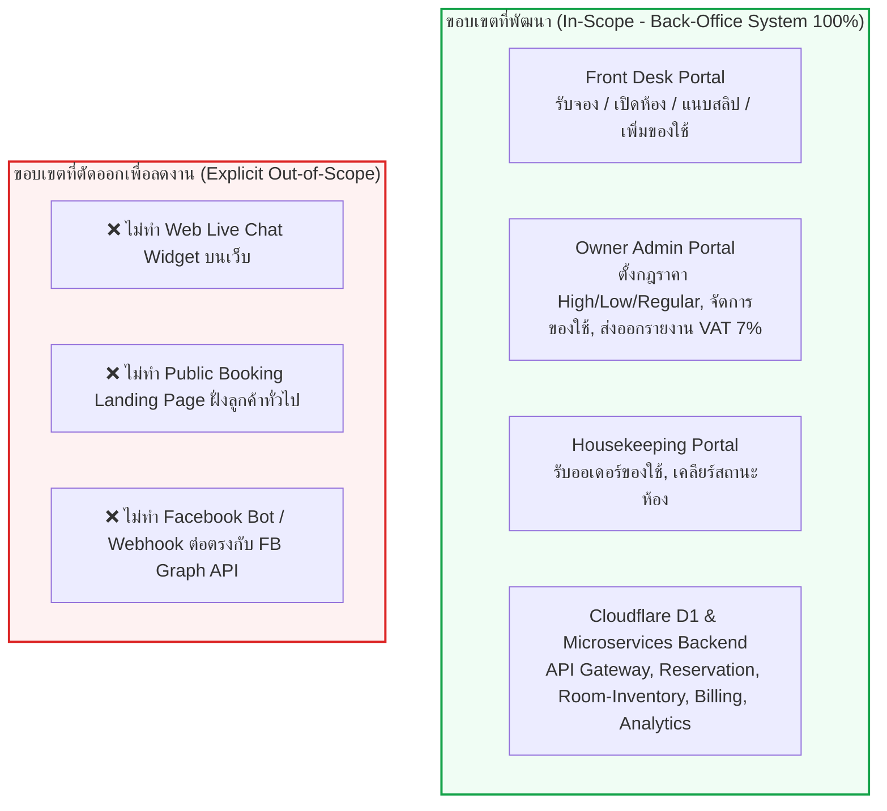
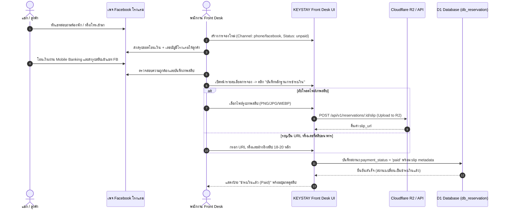
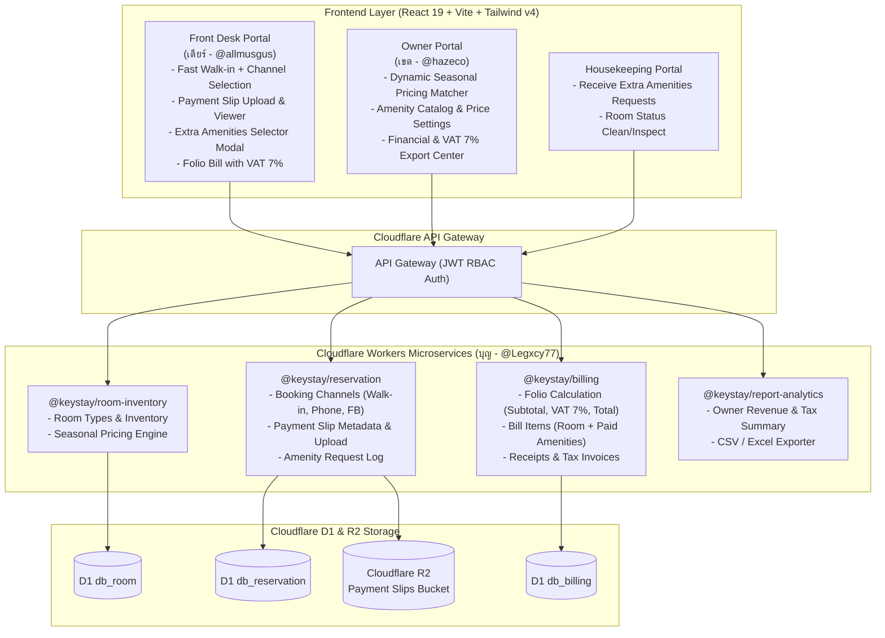

# เอกสารข้อกำหนดระบบและการออกแบบสถาปัตยกรรม (System Specification & Feature Architecture)
## โครงการ: KEYSTAY — Hotel Management System
### รหัสเอกสาร: `SPEC-2026-004` | หมวดหมู่: Core Business Enhancements
**สถานะ:** `Approved for Implementation` (อนุมัติพร้อมเริ่มพัฒนา)  
**วันที่จัดทำ:** 11 พฤศจิกายน 2569  
**เวอร์ชัน:** 1.0.0  

---

### รายชื่อผู้มีส่วนได้ส่วนเสียและการอนุมัติ (Stakeholders & Ownership)

| บทบาท | ชื่อ-นามสกุล | บัญชี / สัญลักษณ์ | หน้าที่รับผิดชอบหลักในรอบนี้ |
| :--- | :--- | :--- | :--- |
| **อาจารย์ที่ปรึกษาโครงงาน** | อาจารย์ท็อป | *Project Advisor* | ให้แนวทางและประเมินผลการปรับปรุงระบบตามมาตรฐานโรงแรม |
| **System Analyst (SA Lead)** | นายธีรภัทร เหนียมสุวรรณ (เดียร์) | `@allmusgus` | ผู้ออกแบบสถาปัตยกรรม, วาง Data Model/API Spec, พัฒนา Front Desk UI & Folio |
| **Project Manager (PM Lead)** | นายเขตโสภณ ไอนาทูน (เขต) | `@hazeco` | บริหารแผนงาน, พัฒนา Owner Pricing UI & Amenity Catalog Management |
| **QA Lead / Backend Dev** | นายบุญฤทธิ์ (บุญ) | `@Legxcy77` | พัฒนา Backend API Services (D1), สร้าง Test Cases & ตรวจสอบคุณภาพระบบ |

---

## 1. บทสรุปผู้บริหารและขอบเขตของระบบ (Executive Summary & Scope Boundary)

### 1.1 ที่มาและวัตถุประสงค์ (Background & Context)
จากการนำเสนอรายงานความคืบหน้ารอบล่าสุด (Quiz 2) ต่ออาจารย์ท็อป ได้รับข้อเสนอแนะเชิงธุรกิจเพื่อยกระดับระบบ KEYSTAY จากระบบจัดการห้องพักพื้นฐาน ให้รองรับ **กลไกการตลาดและการคิดเงินของธุรกิจโรงแรมจริง (Real-world Hotel Operations)** โดยมีข้อกำหนดเพิ่มเติม 4 ฟีเจอร์หลัก:
1. **Dynamic Seasonal & Festival Pricing:** ระบบปรับราคาห้องพักตามฤดูกาลและช่วงเทศกาล โดยคงฐานราคาเดิม (Base Price) ไว้
2. **Booking Channels & Payment Slip Verification:** การบันทึกช่องทางการจอง (Walk-in, Phone, Facebook) และระบบแนบหลักฐานสลิปการโอนเงิน (รองรับทั้งไฟล์รูปภาพและ URL/เลขอ้างอิง)
3. **Extra Amenities (Free & Paid Catalog):** ระบบจัดการขอของใช้และบริการเสริม รองรับทั้งของฟรี (หมอน, ผ้าเช็ดตัว) และของเสียเงิน (เตียงเสริม, ชุดพรีเมียม) วิ่งเข้าบิล Folio ของห้องพักโดยอัตโนมัติ
4. **VAT 7% Accounting & Owner Export:** ระบบคำนวณภาษีมูลค่าเพิ่ม 7% ณ จุดชำระเงิน และการส่งออกรายงานภาษีสำหรับผู้บริหาร (Owner)

### 1.2 ขอบเขตระบบที่ชัดเจน (Clear Scope Boundaries & De-scoping)
เพื่อบริหารทรัพยากรและเวลาในการพัฒนาให้เสร็จทันกำหนดปิดโครงงาน ที่ประชุมทีม (Ngro Team Sync คืนวันที่ 10-11 พ.ย. 2569) ได้กำหนดข้อตกลงร่วมกันดังนี้:



> **มติที่ประชุมเรื่องช่องทางติดต่อลูกค้า:**  
> ระบบ KEYSTAY วางตำแหน่งเป็น **ซอฟต์แวร์บริหารจัดการหลังบ้าน (Internal Back-Office Hotel PMS)** สำหรับพนักงานและเจ้าของโรงแรม ลูกค้าภายนอกจะดูวิวห้องและโปรโมชั่นผ่าน **Facebook Page ของโรงแรม** และโทรศัพท์/ทักแชทเข้ามา จากนั้นพนักงาน Front Desk จะเป็นผู้คีย์ข้อมูลและแนบสลิปเข้าระบบ KEYSTAY

---

## 2. โมดูลที่ 1: ระบบคำนวณราคาตามฤดูกาลและเทศกาล (Dynamic Seasonal Pricing Engine)

### 2.1 สถาปัตยกรรมและหลักการทางธุรกิจ (Business Rules)
1. **Base Price ไม่ถูกแตะต้อง (Immutable Baseline):** ตารางประเภทห้อง `room_types.base_price` ยังคงเก็บราคาฐานเดิมไว้เสมอ ไม่มีการบันทึกทับ เพื่อให้มี Reference Price ตลอดเวลา
2. **รูปแบบการปรับราคา (Adjustment Types):**
   - **ปรับเป็นเปอร์เซ็นต์ (%):** เช่น เพิ่มขึ้น $+5\%$ ในช่วง High Season, ลดลง $-10\%$ ในช่วง Low Season
   - **ปรับเป็นจำนวนเงินคงที่ (บาท):** เช่น เพิ่ม $+300$ บาท สำหรับห้องริมสระในช่วงวันหยุดยาว
3. **ความครอบคลุมของการเลือกช่วงเวลา (Promotion-style Selection):**
   - **รายวันเดี่ยว (Single Date):** เช่น วันส่งท้ายปีเก่า 31 ธ.ค.
   - **ช่วงวันที่ (Date Range):** เช่น เทศกาลสงกรานต์ (12 เม.ย. – 16 เม.ย.)
   - **ทั้งเดือน (Month Matching Table):** เช่น ฤดูหนาวภาคเหนือเดือน พ.ย., ธ.ค., ม.ค., ก.พ.
4. **การแบ่งกลุ่ม Season (Season Classification Tiers):**
   - `High`: ช่วงพีคของการท่องเที่ยวตามบริบทพื้นที่ (เช่น ภาคเหนือช่วง พ.ย. - ก.พ., ทะเลช่วง มี.ค. - พ.ค.)
   - `Regular`: วันหยุดสุดสัปดาห์ทั่วไป (ศุกร์ - เสาร์ - อาทิตย์) หรือช่วงฤดูท่องเที่ยวปกติ
   - `Low` (หรือ Medium/Off-Peak): วันธรรมดาช่วงฤดูมรสุม/ช่วงเปิดเทอม หรือวันทำงานปกติ (จันทร์ - พฤหัสบดี)

### 2.2 สูตรการคำนวณทางคณิตศาสตร์ (Calculation Engine Formula)
เมื่อมีการค้นหาห้องว่างหรือสร้างการจองสำหรับวันใดวันหนึ่ง ระบบจะค้นหากฎราคาที่ตรงกับเงื่อนไขตามลำดับความสำคัญ (Rule Priority):
1. **Priority 1 (สูงสุด):** กฎแบบระบุวันที่เฉพาะเจาะจง (Specific Date / Date Range)
2. **Priority 2:** กฎตามวันในสัปดาห์ (Day of Week: ศุกร์-เสาร์-อาทิตย์ สำหรับ Regular)
3. **Priority 3:** กฎตามระดับเดือน (Month Match: High / Low / Regular)
4. **Default (หากไม่มีกฎ):** ใช้ `base_price` โดยไม่มีส่วนปรับเพิ่ม

$$\text{Effective Daily Rate} = \text{ROUND}\left( \text{Base Price} \times \left(1 + \frac{\text{Adjustment Pct}}{100}\right) + \text{Adjustment Fixed}, 0 \right)$$

### 2.3 โครงสร้างข้อมูลตาราง (Database Schema: Cloudflare D1 - `db_room`)

```sql
-- Migration: 0007_seasonal_pricing_rules.sql
-- Service: @keystay/room-inventory

CREATE TABLE IF NOT EXISTS seasonal_pricing_rules (
    id TEXT PRIMARY KEY,
    name TEXT NOT NULL,                                       -- เช่น 'High Season ภาคเหนือ (พ.ย.-ก.พ.)', 'เทศกาลสงกรานต์'
    tier TEXT NOT NULL CHECK(tier IN ('high', 'low', 'regular')),
    room_type_id TEXT REFERENCES room_types(id) ON DELETE CASCADE, -- NULL แปลว่าบังคับใช้กับทุกประเภทห้อง
    start_date TEXT NOT NULL,                                 -- YYYY-MM-DD
    end_date TEXT NOT NULL,                                   -- YYYY-MM-DD
    days_of_week TEXT,                                        -- JSON Array เช่น '[5,6,0]' (ศุกร์, เสาร์, อาทิตย์) หรือ NULL (ทุกวัน)
    adjustment_type TEXT NOT NULL CHECK(adjustment_type IN ('percent', 'fixed_amount')),
    adjustment_value REAL NOT NULL DEFAULT 5.0,               -- เช่น 5.0 (บวก 5%), -10.0 (ลด 10%), 200.0 (บวก 200 บาท)
    priority INTEGER NOT NULL DEFAULT 10,                     -- ยิ่งตัวเลขมาก ยิ่งมี Priority สูง
    is_active INTEGER NOT NULL DEFAULT 1,
    created_at TEXT NOT NULL DEFAULT (CURRENT_TIMESTAMP),
    updated_at TEXT NOT NULL DEFAULT (CURRENT_TIMESTAMP)
);

CREATE INDEX IF NOT EXISTS idx_seasonal_rules_dates ON seasonal_pricing_rules(start_date, end_date);
CREATE INDEX IF NOT EXISTS idx_seasonal_rules_room_type ON seasonal_pricing_rules(room_type_id);
CREATE INDEX IF NOT EXISTS idx_seasonal_rules_tier ON seasonal_pricing_rules(tier);
```

### 2.4 สัญญาณ API (API Contracts)
- **`GET /api/v1/pricing/rules`** — ดึงรายการกฎการปรับราคาทั้งหมด (สำหรับ Owner UI)
- **`POST /api/v1/pricing/rules`** — สร้างกฎปรับราคาใหม่
- **`PUT /api/v1/pricing/rules/:id`** — แก้ไขกฎปรับราคา
- **`DELETE /api/v1/pricing/rules/:id`** — ลบกฎปรับราคา
- **`POST /api/v1/pricing/calculate-rate`** — คำนวณราคาห้องพักตามวันที่ที่ระบุ
  ```json
  // Request
  {
    "room_type_id": "rt_deluxe_double",
    "check_in_date": "2026-12-30",
    "check_out_date": "2027-01-02"
  }

  // Response (200 OK)
  {
    "success": true,
    "room_type_id": "rt_deluxe_double",
    "base_price": 1500.00,
    "total_nights": 3,
    "daily_breakdown": [
      { "date": "2026-12-30", "rate": 1575.00, "rule_name": "High Season พ.ย.-ก.พ.", "tier": "high", "adjustment": "+5%" },
      { "date": "2026-12-31", "rate": 1800.00, "rule_name": "คืนเคานต์ดาวน์ปีใหม่", "tier": "high", "adjustment": "+300฿" },
      { "date": "2027-01-01", "rate": 1800.00, "rule_name": "วันขึ้นปีใหม่", "tier": "high", "adjustment": "+300฿" }
    ],
    "total_room_charge": 5175.00,
    "average_nightly_rate": 1725.00
  }
  ```

---

## 3. โมดูลที่ 2: ช่องทางการจองและการแนบหลักฐานสลิป (Booking Channels & Slip Verification)

### 3.1 ช่องทางการจองและการส่งหลักฐาน (Supported Booking Channels & Slip Rule)
ระบบรองรับ 3 ช่องทางหลักที่สะท้อนการทำงานจริงของโรงแรม โดยมีข้อกำหนดเรื่องช่องทางยืนยันการโอนเงินที่ชัดเจน:
1. **`walk_in` (วอล์กอิน):** แขกเดินเข้ามาเปิดห้องที่เคาน์เตอร์ Front Desk โดยตรง (ชำระเงินสด, บัตรเครดิต, หรือสแกน QR พร้อมแสดงสลิปหน้าเคาน์เตอร์ทันที)
2. **`phone` (โทรศัพท์เข้ามาจอง):** แขกโทรศัพท์เข้ามาจองล่วงหน้า พนักงานบันทึกข้อมูลลงระบบ (สถานะเบื้องต้น: `unpaid`) และแจ้งยอดพร้อมส่งเลขบัญชีให้ลูกค้าทาง SMS/โทรศัพท์ **โดยมีข้อกำหนดทางธุรกิจสำคัญคือ: แขกที่โทรมาจองจะต้องส่งรูปสลิปโอนเงินยืนยันเข้ามาทาง Facebook Page ของโรงแรมเท่านั้น** (เพจ Facebook ทำหน้าที่เป็น Central Verification Point กลางสำหรับรวบรวมหลักฐานสลิป)
3. **`facebook` (ทักแชทเพจ Facebook):** แขกทักแชทสอบถามห้องพักทางเพจ Facebook อย่างเป็นทางการของโรงแรม พนักงานตกลงวันเข้าพัก ส่งเลขบัญชี และแขกส่งรูปสลิปเข้ามาในช่องแชทเพจโดยตรง

> **📌 กฎเหล็กเรื่องการยืนยันสลิป (Single Verification Point via FB Page):**  
> ไม่ว่าจะติดต่อเข้ามาทางโทรศัพท์ (`phone`) หรือทักแชท (`facebook`) **รูปสลิปการโอนเงินทั้งหมดจะต้องถูกส่งเข้ามารวมที่ "กล่องข้อความเพจ Facebook ของโรงแรม" จุดเดียว** เพื่อให้พนักงาน Front Desk สามารถตรวจสอบและบันทึกรูปภาพสลิปจากแชทเพจ นำมาอัปโหลดแนบเข้าระบบ KEYSTAY ได้อย่างเป็นระเบียบ ไม่กระจัดกระจายและไม่สูญหาย

### 3.2 เวิร์กโฟลว์การยืนยันสลิปโอนเงิน (Payment Slip Workflow)



### 3.3 การขยายตารางฐานข้อมูล (Schema Migration: `db_reservation`)

```sql
-- Migration: 0008_booking_channels_and_slips.sql
-- Service: @keystay/reservation

ALTER TABLE reservations ADD COLUMN booking_source TEXT NOT NULL DEFAULT 'walk_in' 
    CHECK(booking_source IN ('walk_in', 'phone', 'facebook'));

ALTER TABLE reservations ADD COLUMN payment_status TEXT NOT NULL DEFAULT 'unpaid' 
    CHECK(payment_status IN ('unpaid', 'paid'));

ALTER TABLE reservations ADD COLUMN payment_slip_url TEXT;          -- จัดเก็บ Public URL หรือ Cloudflare R2 Key
ALTER TABLE reservations ADD COLUMN payment_slip_ref TEXT;          -- เลขที่อ้างอิงธุรกรรมธนาคาร เช่น '202611119876543210'
ALTER TABLE reservations ADD COLUMN payment_verified_at TEXT;       -- เวลาที่พนักงานกดยืนยันสลิป
ALTER TABLE reservations ADD COLUMN payment_verified_by TEXT;       -- User ID ของพนักงาน Front Desk ที่ตรวจสอบ

CREATE INDEX IF NOT EXISTS idx_reservations_channel ON reservations(booking_source);
CREATE INDEX IF NOT EXISTS idx_reservations_payment_status ON reservations(payment_status);
```

### 3.4 สัญญาณ API (API Contracts)
- **`POST /api/v1/reservations/:id/slip`** — อัปโหลดไฟล์สลิป (`multipart/form-data`)
  ```json
  // Response (200 OK)
  {
    "success": true,
    "message": "Payment slip uploaded successfully",
    "reservation_id": "res_8f9a2b",
    "payment_slip_url": "https://storage.keystay.io/slips/202611/res_8f9a2b_slip.jpg",
    "payment_status": "paid",
    "payment_verified_at": "2026-11-11T09:30:00Z"
  }
  ```
- **`PATCH /api/v1/reservations/:id/payment`** — อัปเดตสถานะชำระเงินและเลขที่อ้างอิง (กรณีไม่ใช้รูป)
  ```json
  // Request Body
  {
    "payment_status": "paid",
    "payment_slip_ref": "BBL-20261111-987654",
    "payment_slip_url": "https://mybank.com/tx/987654" // (Optional)
  }
  ```

---

## 4. โมดูลที่ 3: ระบบจัดการขอของใช้และบริการเสริม (Extra Amenities Management)

### 4.1 ตรรกะทางธุรกิจและข้อสรุปจากแชททีม (Business Logic & Folio Billing)
จากข้อความยืนยันของ PM เขต: *"ใช่ ฟรีไม่คิดตัง เสียตังรวมในบิล แปลว่าต้องมี UI ฝั่ง Owner เป็นคนกำหนดราคาด้วย"*
1. **ของใช้ฟรี (Free Amenities - Unit Price = 0 บาท):**
   - เช่น หมอนหนุนเสริม, ผ้าเช็ดตัวเพิ่ม, ไดร์เป่าผมเสริม, ไม้แขวนเสื้อ
   - แขกหรือพนักงานขอเข้ามาได้ -> ส่งคำขอไปยังแผนก Housekeeping -> **ไม่มีการลงบิลเงิน (ไม่กระทบยอดเงินใน Folio)**
2. **ของใช้มีค่าบริการ (Paid Amenities - Unit Price > 0 บาท):**
   - เช่น เตียงเสริม (Extra Bed) 300 บาท/คืน, เซ็ตชุดนอน/คลุมอาบน้ำพรีเมียม 150 บาท, เซ็ตแปรงสีฟันพรีเมียม 50 บาท
   - เมื่อมีการขอรายการนี้ -> **ระบบจะสร้างรายการลงบิล Folio ของห้องพักนั้นในตาราง `bill_items` โดยอัตโนมัติทันที**
   - ยอดเงินของ Paid Amenities จะถูกนำไปรวมกับ Subtotal และคิดคำนวณ VAT 7% เมื่อเช็คเอาท์หรือออกใบเสร็จ

### 4.2 โครงสร้างข้อมูลตาราง (Database Schema: Cloudflare D1)

```sql
-- Migration: 0009_amenities_and_folio_requests.sql
-- Database: db_room (Catalog ฝั่ง Owner)

CREATE TABLE IF NOT EXISTS amenities_catalog (
    id TEXT PRIMARY KEY,
    name_th TEXT NOT NULL,                                    -- 'เตียงเสริม (Extra Bed)', 'หมอนเสริม'
    name_en TEXT NOT NULL,                                    -- 'Extra Bed', 'Extra Pillow'
    category TEXT NOT NULL CHECK(category IN ('bedding', 'bath', 'appliance', 'food_drink', 'other')),
    is_chargeable INTEGER NOT NULL DEFAULT 0,                 -- 0 = ฟรี (Free), 1 = มีค่าใช้จ่าย (Paid)
    unit_price REAL NOT NULL DEFAULT 0.0,                     -- 0 สำหรับของฟรี, > 0 สำหรับของคิดเงิน
    unit_name_th TEXT NOT NULL DEFAULT 'ชิ้น',                 -- 'ชิ้น', 'หลัง', 'ชุด', 'คืน'
    unit_name_en TEXT NOT NULL DEFAULT 'piece',
    stock_quantity INTEGER NOT NULL DEFAULT -1,               -- -1 คือไม่จำกัดจำนวนสต็อก
    is_active INTEGER NOT NULL DEFAULT 1,
    created_at TEXT NOT NULL DEFAULT (CURRENT_TIMESTAMP),
    updated_at TEXT NOT NULL DEFAULT (CURRENT_TIMESTAMP)
);

-- Database: db_reservation (รายการที่แขกขอในแต่ละการจอง)
CREATE TABLE IF NOT EXISTS reservation_amenity_requests (
    id TEXT PRIMARY KEY,
    reservation_id TEXT NOT NULL REFERENCES reservations(id) ON DELETE CASCADE,
    amenity_id TEXT NOT NULL,
    amenity_name TEXT NOT NULL,
    quantity INTEGER NOT NULL DEFAULT 1,
    unit_price REAL NOT NULL DEFAULT 0.0,
    total_price REAL NOT NULL DEFAULT 0.0,                    -- quantity * unit_price
    is_chargeable INTEGER NOT NULL DEFAULT 0,
    status TEXT NOT NULL DEFAULT 'requested' CHECK(status IN ('requested', 'preparing', 'delivered', 'cancelled')),
    billed_to_folio INTEGER NOT NULL DEFAULT 0,               -- 1 เมื่อบันทึกลง bill_items แล้ว
    bill_item_id TEXT,                                        -- เชื่อมโยงกับ bill_items.id ใน db_billing
    notes TEXT,
    requested_at TEXT NOT NULL DEFAULT (CURRENT_TIMESTAMP),
    delivered_at TEXT
);

CREATE INDEX IF NOT EXISTS idx_amenity_req_res ON reservation_amenity_requests(reservation_id);
```

### 4.3 การบูรณาการกับระบบ Billing (Folio Integration Flow)
เมื่อพนักงาน Front Desk หรือ Housekeeping บันทึกรายการของใช้ที่มีค่าบริการ (`is_chargeable = 1` และ `unit_price > 0`):
1. Service Reservation จะส่ง Event หรือยิง REST Call ภายในเครือข่ายไปยัง Service Billing:
   `POST /api/v1/bills/:bill_id/items`
2. บันทึกข้อมูลเข้าตาราง `bill_items`:
   - `item_type`: `'other'` (หรือ `'amenity'`)
   - `description`: `'เตียงเสริม (Extra Bed) x 1'`
   - `quantity`: `1`
   - `unit_price`: `300.00`
   - `total_price`: `300.00`
3. คำนวณยอดเงินของบิลห้องพักใหม่ทันที:
   $$\text{Subtotal}_{\text{new}} = \text{Subtotal}_{\text{old}} + \text{total\_price}$$
   $$\text{Tax Amount}_{\text{new}} = \text{ROUND}(\text{Subtotal}_{\text{new}} \times 0.07, 2)$$
   $$\text{Total Amount}_{\text{new}} = \text{Subtotal}_{\text{new}} + \text{Tax Amount}_{\text{new}}$$

---

## 5. โมดูลที่ 4: การคำนวณภาษีมูลค่าเพิ่ม (VAT 7%) และรายงานสำหรับ Owner

### 5.1 ทางเลือกทางภาษีตามที่อาจารย์แนะนำ (Option A: เก็บ VAT 7% จากลูกค้า)
โรงแรมมีนโยบายจดทะเบียนภาษีมูลค่าเพิ่ม (VAT Registered Entity) จึงมีหน้าที่เรียกเก็บภาษี 7% จากลูกค้าตอนเข้าพัก โดยการคำนวณในระบบ KEYSTAY เป็นไปตามมาตรฐานสรรพากรดังนี้:

| รายการค่าบริการ | ราคาต่อหน่วย (THB) | จำนวน | ยอดรวม (THB) |
| :--- | :---: | :---: | :---: |
| ค่าห้องพัก Deluxe Double Room (2 คืน) | 1,500.00 | 2 | 3,000.00 |
| เตียงเสริม (Extra Bed) (2 คืน) | 300.00 | 2 | 600.00 |
| หมอนหนุนเสริม (Extra Pillow - Free) | 0.00 | 2 | 0.00 |
| **ยอดรวมก่อนภาษี (Subtotal / Net Amount)** | | | **3,600.00** |
| **ภาษีมูลค่าเพิ่ม 7% (VAT 7%)** | | | **252.00** |
| **ยอดรวมทั้งสิ้นที่ต้องชำระ (Grand Total)** | | | **3,852.00** |
| *หัก เงินมัดจำกุญแจห้อง (Key Deposit - คืนตอนเช็คเอาท์)* | | | *(300.00)* |

> **หมายเหตุเชิงบัญชี:** เงินมัดจำกุญแจห้อง (Key Deposit) **ไม่นำมาคิดภาษีมูลค่าเพิ่ม 7%** เนื่องจากเป็นเงินประกันความเสียหายที่ต้องคืนให้แก่ผู้เข้าพักตอนคืนกุญแจ

### 5.2 ข้อกำหนดรายงานส่งออกของ Owner (Owner Financial Export Specification)
ฟีเจอร์ Export รายงานในหน้า Owner Portal (รองรับ CSV, Excel, และ PDF) ต้องมีฟิลด์ข้อมูลภาษีอย่างครบถ้วน:

```
[Report Header]
KEYSTAY HOTEL — รายงานสรุปยอดขายและภาษีมูลค่าเพิ่ม (Sales & VAT Summary Report)
ประจำงวด: 01/11/2026 - 30/11/2026 | สกุลเงิน: บาท (THB)

[Columns Specification]
1. รหัสรายการ (Transaction ID / Inv Code)
2. วันที่-เวลา (Date / Time)
3. รหัสการจอง (Reservation Code)
4. หมายเลขห้อง (Room No.)
5. ช่องทางการจอง (Channel: Walk-in / Phone / Facebook)
6. ผู้เข้าพัก (Guest Name)
7. ยอดขายก่อนภาษี (Net Amount Before Tax / Subtotal)
8. ภาษีมูลค่าเพิ่ม 7% (VAT 7% Amount)
9. ยอดรวมสุทธิ (Grand Total)
10. สถานะการชำระ (Payment Status: Paid / Unpaid)
11. ช่องทางการชำระ (Method: Cash / Transfer / Credit Card)
12. เลขที่อ้างอิงสลิป (Slip Ref / URL)
```

---

## 6. เมทริกซ์การแบ่งงานและความรับผิดชอบ (RACI & Task Assignment)

เพื่อให้ทีม Ngro สามารถเริ่มเปิด Sprint และลงมือเขียนโค้ดได้ทันที ขอมอบหมายความรับผิดชอบอย่างชัดเจนดังนี้:

| งานที่ต้องส่งมอบ (Deliverable) | เดียร์ (`@allmusgus`)<br>SA / Front Desk UI | เขต (`@hazeco`)<br>PM / Owner UI | บุญ (`@Legxcy77`)<br>QA / Backend API |
| :--- | :---: | :---: | :---: |
| **1. Dynamic Pricing Engine** | **C** (กำหนดสูตร/ทดสอบการแสดงผล) | **A / R** (ทำ Owner UI ตาราง Season, Month Matcher) | **R** (ทำ API ตารางราคา & Logic คำนวณ) |
| **2. Booking Channels & Slips** | **A / R** (ทำ UI ช่องทางจอง, ปุ่มอัปโหลด/ดูสลิป) | **C** (ตรวจสอบรายงานช่องทางจอง) | **R** (ทำ Migration ตาราง + Endpoint อัปโหลด R2) |
| **3. Extra Amenities Catalog** | **C** (ทำ UI ให้ฟรอนต์เลือกของใช้ + ผูกบิล Folio) | **A / R** (ทำ Owner UI จัดการรายการและราคาของใช้) | **R** (ทำ CRUD Amenities API + Trigger ลงบิล) |
| **4. VAT 7% & Export Report** | **A / C** (ร่วมตรวจทานสูตรคิดเงิน VAT 7% กับเขต และตรวจในบิลฟรอนต์) | **A / R** (ทำทั้ง Backend API สรุปยอดใน `report-analytics` และทำหน้า Export CSV/Excel ใน Owner Portal) | **I** (รับทราบผลการสรุปรายงาน / ไม่ต้องทำ API ข้อนี้เพราะอยู่ใน Service ของเขต) |
| **5. Testing & Code Review** | **R** (Full-Stack Review & Front Desk UAT) | **I** (ตรวจทาน Acceptance Criteria) | **A / R** (เขียน Mocha / API Tests & ตรวจสอบ AI Slop) |

*คำอธิบาย:* **A** = Accountable (ผู้รับผิดชอบหลัก), **R** = Responsible (ผู้ลงมือทำ), **C** = Consulted (ผู้ให้คำปรึกษา/ร่วมกำหนด), **I** = Informed (รับทราบ)

---

## 7. แผนภาพแสดงสถาปัตยกรรมระบบรวม (Full Architecture Diagram)



---

## 8. เกณฑ์การทดสอบและการยอมรับงาน (Acceptance Criteria & UAT)

### UAT-01: Dynamic Seasonal Pricing
- **Given:** ห้อง Superior Queen มี `base_price` = 1,000 บาท
- **When:** Owner ตั้งกฎ High Season เดือนธันวาคม ปรับเพิ่ม +5%
- **Then:** เมื่อ Front Desk เปิดห้องจองในวันที่ 15 ธันวาคม ระบบต้องคิดราคาห้องพักเป็น 1,050 บาท โดยในตาราง `room_types` ยังคงเก็บค่า 1,000 บาทเท่าเดิม

### UAT-02: Booking Source & Slip Attachment
- **Given:** ลูกค้าติดต่อจองทางเพจ Facebook และโอนเงินส่งสลิปให้แอดมินเพจ
- **When:** พนักงาน Front Desk เลือกช่องทางเป็น `facebook`, ระบุสถานะเป็น `paid`, และแนบรูปภาพสลิป
- **Then:** ไฟล์สลิปถูกอัปโหลดขึ้น Cloudflare R2 และมีรูปขนาดย่อ (Thumbnail) ให้คลิกดูขยายในหน้ารายละเอียดการจอง

### UAT-03: Extra Amenities Billing
- **Case 3.1 (ของฟรี):** แขกขอ "หมอนเสริม" 2 ใบ -> ระบบบันทึกคำขอส่งให้แม่บ้าน และในบิล Folio ไม่มีการเพิ่มยอดเงิน
- **Case 3.2 (ของเสียเงิน):** แขกขอ "เตียงเสริม" 1 หลัง (300 บาท/คืน) พัก 2 คืน -> ระบบสร้าง `bill_items` มูลค่า 600 บาทลงใน Folio โดยอัตโนมัติ

### UAT-04: VAT 7% Calculation & Export
- **Given:** ยอดค่าห้องรวมเตียงเสริม (Subtotal) เท่ากับ 3,600 บาท
- **When:** เข้าสู่หน้า Check-out หรือออกใบเสร็จ
- **Then:** ระบบต้องแสดง VAT 7% = 252.00 บาท และ Grand Total = 3,852.00 บาทอย่างถูกต้อง และเมื่อ Owner กด Export ข้อมูล จะต้องมีคอลัมน์ Subtotal, VAT 7%, และ Grand Total ชัดเจน

---
**เอกสารนี้พร้อมส่งมอบให้คุณเขต (`@hazeco`) และคุณบุญ (`@Legxcy77`) เริ่มต้นพัฒนาฟีเจอร์ได้ทันที**
