# 🏨 Hotel Management System — Project Design Document & Specification[cite: 7]

> ## โครงงานระบบบริหารจัดการโรงแรมหลังบ้าน (Internal Hotel Operations & Back-Office)[cite: 7]
> สถาปัตยกรรม Microservices บน Serverless Stack (Cloudflare Workers, D1, Upstash QStash, KV) รวม 105 APIs[cite: 1, 7]  
> ออกแบบเฉพาะสำหรับ**ระบบบริหารจัดการภายในโรงแรมขนาดเล็ก 5–10 ห้อง (Boutique Hotel / Poshtel)**  
> รวมบทบาทพนักงานต้อนรับและแคชเชียร์เป็นหนึ่งเดียว (Front Desk Staff & Cashier): **Front Desk Staff & Cashier, Housekeeping Staff, Manager, Admin**[cite: 1, 6, 7]

---

## 📚 สารบัญ (Table of Contents)

1. [🤼 ผู้จัดทำ (Contributors)](#1-ผู้จัดทำ-contributors)
2. [💭 หลักการและเหตุผล (Rationale & Problem Statement)](#2-หลักการและเหตุผล-rationale--problem-statement)
3. [🗃️ วัตถุประสงค์ของโครงงาน (Objectives)](#3-วัตถุประสงค์ของโครงงาน-objectives)
4. [📑 ขอบเขตของระบบและความต้องการ (System Scope & Requirements)](#4-ขอบเขตของระบบและความต้องการ-system-scope--requirements)
5. [🧑‍💻 แนวทางของการพัฒนาตาม SDLC (System Development Life Cycle)](#5-แนวทางของการพัฒนาตาม-sdlc-system-development-life-cycle)
6. [🧰 สแตกเทคโนโลยี (Tech Stack)](#6-สแตกเทคโนโลยี-tech-stack)
7. [👥 การแบ่งหน้าที่และความรับผิดชอบ (Team Roles & Responsibilities)](#7-การแบ่งหน้าที่และความรับผิดชอบ-team-roles--responsibilities)
8. [🗺️ แผนการดำเนินงาน 12 สัปดาห์ (Project Timeline)](#8-แผนการดำเนินงาน-12-สัปดาห์-project-timeline)
9. [🎨 Brand Identity & Design System (Color Palette & Status-Color)](#9-brand-identity--design-system)
10. [👥 ข้อมูลกลุ่มผู้ใช้งานจำลอง (User Personas)](#10-ข้อมูลกลุ่มผู้ใช้งานจำลอง-user-personas)
11. [🧩 ผังการใช้งานระบบ (Use Case Diagram)](#11-ผังการใช้งานระบบ-use-case-diagram)
12. [🏗️ แผนภาพคลาส (Class Diagram)](#12-แผนภาพคลาส-class-diagram)
13. [🖥️ สถาปัตยกรรมระบบ (System Architecture & Event-Driven Patterns)](#13-สถาปัตยกรรมระบบ-system-architecture--event-driven-patterns)
14. [🔄 วงจรชีวิตสถานะห้องพัก (Room Lifecycle State Machine)](#14-วงจรชีวิตสถานะห้องพัก-room-lifecycle-state-machine)
15. [🔁 แผนผังลำดับการทำงานหลัก (Sequence Diagrams - 5 Flows)](#15-แผนผังลำดับการทำงานหลัก-sequence-diagrams)
16. [📋 รายการ API ทั้งหมด (105 Microservice Endpoints)](#16-รายการ-api-ทั้งหมด-105-microservice-endpoints)
17. [🗄️ โครงสร้างฐานข้อมูลและผังความสัมพันธ์ (Database Schema & ER Diagrams)](#17-โครงสร้างฐานข้อมูลและผังความสัมพันธ์-database-schema--er-diagrams)
18. [🎯 การออกแบบหน้าจอ (UI Prototype & Wireframe)](#18-การออกแบบหน้าจอ-ui-prototype--wireframe)
19. [⚙️ การทดสอบการยอมรับของผู้ใช้ (User Acceptance Testing: UAT)](#19-การทดสอบการยอมรับของผู้ใช้-user-acceptance-testing-uat)
20. [🖼️ ผลลัพธ์ที่คาดว่าจะได้รับ (Expected Outcomes)](#20-ผลลัพธ์ที่คาดว่าจะได้รับ-expected-outcomes)

---

## 1. 🤼 ผู้จัดทำ (Contributors)

*   **คน A (เขตโสภณ อินอุตออน)** — Project Manager (PM) + Infra/DevOps Lead[cite: 1, 7]
*   **คน B (ธีรภัทร เนียมสุวรรณ)** — System Analyst (SA) + Backend Developer[cite: 1, 7]
*   **คน C (ปวริศ ธรรมวงษ์)** — Tester / QA Lead + Backend Developer[cite: 1, 7]

---

## 2. 💭 หลักการและเหตุผล (Rationale & Problem Statement)

ระบบจองโรงแรมทั่วไปที่พบเห็นได้บ่อยในตลาด (เช่น Booking.com, Agoda) มักเน้นมุมมอง **"ฝั่งลูกค้า" (B2C)** เช่น การค้นหาห้องพัก เปรียบเทียบราคา ชำระเงิน และรอรับการยืนยัน ซึ่งฟังก์ชันหลังบ้านส่วนใหญ่เป็นเพียง CRUD พื้นฐาน[cite: 7]

โครงงานนี้จึงเลือกมุมมองที่ตอบโจทย์เฉพาะเจาะจง คือมุมมอง **"ฝั่งเจ้าของและพนักงานปฏิบัติการโรงแรมขนาดเล็ก 5–10 ห้อง" (B2B / Small-Scale Hotel Operations)** ซึ่งเป็นระบบแกนหลักหลังบ้าน (Back-Office Operating System):
ในโรงแรมขนาดเล็ก 5–10 ห้อง (Boutique Hotel / Poshtel / เกสต์เฮาส์) จะไม่มีเคาน์เตอร์การเงินหรือพนักงานบัญชีแยกต่างหาก แต่พนักงานต้อนรับเพียงคนเดียวจะทำหน้าที่ควบทั้งการต้อนรับและงานแคชเชียร์แบบครบวงจร (Front Desk Staff & Cashier) ประสานงานร่วมกับแม่บ้าน (Housekeeping) และผู้บริหาร (Management) แบบ Real-time ตลอด 24 ชั่วโมง[cite: 1, 7]:

1.  **State Machine ของห้องพักมีความซับซ้อนและหมุนเวียนต่อเนื่อง:** สถานะห้องพักในโรงแรมมีวงจรชีวิตที่ชัดเจน (`ว่าง` → `จองแล้ว` → `เข้าพัก` → `เช็คเอาท์` → `รอทำความสะอาด` → `พร้อมใช้` หรือ `ส่งซ่อมบำรุง`) การเปลี่ยนสถานะในแต่ละจังหวะต้องควบคุมด้วย Business Logic ที่รัดกุมเพื่อป้องกันการจองซ้อน (Double Booking)[cite: 7]
2.  **ตอบโจทย์ Use Case จริงในธุรกิจที่มีการส่งต่องานข้ามแผนก:** เมื่อลูกค้าเช็คเอาท์ แผนกต้อนรับต้องแจ้งแผนกแม่บ้านเข้าทำความสะอาดทันที ระบบการเงินต้องสร้างบิลรอรวมยอดมินิบาร์ และระบบรายงานต้องบันทึกสถิติเพื่อนำไปวิเคราะห์ Occupancy Rate โดยกระบวนการเหล่านี้ไม่ควรหยุดชะงักหากระบบใดระบบหนึ่งทำงานช้า[cite: 1, 7]
3.  **เป็นกรณีศึกษาที่สะท้อนศักยภาพของ Microservices Architecture อย่างแท้จริง:** ความเชื่อมโยงข้ามแผนกนี้เปิดโอกาสให้ประยุกต์ใช้แนวคิดระดับสูง เช่น **Database-per-Service** (แยกฐานข้อมูล D1 อิสระ 6 ก้อน), **Outbox Pattern** (ป้องกันข้อมูลสูญหายขณะส่งข้อความข้าม Service) และ **Asynchronous Event Bus** ผ่าน Upstash QStash ที่ทำงานแบบ True Pub/Sub 1:N Fan-out ไร้การพึ่งพากันโดยตรง[cite: 1, 7]

---

## 3. 🗃️ วัตถุประสงค์ของโครงงาน (Objectives)

1.  เพื่อออกแบบและพัฒนาระบบบริหารจัดการโรงแรมหลังบ้านด้วยสถาปัตยกรรม **Microservices Architecture** ครอบคลุม 6 เซอร์วิสหลัก และมีจำนวน API รวม 105 Endpoints[cite: 1, 7]
2.  เพื่อพัฒนาระบบจัดการวงจรชีวิตห้องพัก (Room Lifecycle & State Machine) งานจอง งานเช็คอิน/เช็คเอาท์ งานทำความสะอาด ระบบบิล และระบบรายงานสถิติแบบ Real-time[cite: 7]
3.  เพื่อประยุกต์ใช้แพตเทิร์นสถาปัตยกรรมระดับสูง ได้แก่ **Database-per-Service**, **Outbox Pattern**, และ **Asynchronous Event-Driven Messaging (True 1:N Fan-out Pub/Sub via Webhooks)** บน Serverless Infrastructure[cite: 1, 7]
4.  เพื่อศึกษาการทำงานของ Cloudflare Workers, Cloudflare D1 (Serverless SQLite), Cloudflare KV และ Upstash QStash ในการพัฒนาระบบที่รองรับการ Deploy แยกกันได้อย่างอิสระ (Independent Deployability) และมีความทนทานสูง (Resilience)[cite: 1, 7]

---

## 4. 📑 ขอบเขตของระบบและความต้องการ (System Scope & Requirements)

### ผู้ใช้งานระบบ (Actors & Roles)
ระบบควบคุมการเข้าถึงด้วย **Role-Based Access Control (RBAC) 4 บทบาทหลัก**:
*   **พนักงานต้อนรับและแคชเชียร์ (Front Desk Staff & Cashier — `role=front_desk`):** รวมหน้าที่ต้อนรับและการเงินเข้าด้วยกันสำหรับโรงแรมขนาดเล็ก (5–10 ห้อง) — เช็คห้องว่าง, จัดการการจองล่วงหน้า, เช็คอิน, เช็คเอาท์, รับ Walk-in, ขยายเวลาพัก, อัปเกรดห้อง, คิดเงินค่าห้อง/มินิบาร์, หักเงินมัดจำ, ออกใบเสร็จรับเงิน และดำเนินการคืนเงิน *(ไม่มี Role พนักงานบัญชีแยกต่างหาก เพื่อความคล่องตัวในการปฏิบัติงานหน้าเคาน์เตอร์)* พร้อมสิทธิ์ **Read-Only สำหรับสมุดเบอร์ติดต่อ Outsource ฉุกเฉิน 24 ชม.** เพื่อโทรเรียกช่างซ่อมบำรุงด่วน (แอร์เสีย, ส้วมตัน, ท่อแตก) ได้ทันทีเมื่อแขกร้องเรียน[cite: 1, 6, 7]
*   **พนักงานแม่บ้าน (Housekeeping Staff — `role=housekeeping`):** รับมอบหมายงานทำความสะอาด, เปลี่ยนสถานะงาน, ตรวจสอบสภาพห้อง, รายงานสิ่งของชำรุด พร้อมสิทธิ์ **Read-Only สำหรับสมุดเบอร์ช่าง Outsource เฉพาะทาง** เพื่อประสานงานซ่อมหน้างานควบคู่กับการเปิดใบงาน Issue[cite: 7]
*   **ผู้จัดการ (Manager — `role=manager`):** ตรวจสอบภาพรวมการดำเนินงาน, จัดการประเภทห้องพักและอัตราค่าบริการ, ติดตาม Occupancy Rate และรายงานรายได้[cite: 7]
*   **ผู้ดูแลระบบ (Admin — `role=admin`):** กำหนดสิทธิ์และบัญชีผู้ใช้งาน, ตั้งค่าระบบความปลอดภัย, ดูแลภาพรวมของระบบทั้งหมด โดย **Admin เป็นผู้มีสิทธิ์ Full CRUD จัดการ Master Data ข้อมูลคู่ค้าและช่าง Outsource ภายนอก** (เพิ่ม, แก้ไข, ระงับการใช้งาน `is_active = 0`) เพื่อป้องกันข้อมูลเบอร์ติดต่อสูญหายหรือถูกแก้ไขโดยไม่ได้รับอนุญาต[cite: 7]

1.  **ระบบสิทธิ์ และการยืนยันตัวตน (Auth & User Management):** ระบบเข้าสู่ระบบจุดเดียว (Single Portal `/login` for all roles) พร้อมฟังก์ชัน **Remember Me (จำฉันไว้ในระบบ)** ที่จดจำ Email/Username และขยายอายุ Refresh Token เป็น 30 วัน, ล็อกอินด้วย JWT, รีเฟรชโทเค็น, รีเซ็ตรหัสผ่าน, นำทางผู้ใช้ไปยัง Portal ตามบทบาทอัตโนมัติ (Role-Based Redirection: Admin/Manager ➡️ `/admin`, Front Desk ➡️ `/front-desk`, Housekeeping ➡️ `/housekeeping`), กำหนดสิทธิ์แบบ Role-Based Access Control (4 Roles) แคชผ่าน Cloudflare KV[cite: 1, 6, 7]
2.  **ระบบห้องพักและสิ่งอำนวยความสะดวก (Room Inventory Management):** จัดการห้องพัก, ประเภทห้อง (Standard, Deluxe, Suite, Presidential), ชั้น, สิ่งอำนวยความสะดวก และประวัติการเปลี่ยนแปลง[cite: 1, 7]
3.  **ระบบวงจรชีวิตสถานะห้องพัก (Room Lifecycle State Machine):** จัดการและควบคุมการเปลี่ยนสถานะของห้องพักทั้ง 7 สถานะอย่างเป็นระบบตามเงื่อนไขทางธุรกิจ[cite: 7]
4.  **ระบบการจองห้องพัก (Reservation Management):** สร้างการจองล่วงหน้า (ตรวจสอบ Date Range Overlap โดยยังไม่เปลี่ยน `rooms.status` ทันที), บันทึกประวัติแขก (Guest Profiles) และรองรับการ Walk-in[cite: 3, 7]
5.  **ระบบประมวลผลตามเวลา (Night Audit Cron Worker):** ทำงานอัตโนมัติทุกวันเวลา 02:00 น. ตรวจสอบ No-show และปรับสถานะห้องพักที่มีกำหนดเช็คอินวันนี้เป็น `reserved`[cite: 3, 6]
6.  **ระบบเช็คอินและเช็คเอาท์ (Check-in & Check-out Operations):** บันทึกยอดมัดจำ (`depositAmount`), บันทึกเวลาจริง และกระจายคำสั่งเช็คเอาท์แบบ Fan-out 1:4 ไปยังฝ่ายห้องพัก แม่บ้าน การเงิน และรายงาน[cite: 1, 2, 4]
7.  **ระบบขยายเวลาพักและอัปเกรดห้อง (Extend Stay & Room Upgrade):** ปรับปรุงรายละเอียดการจองขณะเข้าพัก พร้อมคำนวณส่วนต่างค่าห้องพักอัตโนมัติ[cite: 7]
8.  **ระบบงานแม่บ้าน งานทำความสะอาด และจัดการคู่ค้า Outsource (Housekeeping, Maintenance & Outsource Management):** ระบบสร้างงานทำความสะอาดอัตโนมัติหลังเช็คเอาท์, มอบหมายงานตามกะ/โซน, บันทึกเวลาเริ่มและเสร็จสิ้น, รายงานปัญหาห้องชำรุดส่งซ่อมบำรุง, และบริหารสมุดรายชื่อเบอร์ติดต่อช่าง/คนสวน/คู่ค้าภายนอก (Outsource Contacts) จำแนกตามหมวดหมู่งานและระดับความฉุกเฉิน[cite: 1, 2, 7]
9.  **ระบบรายงานปัญหาห้องพัก (Room Issue & Maintenance Reporting):** แจ้งปัญหาห้องชำรุด สิ่งของสูญหาย หรือปัญหาความสะอาด พร้อมส่งต่อสถานะไปยังฝ่ายซ่อมบำรุง[cite: 7]
10. **ระบบบิลและการชำระเงิน (Billing & Payment Operations):** บันทึกค่าห้อง, บริการเสริม (มินิบาร์, ซักรีด), หักเงินมัดจำ, รับชำระเงินหลายช่องทาง (เงินสด, โอน, บัตร, QR) และออกใบเสร็จ[cite: 6, 7]
11. **ระบบรายงานและวิเคราะห์ข้อมูลเชิงลึก (Analytics & Reporting):** อัตราการเข้าพัก (Occupancy Rate), สถิติรายได้รายวัน/รายเดือน, ประสิทธิภาพแม่บ้าน, ส่งออกข้อมูล PDF/CSV[cite: 7]
12. **ระบบ Event Bus และความสอดคล้องของข้อมูล (Event-Driven Consistency):** รับ-ส่ง Event ข้าม Service ผ่าน Upstash QStash โดยใช้ Outbox Pattern และ HTTP Webhooks ที่มีการยืนยัน Signature[cite: 1]

### ฟังก์ชันที่อยู่นอกเหนือขอบเขต (Out-of-Scope)
*   ระบบจองห้องพักสาธารณะสำหรับลูกค้าทั่วไปผ่านเว็บไซต์ (Customer-Facing Public Booking)[cite: 7]
*   การเชื่อมต่อ Payment Gateway ตัดบัตรเครดิตจริง (ใช้ระบบบันทึกและจำลอง Sandbox)[cite: 7]
*   ระบบงานบุคคล (HR) เต็มรูปแบบ เช่น การคิดเงินเดือน (Payroll) หรือการลางานของพนักงาน[cite: 7]
*   การรองรับหลายสาขาพร้อมกัน (Multi-Property / Multi-Branch) มุ่งเน้นการจัดการสำหรับ 1 โรงแรม[cite: 7]

---

## 5. 🧑‍💻 แนวทางของการพัฒนาตาม SDLC (System Development Life Cycle)

| ขั้นตอน (Phase) | รายละเอียดโดยย่อ (Brief Description) |
|---|---|
| **1. Planning** | ร่วมกันระบุปัญหาการดำเนินงานหลังบ้านของโรงแรม กำหนดขอบเขตโครงการ สถาปัตยกรรม Microservices และประเมินการใช้ Cloudflare Serverless Stack + Upstash QStash[cite: 1, 7] |
| **2. Analysis** | วิเคราะห์กระบวนการทางธุรกิจ (Business Process) วงจรชีวิตห้องพัก ออกแบบ Use Case Diagram และจัดทำข้อกำหนดความต้องการระบบ (SRS) เชิงฟังก์ชัน 105 APIs[cite: 1, 7] |
| **3. Design** | ออกแบบ System Architecture, State Machine, Class Diagram, Sequence Diagram (5 Flows), โครงสร้างฐานข้อมูล D1 6 ก้อน (ER Diagram) และ Design System[cite: 1, 7] |
| **4. Development** | พัฒนา Backend Microservices บน Cloudflare Workers ด้วย TypeScript พัฒนา API Gateway เชื่อมต่อ Upstash QStash Webhooks และพัฒนาหน้าจอ React + Tailwind CSS[cite: 1, 7] |
| **5. Testing** | ดำเนินการทดสอบระบบด้วย Postman (Functional Test), ทดสอบ Event-Driven ข้ามเซอร์วิส (Webhook Delivery & DLQ) และทำการทดสอบการยอมรับของผู้ใช้งาน (Manual UAT)[cite: 1, 7] |
| **6. Deployment** | นำระบบขึ้นสู่สภาพแวดล้อม Cloudflare Edge จริง ผ่าน Wrangler CLI และ GitHub Actions CI/CD Pipeline[cite: 7] |
| **7. Maintenance** | ติดตามการทำงาน (Monitoring) ผ่าน Cloudflare Dashboard และ Upstash Console ตรวจสอบ Dead-Letter Queue (DLQ) เมื่อมี Webhook ล้มเหลว[cite: 1, 7] |

---

## 6. 🧰 สแตกเทคโนโลยี (Tech Stack)

| หมวดหมู่ | เทคโนโลยี | รายละเอียดและเหตุผลการเลือกใช้ |
|---|---|---|
| **Programming Language** | TypeScript | ใช้ทั้งฝั่ง Backend และ Frontend เพื่อความปลอดภัยของข้อมูล (Type Safety), ลดข้อผิดพลาดขณะรันไทม์ และสื่อสาร Data Model ได้แม่นยำ[cite: 7] |
| **Serverless Compute** | Cloudflare Workers | รันไทม์ประสิทธิภาพสูงที่ Edge ทั่วโลก ทำงานแบบ V8 Isolates บูตเร็วระดับมิลลิวินาที ประหยัดค่าใช้จ่ายและรองรับโหลดได้ทันที[cite: 7] |
| **API Gateway** | Cloudflare Workers | จุดรับคำขอหลัก ทำหน้าที่ Reverse Proxy, ตรวจสอบ JWT, RBAC Guard, Rate Limiting, CORS Handling และ Route ไปยัง Microservices[cite: 1, 6, 7] |
| **Database** | Cloudflare D1 (SQLite-based) | Serverless Relational Database แยก 1 ก้อนต่อ 1 เซอร์วิส (`auth`, `room`, `reserve`, `house`, `bill`, `report`) ตอบสนองเร็วผ่าน Edge ตามหลัก Database-per-Service[cite: 1, 7] |
| **Caching & Fast KV** | Cloudflare KV | แคชความเร็วสูงสำหรับเก็บสถานะ Session, สิทธิ์การใช้งานของ Role และ System Configurations[cite: 1, 7] |
| **Message Queue / Event Bus**| Upstash QStash | Serverless Pub/Sub Event Bus ส่งผ่าน HTTP Webhooks รับประกันการส่งข้อมูล, รองรับ True 1:N Fan-out, Webhook Signature Verification, Auto-Retry แบบ Exponential Backoff และ DLQ[cite: 1, 2] |
| **Scheduled Jobs** | Cloudflare Cron Triggers | Night Audit Cron ทำงานทุกวันเวลา 02:00 น. เพื่อตรวจสอบ No-show และปรับสถานะห้องเป็น reserved[cite: 3, 6] |
| **Frontend Framework** | React + Vite + TypeScript | พัฒนาในรูปแบบ Single Page Application (SPA) เพื่อความลื่นไหลในการใช้งานหลังบ้านของพนักงาน[cite: 7] |
| **Styling & UI Components** | Tailwind CSS | Utility-First CSS สำหรับตกแต่งหน้าจออย่างรวดเร็ว พร้อมสร้าง Status-Color Design System[cite: 7] |
| **Frontend Hosting** | Cloudflare Workers (Static Assets) | โฮสต์ไฟล์ Static ของ Frontend บน Workers Stack เดียวกัน ทำให้จัดการ Deploy ง่ายผ่าน `wrangler deploy`[cite: 7] |
| **API Documentation** | OpenAPI / Swagger | บันทึกข้อกำหนดและเอกสารสเปกของทั้ง 105 APIs สำหรับใช้อ้างอิงและทดสอบระบบ[cite: 7] |
| **Testing Tools** | Postman | ใช้ทดสอบ Functional API ราย Endpoint และทดสอบกระบวนการ Integration ข้ามเซอร์วิส[cite: 7] |
| **DevOps & CI/CD** | GitHub Actions + Wrangler CLI | ระบบตรวจทานโค้ดอัตโนมัติและสั่ง Deploy ระบบขึ้น Cloudflare โดยอัตโนมัติเมื่อ Merge โค้ด[cite: 7] |

---

## 7. 👥 การแบ่งหน้าที่และความรับผิดชอบ (Team Roles & Responsibilities)

| สมาชิก | บทบาทหลักในทีม | Service Backend ที่รับผิดชอบ | จำนวน API | หน้าจอ Frontend | ภาระงานหลักอื่น ๆ |
|---|---|---|:---:|---|---|
| **คน A (เขตโสภณ)** | **PM + Infra/DevOps Lead** | • API Gateway<br/>• Auth/User (12)<br/>• Report/Analytics (14) | **26** + Gateway | **Manager & Admin Portal** (`/admin`)<br/>• KPI Dashboard<br/>• User Management<br/>• Outsource Contacts Management (Admin UI)<br/>• Export Reports | วางโครงสร้าง Monorepo, ติดตั้ง Cloudflare Stack (6 D1, KV, R2), ออกแบบ API Gateway & RBAC, ติดตั้ง Upstash QStash Event Broker, ดูแล Master Data Outsource (Admin UI), CI/CD Deploy Pipeline |
| **คน B (ธีรภัทร)** | **SA Lead + Core Dev** | • Reservation (24)<br/>• Billing (16) | **40** | **Front Desk & Cashier Portal** (`/front-desk`)<br/>• Room Matrix Grid (5–10 ห้อง)<br/>• Check-in / Check-out<br/>• Cashier & Split Screen Invoices<br/>• Quick Emergency Contact Drawer | System Analyst, วิเคราะห์ State Machine, ออกแบบ D1 Schemas & Outbox Pattern, กำหนด Event Contracts (`packages/events`), ดูแล Flow เงินมัดจำ/มินิบาร์/คิดเงิน และช่องทางติดต่อช่างด่วน |
| **คน C (ปวริศ)** | **QA Lead + Core Dev** | • Room Inventory (18)<br/>• Housekeeping (21) | **39** | **Housekeeping Portal** (`/housekeeping`)<br/>• Cleaning Kanban Board<br/>• Task Execution & Inspection<br/>• Report Room Issue<br/>• Outsource Contacts CRUD & Quick Contact Dialog | ออกแบบ Test Plan / 24 UAT Test Cases, ทำ Automated Postman Collection, ดูแล D1 Schema และ APIs งานแม่บ้านและ Outsource Contacts, ควบคุม State เปลี่ยนผ่านงานแม่บ้านและผังห้อง |

---

## 8. 🗺️ แผนการดำเนินงาน 12 สัปดาห์ (Project Timeline)

| สัปดาห์ (Week) | ระยะงาน (Phase) | รายละเอียดกิจกรรม |
|:---:|---|---|
| **1** | **System & Infra Setup** | วางโครงสร้าง Repo กลาง, ออกแบบ DB Schema เบื้องต้น, ตั้งค่า Cloudflare Workers / D1 (6 DBs) / KV / Upstash QStash, วาง Auth Pattern และตกลง API Contract[cite: 1, 7] |
| **2 – 5** | **Backend Development** | พัฒนา Microservices ทั้ง 6 ตัวแยกกันตามที่ได้รับมอบหมาย เขียน Outbox Pattern และ Webhook Endpoints สื่อสาร Contract ข้าม Service เป็นประจำทุกสัปดาห์[cite: 1, 7] |
| **6** | **Backend Integration & Event Testing** | รวม Service เข้าผ่าน API Gateway, ทดสอบ Event-Driven ผ่าน Upstash QStash ตาม Flow จริง (จอง → เช็คอิน → แม่บ้าน → เช็คเอาท์ Fan-out 1:4 → บิล → รายงาน)[cite: 1, 2, 7] |
| **7 – 9** | **Frontend Development** | พัฒนาหน้าจอตามส่วนงานของตนเอง โดยใช้ Design System และ Layout กลางร่วมกัน[cite: 7] |
| **10** | **End-to-End Integration** | เชื่อมต่อส่วนหน้าบ้านเข้ากับ API จริงทั้งหมด และทดสอบ User Flow จากต้นจนจบ[cite: 7] |
| **11** | **Bug Fixing & Documentation** | แก้ไขข้อผิดพลาดของระบบ, ปรับแต่งหน้าจอ UI, จัดทำเอกสารฉบับสมบูรณ์ (OpenAPI, README, System Diagrams Viewer)[cite: 6, 7] |
| **12** | **Buffer & Presentation** | ซ้อมการสาธิตระบบ (Demo Flow), จัดเตรียมสไลด์ และเตรียมพร้อมการนำเสนอโครงงาน[cite: 7] |

---

## 9. 🎨 Brand Identity & Design System

แนวคิดการออกแบบ: **"Operational Clarity & Status-First"**[cite: 7]  
ให้ความสำคัญกับ **ความรวดเร็วในการรับรู้สถานะ (Cognitive Load Reduction)** พนักงานหน้างานต้องมองเห็นและเข้าใจสถานะของห้องพัก งานแม่บ้าน หรือยอดเงินได้ทันที[cite: 7]

| บทบาทสี | ชื่อสี | Hex Code | บริบทการใช้งาน |
|---|---|---|---|
| **Base Background** | Warm Off-White | `#FAFAF9` | พื้นหลังหลักของทุกหน้าจอ ให้ความสบายตาตลอดกะการทำงาน[cite: 7] |
| **Surface / Card** | Pure White | `#FFFFFF` | การ์ดข้อมูล, ตาราง, โมดอล และแผงควบคุม[cite: 7] |
| **Text Primary** | Slate Ink | `#1E293B` | ตัวหนังสือหลัก, หัวข้อ, รหัสห้องพัก, ยอดเงิน[cite: 7] |
| **Text Muted** | Slate Grey | `#64748B` | ป้ายกำกับรอง, คำอธิบายย่อย, วันที่และเวลา[cite: 7] |
| **Border / Divider** | Light Grey | `#E2E8F0` | เส้นแบ่งตาราง, กรอบ Input, เส้นคั่นส่วนเนื้อหา[cite: 7] |
| **Primary Accent** | Vibrant Orange | `#F97316` | ปุ่ม Action หลัก (CTA), แถบเมนูที่เลือก, การไฮไลต์สำคัญ[cite: 7] |
| **Status: รอดำเนินการ** | Neutral Slate | `#94A3B8` | งานแม่บ้านรอ Assign, บิลแบบร่าง (Draft)[cite: 7] |
| **Status: ยืนยันแล้ว** | Sky Blue | `#3B82F6` | ห้องพักสถานะ `reserved`, การจองที่รอเข้าพัก[cite: 7] |
| **Status: สำเร็จ / พร้อม** | Emerald Green | `#22C55E` | ห้อง `available` หรือ `occupied`, งานเสร็จสิ้น, บิลชำระแล้ว (`paid`)[cite: 7] |
| **Status: กำลังดำเนินการ**| Amber Gold | `#F59E0B` | ห้อง `cleaning`, งานทำความสะอาดกำลังดำเนินการ (`in_progress`)[cite: 7] |
| **Status: ปัญหา / แจ้งเตือน**| Crimson Red | `#EF4444` | ห้อง `maintenance` หรือ `out_of_order`, การจองยกเลิก, งานค้างเกินเวลา[cite: 7] |

---

## 10. 👥 ข้อมูลกลุ่มผู้ใช้งานจำลอง (User Personas)

### 🧑‍💼 Persona 1 — Front Desk & Cashier Staff: "ฟ้า" (พนักงานต้อนรับและคิดเงิน)
*   **อายุ:** 24 ปี | ประสบการณ์ 2 ปี | **บทบาทในระบบ:** `role=front_desk`[cite: 7]
*   **เป้าหมาย:** ให้บริการเช็คอิน-เช็คเอาท์แขกได้อย่างรวดเร็ว ถูกต้อง บันทึกมัดจำ และคิดเงินค่าห้องรวมมินิบาร์ออกใบเสร็จได้จบในจุดเดียว[cite: 7]
*   **Pain Points:** ช่วงเวลาเร่งด่วนมักสับสนว่าห้องไหนแม่บ้านทำความสะอาดเสร็จแล้วจริง และการคิดเงินค่ามินิบาร์ร่วมกับค่าห้องในระบบเดิมต้องสลับหลายหน้าจอ[cite: 7]
*   **Needs & Motivations:** แผงควบคุมที่อัปเดตสถานะห้องทันทีแบบ Real-time และฟังก์ชัน Check-out ที่สร้างบิลพร้อมหักเงินมัดจำให้อัตโนมัติ[cite: 7]

---

### 🧹 Persona 2 — Housekeeping Supervisor: "สมศักดิ์" (หัวหน้าแผนกแม่บ้าน)
*   **อายุ:** 38 ปี | ประสบการณ์ 8 ปี | **บทบาทในระบบ:** `role=housekeeping`
*   **เป้าหมาย:** จัดสรรงานทำความสะอาดให้แม่บ้านอย่างทั่วถึง และเคลียร์ห้องพักให้พร้อมขายเร็วที่สุด[cite: 7]
*   **Pain Points:** ไม่ทราบทันทีเมื่อแขกเช็คเอาท์ ต้องรอโทรศัพท์แจ้ง ทำให้เข้าทำความสะอาดช้า[cite: 7]
*   **Needs & Motivations:** ระบบที่สร้างงานทำความสะอาดอัตโนมัติเมื่อแขกเช็คเอาท์ พร้อมมอบหมายงานตามโซน และแจ้งห้องชำรุดเข้าฝ่ายซ่อมได้ทันที[cite: 7]

---

### 📊 Persona 3 — Hotel General Manager: "วิชัย" (ผู้จัดการทั่วไป)
*   **อายุ:** 45 ปี | ผู้บริหารระดับสูง | **บทบาทในระบบ:** `role=manager`
*   **เป้าหมาย:** ติดตามผลประกอบการ ภาพรวมอัตราการเข้าพัก (Occupancy Rate) และควบคุมต้นทุนการดำเนินงาน[cite: 7]
*   **Pain Points:** ในโรงแรมขนาดเล็กเดิมที่ไม่มีระบบรวมศูนย์ ผู้จัดการต้องรอรวบรวมข้อมูลสิ้นวัน ทำให้ไม่สามารถตัดสินใจปรับราคาห้องพักได้ทันต่อสถานการณ์[cite: 7]
*   **Needs & Motivations:** Dashboard แสดง Occupancy Rate, รายได้รวม และสถิติเช็คอิน/เช็คเอาท์แบบ Real-time พร้อมส่งออกรายงาน PDF/CSV ในคลิกเดียว[cite: 7]

---

## 11. 🧩 ผังการใช้งานระบบ (Use Case Diagram)

```mermaid
flowchart LR

    %% Actors
    Staff(["👤 Hotel Staff\n(abstract)"])
    FD(["👤 Front Desk Staff\n(รวม Cashier / Billing)"])
    HK(["👤 Housekeeping Staff"])
    MGR(["👤 Manager / Admin"])

    %% Actor Generalization
    FD  -.->|"<<generalize>>"| Staff
    HK  -.->|"<<generalize>>"| Staff
    MGR -.->|"<<generalize>>"| Staff

    %% Shared Use Cases
    subgraph SharedUC["Common Operations"]
        direction TB
        UC_Login(("Login / Logout"))
        UC_ViewProfile(("View / Update Profile"))
        UC_ResetPwd(("Reset Password"))
    end

    Staff --- UC_Login
    Staff --- UC_ViewProfile
    Staff --- UC_ResetPwd

    %% Front Desk & Billing Use Cases
    subgraph FrontDeskUC["Front Desk & Cashier Operations"]
        direction TB
        UC_ViewRooms(("Check Room Status"))
        UC_CreateRes(("Create Advance Reservation / Walk-in"))
        UC_CheckIn(("Process Check-in & Deposit"))
        UC_CheckOut(("Process Check-out (Fan-out)"))
        UC_ExtendStay(("Extend Stay / Upgrade Room"))
        UC_CancelRes(("Cancel Reservation"))
        UC_ManageBills(("Manage Bills & Folio"))
        UC_AddCharge(("Add Extra Service Charges"))
        UC_ProcessPayment(("Process Payment & Deduct Deposit"))
        UC_IssueInvoice(("Issue Receipt / Invoice"))
        UC_ProcessRefund(("Process Refund"))
        UC_QuickEmergency(("Quick Emergency Outsource Contact"))
    end

    FD --- UC_ViewRooms
    FD --- UC_CreateRes
    FD --- UC_CheckIn
    FD --- UC_CheckOut
    FD --- UC_ExtendStay
    FD --- UC_CancelRes
    FD --- UC_ManageBills
    FD --- UC_AddCharge
    FD --- UC_ProcessPayment
    FD --- UC_IssueInvoice
    FD --- UC_ProcessRefund
    FD --- UC_QuickEmergency

    UC_CheckIn -.->|"<<include>>"| UC_ViewRooms
    UC_CheckOut -.->|"<<include>>"| UC_ViewRooms
    UC_ProcessPayment -.->|"<<include>>"| UC_ManageBills
    UC_IssueInvoice -.->|"<<extend>>"| UC_ProcessPayment
    UC_AddCharge -.->|"<<include>>"| UC_ManageBills

    %% Housekeeping Use Cases
    subgraph HousekeepingUC["Housekeeping Operations"]
        direction TB
        UC_ViewTasks(("View Cleaning Tasks"))
        UC_AssignTask(("Assign Task to Staff"))
        UC_CompleteTask(("Mark Task Complete"))
        UC_ReportIssue(("Report Room Issue / Maintenance"))
        UC_ManageSchedule(("Manage Staff Schedule"))
        UC_QuickTechnician(("Quick Technician Contact"))
    end

    HK --- UC_ViewTasks
    HK --- UC_AssignTask
    HK --- UC_CompleteTask
    HK --- UC_ReportIssue
    HK --- UC_ManageSchedule
    HK --- UC_QuickTechnician

    UC_CompleteTask -.->|"<<include>>"| UC_ViewTasks
    UC_ReportIssue -.->|"<<extend>>"| UC_CompleteTask

    %% Manager / Admin Use Cases
    subgraph AdminUC["Manager & Admin Operations"]
        direction TB
        UC_AdminDashboard(("View KPI Dashboard"))
        UC_ManageUsers(("Manage User Accounts & Roles (4 Roles)"))
        UC_ManageRoomTypes(("Manage Room Types & Rates"))
        UC_ManageOutsource(("Manage Outsource Master Data (CRUD)"))
        UC_ViewReports(("Generate Occupancy & Revenue Reports"))
        UC_ExportReports(("Export Reports (PDF/CSV)"))
    end

    MGR --- UC_AdminDashboard
    MGR --- UC_ManageUsers
    MGR --- UC_ManageRoomTypes
    MGR --- UC_ManageOutsource
    MGR --- UC_ViewReports
    MGR --- UC_ExportReports

    UC_ExportReports -.->|"<<include>>"| UC_ViewReports
    UC_ViewReports -.->|"<<include>>"| UC_AdminDashboard
```

---

## 12. 🏗️ แผนภาพคลาส (Class Diagram)

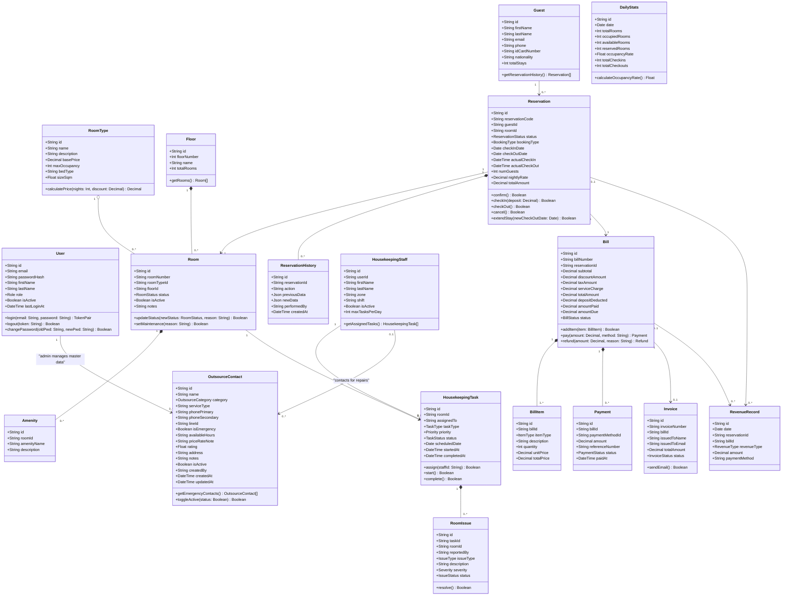

---

## 13. 🖥️ สถาปัตยกรรมระบบ (System Architecture & Event-Driven Patterns)

### 1. แผนผังสถาปัตยกรรมระดับระบบ (System Architecture Flowchart)

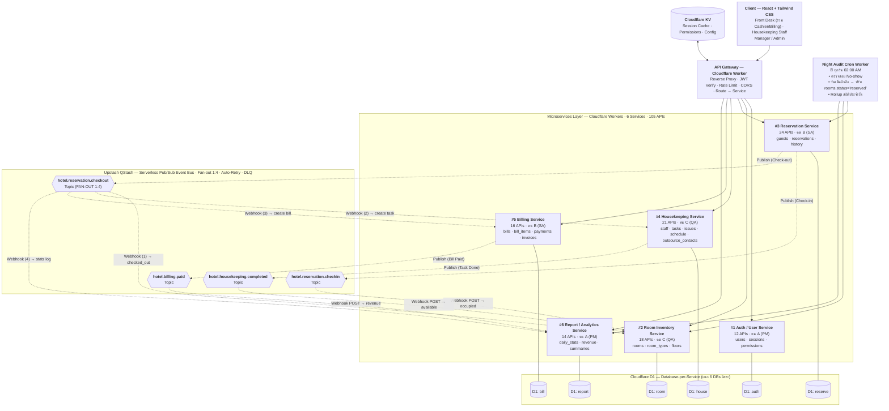

### 2. รูปแบบความสอดคล้องของข้อมูล (Outbox Pattern Implementation)
เพื่อรับประกันความถูกต้องของข้อมูลข้าม Service โดยไม่ต้องทำ Distributed Locking ระบบกำหนดให้ทุก Action สำคัญบันทึกข้อมูลหลักพร้อม Event ลงตาราง `outbox_events` ภายใต้ Atomic Transaction ก้อนเดียวกัน (`await db.batch([...])`)[cite: 7]:

```sql
BEGIN TRANSACTION;
UPDATE reservations SET status = 'checked_in', actual_check_in = CURRENT_TIMESTAMP WHERE id = ?;
INSERT INTO outbox_events (id, event_type, aggregate_id, aggregate_type, payload, status, created_at)
VALUES (lower(hex(randomblob(16))), 'ReservationCheckedIn', ?, 'Reservation', ?, 'pending', CURRENT_TIMESTAMP);
INSERT INTO reservation_history (id, reservation_id, action, performed_by, created_at)
VALUES (lower(hex(randomblob(16))), ?, 'checked_in', ?, CURRENT_TIMESTAMP);
COMMIT;
```

### 3. ตารางความสัมพันธ์ Event Bus ข้ามเซอร์วิส (Cross-Service Event Mapping via Upstash QStash)

| # | Event Name | Producer Service | Trigger Endpoint | บันทึกใน Outbox DB | Upstash QStash Topic / Method | Consumer Service | การตอบสนองของ Consumer |
|:---:|---|---|---|---|---|---|---|
| 1 | `ReservationCreated`[cite: 7] | Reservation[cite: 7] | `POST /reservations`[cite: 7] | `D1: reserve`[cite: 1] | *ไม่มี Queue* (Scheduled Night Audit Cron)[cite: 3] | Room Inventory[cite: 7] | Night Audit Cron รันเวลา 02:00 น. ในวันเช็คอินจริงเพื่อปรับสถานะห้องเป็น `reserved`[cite: 3] |
| 2 | `ReservationCheckedIn`[cite: 7] | Reservation[cite: 7] | `POST /reservations/:id/check-in`[cite: 7] | `D1: reserve`[cite: 1] | `hotel.reservation.checkin`[cite: 1] | Room Inventory[cite: 7] | Webhook POST `/webhooks/checkin` → เปลี่ยนสถานะห้องเป็น `occupied`[cite: 1, 4] |
| 3 | `ReservationCheckedOut`[cite: 7] | Reservation[cite: 7] | `POST /reservations/:id/check-out`[cite: 7] | `D1: reserve`[cite: 1] | `hotel.reservation.checkout`<br/>*(True Fan-out 1:4)*[cite: 1, 2] | • Room Inventory<br/>• Housekeeping<br/>• Billing<br/>• Report[cite: 1, 2] | **(1) Room:** ปรับ `status='checked_out'` ทันที[cite: 1, 2]<br/>**(2) HK:** สร้าง cleaning task (`pending`)[cite: 1, 2]<br/>**(3) Bill:** สร้างบิลรอคิดเงินรวมมินิบาร์[cite: 1, 2]<br/>**(4) Report:** `total_checkouts++`[cite: 1, 2] |
| 4 | `ReservationCancelled`[cite: 7] | Reservation[cite: 7] | `POST /reservations/:id/cancel`[cite: 7] | `D1: reserve`[cite: 1] | `hotel.reservation.checkin`[cite: 1] | Room Inventory[cite: 7] | คืนสถานะห้องเป็น `available`[cite: 1, 7] |
| 5 | `HousekeepingTaskCompleted`[cite: 7] | Housekeeping[cite: 7] | `PUT /housekeeping/tasks/:id/complete`[cite: 7] | `D1: house`[cite: 1] | `hotel.housekeeping.completed`[cite: 1] | Room Inventory[cite: 7] | Webhook POST `/webhooks/housekeeping-completed` → ปรับห้องเป็น `available`[cite: 1, 5] |
| 6 | `BillPaid`[cite: 7] | Billing[cite: 7] | `POST /bills/:id/pay`[cite: 7] | `D1: bill`[cite: 1] | `hotel.billing.paid`[cite: 1] | Report[cite: 7] | Webhook POST `/webhooks/bill-paid` → อัปเดตรายได้ใน `revenue_records`[cite: 1, 6] |

---

## 14. 🔄 วงจรชีวิตสถานะห้องพัก (Room Lifecycle State Machine)

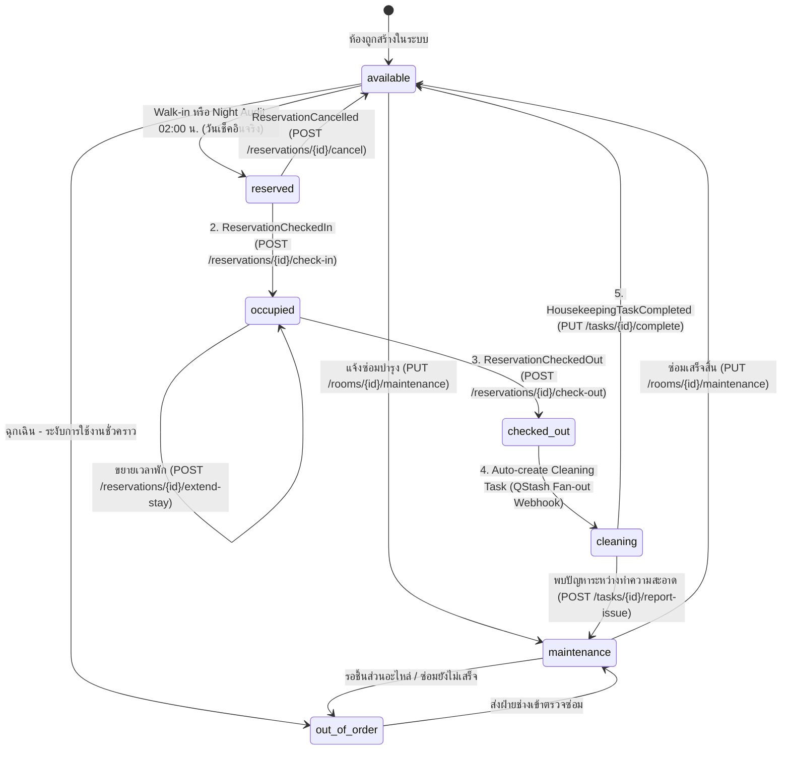

---

## 15. 🔁 แผนผังลำดับการทำงานหลัก (Sequence Diagrams - 5 Flows)

### Flow #1: การจองห้องพักล่วงหน้า (Advance Booking Flow)
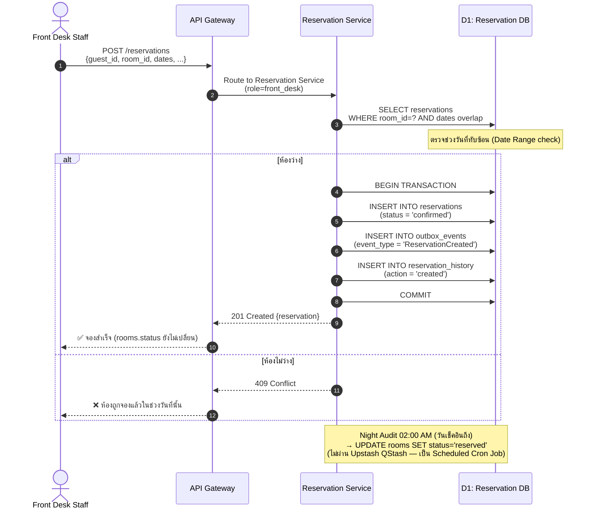

### Flow #2: การเช็คอินเข้าพัก (Check-in Flow)
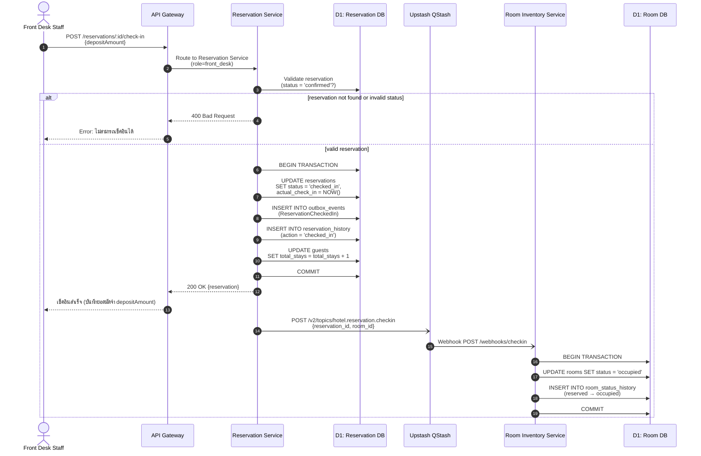

### Flow #3: การเช็คเอาท์และกระจายงานแบบ Fan-out 1:4 (Check-out Fan-out Flow)
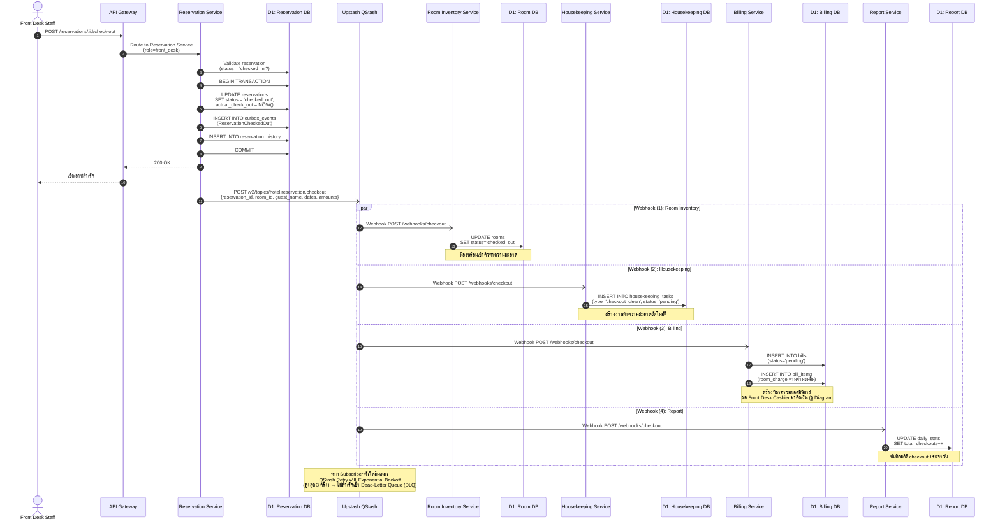

### Flow #4: แม่บ้านทำความสะอาดเสร็จสิ้น (Housekeeping Complete Flow)
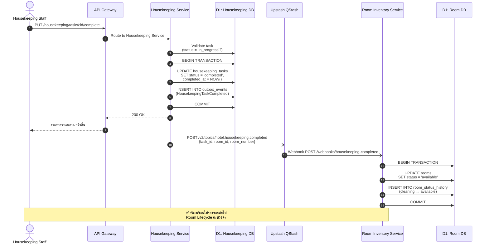

### Flow #5: การชำระเงินและออกใบเสร็จ (Billing & Payment Flow)
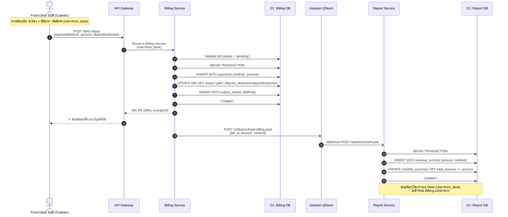

---

## 16. 📋 รายการ API ทั้งหมด (105 Microservice Endpoints)

### 🔐 Service #1: Auth/User Service (12 APIs) — Owner: คน A (PM)[cite: 1, 7]
1. `POST /register` — ลงทะเบียนผู้ใช้งานใหม่[cite: 7]
2. `POST /login` — ล็อกอินเข้าสู่ระบบและรับ JWT[cite: 7]
3. `POST /logout` — ออกจากระบบและยกเลิก Session[cite: 7]
4. `POST /refresh-token` — ขอ Refresh Token ใหม่[cite: 7]
5. `GET /users` — ดึงรายชื่อผู้ใช้งานทั้งหมด[cite: 7]
6. `GET /users/:id` — ดึงข้อมูลผู้ใช้รายบุคคล[cite: 7]
7. `PUT /users/:id` — แก้ไขข้อมูลผู้ใช้งาน[cite: 7]
8. `DELETE /users/:id` — ปิดการใช้งานผู้ใช้ (Soft Delete)[cite: 7]
9. `PUT /users/:id/role` — เปลี่ยนบทบาทผู้ใช้ (4 Roles)[cite: 7]
10. `GET /users/:id/permissions` — ดูรายการสิทธิ์ของผู้ใช้[cite: 7]
11. `POST /forgot-password` — ขอกู้คืนรหัสผ่าน[cite: 7]
12. `POST /reset-password` — ตั้งรหัสผ่านใหม่[cite: 7]

### 🛏️ Service #2: Room Inventory Service (18 APIs) — Owner: คน B (SA)[cite: 1, 7]
13. `GET /rooms` — รายการห้องพักทั้งหมด[cite: 7]
14. `GET /rooms/:id` — ข้อมูลห้องพักรายห้อง[cite: 7]
15. `POST /rooms` — เพิ่มห้องพักใหม่[cite: 7]
16. `PUT /rooms/:id` — แก้ไขรายละเอียดห้องพัก[cite: 7]
17. `DELETE /rooms/:id` — ลบหรือระงับการใช้ห้องพัก[cite: 7]
18. `GET /rooms/:id/status` — ดึงสถานะปัจจุบันของห้อง[cite: 7]
19. `PUT /rooms/:id/status` — ปรับปรุงสถานะห้องพัก[cite: 7]
20. `GET /room-types` — รายการประเภทห้องพักทั้งหมด[cite: 7]
21. `POST /room-types` — เพิ่มประเภทห้องพักใหม่[cite: 7]
22. `PUT /room-types/:id` — แก้ไขประเภทห้องพักและราคา[cite: 7]
23. `DELETE /room-types/:id` — ลบประเภทห้องพัก[cite: 7]
24. `GET /rooms/available` — ค้นหาห้องว่างตามช่วงเวลา[cite: 7]
25. `GET /floors` — รายชื่อชั้นทั้งหมดในโรงแรม[cite: 7]
26. `GET /floors/:id/rooms` — รายการห้องพักประจำชั้น[cite: 7]
27. `PUT /rooms/:id/maintenance` — ปรับห้องเข้าโหมดซ่อมบำรุง[cite: 7]
28. `GET /rooms/:id/history` — ดูประวัติการเปลี่ยนสถานะห้อง[cite: 7]
29. `POST /rooms/:id/amenities` — เพิ่มสิ่งอำนวยความสะดวกในห้อง[cite: 7]
30. `DELETE /rooms/:id/amenities/:amenityId` — ลบสิ่งอำนวยความสะดวก[cite: 7]

### 📋 Service #3: Reservation Service (24 APIs) — Owner: คน C (QA)[cite: 1, 7]
31. `GET /reservations` — รายการการจองทั้งหมด[cite: 7]
32. `GET /reservations/:id` — รายละเอียดการจองรายรายการ[cite: 7]
33. `POST /reservations` — สร้างการจองห้องพักล่วงหน้า (Date Range Check)[cite: 7]
34. `PUT /reservations/:id` — แก้ไขข้อมูลการจอง[cite: 7]
35. `DELETE /reservations/:id` — ลบข้อมูลการจอง[cite: 7]
36. `POST /reservations/:id/check-in` — ดำเนินการเช็คอินเข้าพักและเก็บมัดจำ[cite: 4, 7]
37. `POST /reservations/:id/check-out` — ดำเนินการเช็คเอาท์คืนห้อง (Fan-out 1:4)[cite: 1, 2, 7]
38. `POST /reservations/:id/cancel` — ขอยกเลิกการจอง[cite: 7]
39. `PUT /reservations/:id/modify-dates` — เปลี่ยนแปลงวันเข้าพัก/ออก[cite: 7]
40. `GET /reservations/by-guest/:guestId` — ประวัติการจองตามรายชื่อแขก[cite: 7]
41. `GET /reservations/by-room/:roomId` — ประวัติการจองตามห้องพัก[cite: 7]
42. `GET /reservations/today-checkins` — รายการที่ต้องเช็คอินวันนี้[cite: 7]
43. `GET /reservations/today-checkouts` — รายการที่ต้องเช็คเอาท์วันนี้[cite: 7]
44. `POST /guests` — บันทึกประวัติแขกใหม่[cite: 7]
45. `GET /guests` — รายชื่อแขกทั้งหมดในระบบ[cite: 7]
46. `GET /guests/:id` — ข้อมูลแขกรายบุคคล[cite: 7]
47. `PUT /guests/:id` — แก้ไขข้อมูลประวัติแขก[cite: 7]
48. `DELETE /guests/:id` — ลบข้อมูลแขก[cite: 7]
49. `POST /reservations/:id/extend-stay` — ขอขยายเวลาเข้าพัก[cite: 7]
50. `POST /reservations/:id/upgrade-room` — ขออัปเกรดประเภทห้องพัก[cite: 7]
51. `GET /reservations/calendar` — ข้อมูลตารางการจองแบบปฏิทิน[cite: 7]
52. `POST /walk-in` — สร้างการจองและเช็คอินแบบ Walk-in[cite: 7]
53. `GET /reservations/:id/invoice-preview` — ดูตัวอย่างบิลล่วงหน้า[cite: 7]
54. `POST /reservations/:id/apply-discount` — ใช้โค้ดหรือบันทึกส่วนลด[cite: 7]

### 🧼 Service #4: Housekeeping Service (21 APIs) — Owner: คน B (SA)[cite: 1, 7]
55. `GET /housekeeping/tasks` — รายการงานทำความสะอาดทั้งหมด[cite: 7]
56. `GET /housekeeping/tasks/:id` — ข้อมูลงานทำความสะอาดรายรายการ[cite: 7]
57. `POST /housekeeping/tasks` — สร้างงานทำความสะอาดด้วยมือ[cite: 7]
58. `PUT /housekeeping/tasks/:id` — แก้ไขรายละเอียดงาน[cite: 7]
59. `DELETE /housekeeping/tasks/:id` — ลบงานทำความสะอาด[cite: 7]
60. `PUT /housekeeping/tasks/:id/assign` — มอบหมายงานให้พนักงานแม่บ้าน[cite: 7]
61. `PUT /housekeeping/tasks/:id/complete` — บันทึกว่าทำความสะอาดเสร็จแล้ว[cite: 5, 7]
62. `GET /housekeeping/rooms-to-clean` — รายชื่อห้องที่ต้องทำความสะอาด[cite: 7]
63. `GET /housekeeping/staff-assignments` — สรุปงานที่แม่บ้านแต่ละคนถืออยู่[cite: 7]
64. `GET /housekeeping/staff` — รายชื่อพนักงานแม่บ้านทั้งหมด[cite: 7]
65. `POST /housekeeping/staff` — เพิ่มพนักงานแม่บ้านเข้าระบบ[cite: 7]
66. `PUT /housekeeping/staff/:id` — แก้ไขข้อมูลพนักงานแม่บ้าน[cite: 7]
67. `GET /housekeeping/staff/:id/tasks` — รายการงานของแม่บ้านรายคน[cite: 7]
68. `PUT /housekeeping/staff/:id/zone` — กำหนดโซนหรือชั้นที่รับผิดชอบ[cite: 7]
69. `POST /housekeeping/tasks/:id/report-issue` — แจ้งปัญหา/สิ่งของชำรุด[cite: 7]
70. `GET /housekeeping/schedule` — ตารางกะการทำงานของแม่บ้าน[cite: 7]
71. `GET /housekeeping/outsource-contacts` — ดึงรายชื่อผู้ติดต่อคู่ค้า/ช่าง Outsource ทั้งหมด (รองรับฟิลเตอร์ category, is_emergency)[cite: 7]
72. `GET /housekeeping/outsource-contacts/:id` — ดึงข้อมูลผู้ติดต่อ Outsource รายบุคคล/บริษัท[cite: 7]
73. `POST /housekeeping/outsource-contacts` — เพิ่มข้อมูลคู่ค้า/ช่าง Outsource ใหม่ (เฉพาะ Admin)[cite: 7]
74. `PUT /housekeeping/outsource-contacts/:id` — แก้ไขข้อมูลช่างและเงื่อนไขการติดต่อ (เฉพาะ Admin)[cite: 7]
75. `DELETE /housekeeping/outsource-contacts/:id` — ระงับการใช้งานช่าง/คู่ค้า (Soft Delete: `is_active = 0`, เฉพาะ Admin)[cite: 7]

### 🧾 Service #5: Billing Service (16 APIs) — Owner: คน A (PM)[cite: 1, 7]
*(ดำเนินการโดย Front Desk Cashier / `role=front_desk`)*[cite: 1, 6]
76. `GET /bills` — รายการบิลทั้งหมด[cite: 7]
77. `GET /bills/:id` — ข้อมูลบิลรายใบ[cite: 7]
78. `POST /bills` — สร้างบิลใหม่[cite: 7]
79. `PUT /bills/:id` — แก้ไขข้อมูลบิล[cite: 7]
80. `POST /bills/:id/items` — เพิ่มรายการค่าใช้จ่ายเสริม (มินิบาร์/ซักรีด)[cite: 7]
81. `DELETE /bills/:id/items/:itemId` — ลบรายการค่าใช้จ่าย[cite: 7]
82. `POST /bills/:id/pay` — บันทึกการชำระเงินและหักเงินมัดจำ[cite: 6, 7]
83. `GET /bills/:id/receipt` — พิมพ์/ดูใบเสร็จรับเงิน[cite: 7]
84. `GET /bills/by-reservation/:reservationId` — ค้นหาบิลจากการจอง[cite: 7]
85. `POST /bills/:id/refund` — ดำเนินการคืนเงิน[cite: 7]
86. `POST /bills/:id/discount` — เพิ่มส่วนลดท้ายบิล[cite: 7]
87. `GET /payment-methods` — ช่องทางการชำระเงินที่เปิดรับ[cite: 7]
88. `POST /payment-methods` — เพิ่มช่องทางการชำระเงิน[cite: 7]
89. `GET /invoices` — รายการใบแจ้งหนี้ทั้งหมด[cite: 7]
90. `GET /invoices/:id` — ดูใบแจ้งหนี้รายใบ[cite: 7]
91. `POST /invoices/:id/send-email` — ส่งใบแจ้งหนี้ให้แขกทางอีเมล[cite: 7]

### 📊 Service #6: Report/Analytics Service (14 APIs) — Owner: คน C (QA)[cite: 1, 7]
92. `GET /reports/occupancy-rate` — สถิติอัตราการเข้าพัก (Occupancy Rate)[cite: 7]
93. `GET /reports/revenue-daily` — รายงานสรุปรายได้รายวัน[cite: 7]
94. `GET /reports/revenue-monthly` — รายงานสรุปรายได้รายเดือน[cite: 7]
95. `GET /reports/revenue-by-room-type` — รายงานรายได้แยกตามประเภทห้อง[cite: 7]
96. `GET /reports/top-rooms` — รายการห้องพักที่ทำรายได้สูงสุด[cite: 7]
97. `GET /reports/avg-stay-duration` — จำนวนคืนที่เข้าพักเฉลี่ย[cite: 7]
98. `GET /reports/cancellation-rate` — อัตราการยกเลิกการจอง[cite: 7]
99. `GET /reports/housekeeping-performance` — รายงานประสิทธิภาพงานแม่บ้าน[cite: 7]
100. `GET /reports/checkin-checkout-stats` — สถิติจำนวนเช็คอินและเช็คเอาท์[cite: 7]
101. `GET /reports/guest-demographics` — สถิติสัญชาติและกลุ่มผู้เข้าพัก[cite: 7]
102. `GET /dashboard/summary` — ข้อมูลสรุปภาพรวมสำหรับ Dashboard[cite: 7]
103. `GET /reports/export/pdf` — ส่งออกรายงานเป็นไฟล์ PDF[cite: 7]
104. `GET /reports/export/csv` — ส่งออกรายงานเป็นไฟล์ CSV[cite: 7]
105. `GET /reports/custom` — ดึงข้อมูลรายงานแบบกำหนดช่วงเวลาเอง[cite: 7]

---

## 17. 🗄️ โครงสร้างฐานข้อมูลและผังความสัมพันธ์ (Database Schema & ER Diagrams)

สถาปัตยกรรมใช้รูปแบบ **Database-per-Service** แยกฐานข้อมูล Cloudflare D1 อิสระ 6 ก้อน ไม่มีการสร้าง Foreign Key ข้ามก้อน แต่ใช้ Soft Reference ผ่าน UUID และมีตาราง `outbox_events` ในทุกก้อนที่ส่ง Event[cite: 1, 7]:

### 1. Auth/User Service (`D1: auth`)
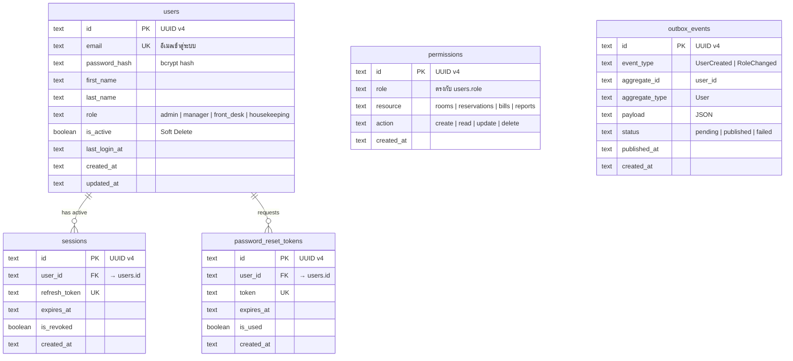

### 2. Room Inventory Service (`D1: room`)
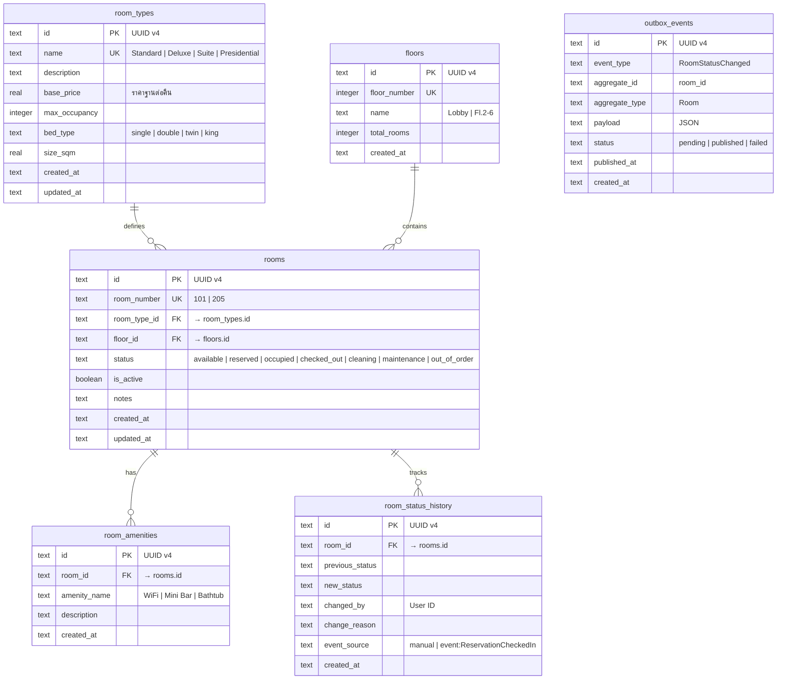

### 3. Reservation Service (`D1: reserve`)
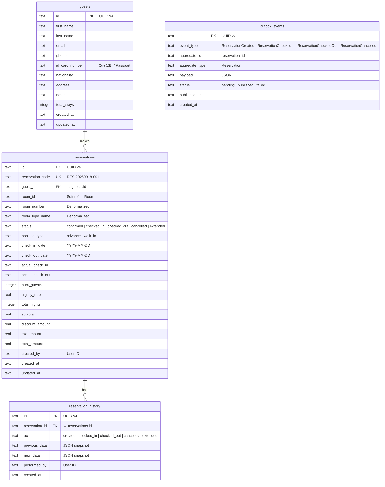

### 4. Housekeeping Service (`D1: house`)
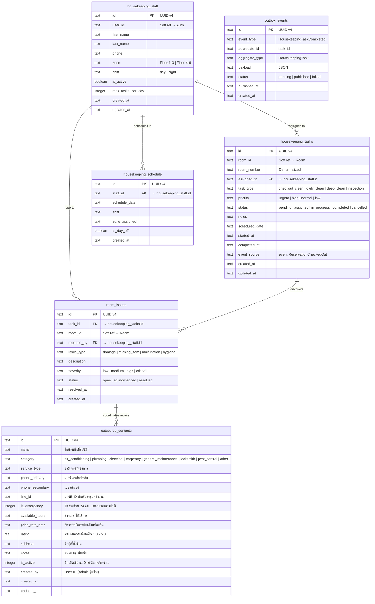

### 5. Billing Service (`D1: bill`)
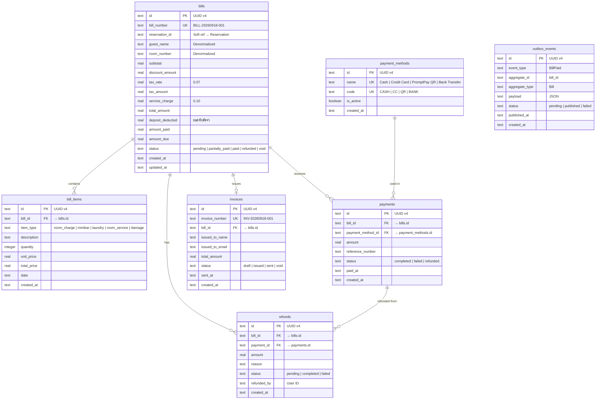

### 6. Report/Analytics Service (`D1: report`)
```mermaid
erDiagram
    daily_stats {
        text id PK "UUID v4"
        text date UK "YYYY-MM-DD"
        integer total_rooms
        integer occupied_rooms
        integer available_rooms
        integer reserved_rooms
        integer maintenance_rooms
        real occupancy_rate "occupied / total * 100"
        integer total_checkins
        integer total_checkouts
        integer total_cancellations
        integer total_walk_ins
        text created_at
        text updated_at
    }
    revenue_records {
        text id PK "UUID v4"
        text date "YYYY-MM-DD"
        text reservation_id "Soft ref → Reservation"
        text bill_id "Soft ref → Billing"
        text room_type_name
        text revenue_type "room_charge | service | refund"
        real amount
        text payment_method
        text created_at
    }
    monthly_summary {
        text id PK "UUID v4"
        text year_month UK "YYYY-MM"
        real total_revenue
        real net_revenue
        real avg_occupancy_rate
        integer total_reservations
        real cancellation_rate
        real avg_stay_duration
        integer total_guests
        text created_at
        text updated_at
    }
    room_performance {
        text id PK "UUID v4"
        text room_id "Soft ref → Room"
        text room_number
        text room_type_name
        text year_month "YYYY-MM"
        integer total_bookings
        integer total_nights_sold
        real total_revenue
        text created_at
        text updated_at
    }
    guest_demographics {
        text id PK "UUID v4"
        text year_month "YYYY-MM"
        text nationality
        integer guest_count
        real total_revenue
        real avg_stay_nights
        text created_at
        text updated_at
    }
    housekeeping_performance {
        text id PK "UUID v4"
        text staff_id "Soft ref → Housekeeping"
        text staff_name
        text year_month
        integer tasks_completed
        real avg_completion_minutes
        integer issues_reported
        text created_at
        text updated_at
    }
    event_log {
        text id PK "UUID v4"
        text event_type
        text source_service
        text payload "JSON"
        boolean processed
        text processed_at
        text created_at
    }
```

---

## 18. 🎯 การออกแบบหน้าจอ (UI Prototype & Wireframe)

หน้าจอระบบแบ่งออกเป็น 3 ส่วนการทำงานหลักตามบทบาทของผู้ใช้งาน โดยทำงานบน Layout กลางร่วมกัน[cite: 7]:

1.  **Front Desk & Cashier Operations Portal:**
    *   **Room Status Grid & List:** แสดงสถานะห้องพักทั้ง 7 สถานะด้วยสีเฉพาะตัวแบบ Real-time พร้อมฟังก์ชันกรองตามชั้นและประเภทห้อง[cite: 7]
    *   **Quick Booking / Walk-in Modal:** ฟอร์มสร้างการจองและเช็คอินแบบด่วนในหน้าเดียว พร้อมบันทึกมัดจำ[cite: 7]
    *   **Check-out & Cashier Drawer:** แผงควบคุมด้านข้างสำหรับรับคืนคีย์การ์ด รวมค่ามินิบาร์ หักยอดมัดจำ และออกใบเสร็จรับเงิน[cite: 7]
    *   **Quick Emergency Outsource Drawer:** แผงลิ้นชักด้านข้างสำหรับค้นหาและโทรติดต่อช่าง Outsource ฉุกเฉิน 24 ชม. (แอร์เสีย, ประปาแตก, ไฟฟ้าลัดวงจร) พร้อมปุ่มคลิกโทรออกและคัดลอกเบอร์/LINE ID เพื่อแก้ปัญหาเฉพาะหน้าให้แขกได้ทันท่วงที[cite: 7]
2.  **Housekeeping Management Portal:**
    *   **Task Kanban Board:** บอร์ดแบ่งสถานะงานทำความสะอาด (รอมอบหมาย → กำลังทำ → เสร็จสิ้น)[cite: 7]
    *   **Staff Assignment Modal:** มอบหมายงานตามชั้นและโซนความรับผิดชอบ[cite: 7]
    *   **Report Issue Form:** แบบฟอร์มแจ้งห้องชำรุดพร้อมระบุระดับความรุนแรง (Low, Medium, High, Critical)[cite: 7]
    *   **Quick Technician Contact Modal:** ป็อปอัปค้นหาเบอร์ช่างเฉพาะทางเพื่อประสานงานซ่อมหน้างานควบคู่กับการเปิดใบงานแจ้งชำรุด (Report Issue)[cite: 7]
3.  **Manager / Executive Dashboard:**
    *   **KPI Cards:** การ์ดตัวเลขสรุป Occupancy Rate วันนี้, รายได้รวมประจำวัน, ห้องพร้อมขาย และจำนวนเช็คอิน/เช็คเอาท์[cite: 7]
    *   **Revenue & Occupancy Trend Charts:** กราฟเส้นและกราฟแท่งแสดงแนวโน้มอัตราการเข้าพักและรายได้ย้อนหลัง 30 วัน[cite: 7]
    *   **Outsource Master Data Management Table:** ตารางบริหารจัดการคู่ค้าและช่าง Outsource (Full CRUD: เพิ่ม/แก้ไข/ระงับการจ้าง `is_active = 0`) และกำหนดหมวดหมู่/แท็กช่างด่วน[cite: 7]
    *   **Export Center:** ปุ่มคลิกเดียวสำหรับดาวน์โหลดรายงานภาพรวมในรูปแบบ PDF และ CSV[cite: 7]

---

## 19. ⚙️ การทดสอบการยอมรับของผู้ใช้ (User Acceptance Testing: UAT)

**โครงงาน:** Hotel Management System (Microservice Architecture สำหรับโรงแรมขนาดเล็ก 5–10 ห้อง)[cite: 7]  
**รูปแบบการทดสอบ:** Manual UAT & Functional Integration Testing ผ่าน Postman และ UI Prototype[cite: 7]  
**กลุ่มผู้ทดสอบ:** Front Desk Staff & Cashier, Housekeeping Staff, Hotel Manager / Admin (4 บทบาทตามระบบ RBAC)[cite: 6, 7]

### ตารางกรณีทดสอบ (UAT Test Cases)

#### 🧑‍💼 1. Front Desk Staff (UAT-FD)
| รหัสทดสอบ | ฟีเจอร์ที่ทดสอบ | ขั้นตอนการทดสอบ | ผลลัพธ์ที่คาดหวัง | ผลลัพธ์จริง | สถานะ |
|---|---|---|---|---|:---:|
| **UAT-FD01**[cite: 7] | Check Room Status[cite: 7] | เปิดหน้า Room Grid เลือกฟิลเตอร์ชั้น 2[cite: 7] | แสดงห้องพักชั้น 2 พร้อมสีสถานะถูกต้องตาม State Machine[cite: 7] | แสดงห้องชั้น 2 ถูกต้อง พร้อมสีสถานะชัดเจน[cite: 7] | **Pass**[cite: 7] |
| **UAT-FD02**[cite: 7] | Create Advance Booking[cite: 7] | จองห้อง Deluxe ล่วงหน้า 3 วัน ระบุชื่อแขก[cite: 7] | ระบบสร้างการจอง บันทึกลง D1 ตรวจ Date Range Overlap ห้องคงสถานะ `available` จนถึงวันเช็คอินจริง[cite: 3] | การจองสร้างสำเร็จ สถานะห้องยังคงเป็น available[cite: 3] | **Pass**[cite: 7] |
| **UAT-FD03**[cite: 7] | Check-in Success[cite: 7] | เลือกรายการจองที่ confirmed บันทึกมัดจำ 1,000 บาทแล้วกด "Check-in"[cite: 4] | สถานะการจองเปลี่ยนเป็น `checked_in` ส่ง Event เข้า QStash ปรับห้องเป็น `occupied`[cite: 4] | เช็คอินสำเร็จ ข้อมูลอัปเดตทั้งสองเซอร์วิส[cite: 7] | **Pass**[cite: 7] |
| **UAT-FD04**[cite: 7] | Check-in Invalid[cite: 7] | พยายามเช็คอินรายการจองที่ถูกยกเลิกไปแล้ว[cite: 7] | ระบบปฏิเสธพร้อมแสดงข้อความ "ไม่สามารถเช็คอินได้"[cite: 7] | ระบบแจ้งเตือนปฏิเสธตามที่คาดหวัง[cite: 7] | **Pass**[cite: 7] |
| **UAT-FD05**[cite: 7] | Check-out Fan-out[cite: 7] | กด "Check-out" ห้องที่เข้าพักอยู่[cite: 7] | ระบบส่ง Event เข้า QStash Fan-out 1:4 (ห้องเป็น checked_out, แม่บ้านได้งาน, มีบิลรอคิดเงิน, รายงานบันทึกสถิติ)[cite: 1, 2] | Fan-out 1:4 ทำงานสมบูรณ์ครบทั้ง 4 ปลายทาง[cite: 1, 2] | **Pass**[cite: 7] |
| **UAT-FD06**[cite: 7] | Walk-in Booking[cite: 7] | ทำรายการ Walk-in แขกที่หน้าเคาน์เตอร์[cite: 7] | สร้างการจองและเช็คอินสำเร็จในขั้นตอนเดียว ห้องเปลี่ยนเป็น `occupied`[cite: 7] | ทำรายการสำเร็จในขั้นตอนเดียว[cite: 7] | **Pass**[cite: 7] |
| **UAT-FD07** | Quick Emergency Outsource Contact | เปิด Quick Emergency Contact Drawer กรองหมวด 'แอร์' และ 'ประปา' | แสดงรายชื่อช่างด่วน 24 ชม. พร้อมปุ่มโทรออกและ LINE ID ทันที | ค้นหาและคัดลอกข้อมูลช่างฉุกเฉินได้ในคลิกเดียว | **Pass** |

#### 🧹 2. Housekeeping Staff (UAT-HK)
| รหัสทดสอบ | ฟีเจอร์ที่ทดสอบ | ขั้นตอนการทดสอบ | ผลลัพธ์ที่คาดหวัง | ผลลัพธ์จริง | สถานะ |
|---|---|---|---|---|:---:|
| **UAT-HK01**[cite: 7] | Auto Task Creation[cite: 7] | ตรวจสอบหน้ารายการงานหลังมีห้องเช็คเอาท์[cite: 7] | ปรากฏ Task ทำความสะอาดประเภท `checkout_clean` สถานะ `pending`[cite: 1, 7] | Task ใหม่ปรากฏขึ้นทันทีจาก Webhook[cite: 1, 7] | **Pass**[cite: 7] |
| **UAT-HK02**[cite: 7] | Assign Task[cite: 7] | หัวหน้าแม่บ้านเลือกงานและมอบหมายให้แม่บ้านรายคน[cite: 7] | Task อัปเดตสถานะเป็น `assigned` พร้อมระบุชื่อผู้รับผิดชอบ[cite: 7] | มอบหมายงานสำเร็จและแสดงในบอร์ด[cite: 7] | **Pass**[cite: 7] |
| **UAT-HK03**[cite: 7] | Complete Cleaning[cite: 7] | แม่บ้านกด "Complete" หลังทำความสะอาดเสร็จ[cite: 7] | Task อัปเดตเป็น `completed` และห้องพักใน Room Service คืนสถานะเป็น `available`[cite: 5, 7] | ห้องพักกลับมาเป็น available พร้อมขายทันที[cite: 7] | **Pass**[cite: 7] |
| **UAT-HK04**[cite: 7] | Report Issue[cite: 7] | แจ้งสิ่งของชำรุด (ก๊อกน้ำรั่ว) ระดับ High[cite: 7] | ระบบบันทึก Issue และปรับสถานะห้องเป็น `maintenance`[cite: 7] | ห้องถูกปรับเป็น maintenance และปิดรับการจอง[cite: 7] | **Pass**[cite: 7] |
| **UAT-HK05** | Quick Outsource Contact for Repairs | เปิดสมุดเบอร์ช่างจากหน้างานห้องชำรุด ค้นหาช่างประปา/ไฟ | แสดงเบอร์ติดต่อและเวลาให้บริการ เพื่อโทรนัดช่างเข้าหน้างานควบคู่กับ Report Issue | แสดงข้อมูลช่างเฉพาะทางถูกต้องและโทรออกได้ | **Pass** |
| **UAT-HK06** | View Shift Schedule | เปิดหน้าตารางกะการทำงานของพนักงานแม่บ้าน | แสดงตารางการเข้าเวร โซน และชั้นที่รับผิดชอบอย่างชัดเจน | ตารางงานแสดงผลครบถ้วนตามกะ | **Pass** |

#### 🧾 3. Front Desk Cashiering & Billing (UAT-BL — ดำเนินการโดย Front Desk Staff)
| รหัสทดสอบ | ฟีเจอร์ที่ทดสอบ | ขั้นตอนการทดสอบ | ผลลัพธ์ที่คาดหวัง | ผลลัพธ์จริง | สถานะ |
|---|---|---|---|---|:---:|
| **UAT-BL01** | Auto Bill Creation | ตรวจสอบรายการบิลหลังมีห้องเช็คเอาท์ | พบใบแจ้งหนี้ใหม่ที่รวมค่าห้องตามจำนวนคืน พร้อมภาษี 7% ถูกต้อง | บิลถูกสร้างอัตโนมัติพร้อมคำนวณภาษีถูกต้อง | **Pass** |
| **UAT-BL02** | Add Extra Item | เพิ่มรายการค่ามินิบาร์ 250 บาทลงในบิล | ยอดรวมของบิลอัปเดตเพิ่มขึ้น 250 บาท พร้อมบันทึกประวัติ | ยอดรวมอัปเดตถูกต้องตามรายการที่เพิ่ม | **Pass** |
| **UAT-BL03** | Payment Processing | รับชำระเงินเต็มจำนวนด้วยบัตรเครดิต | สถานะบิลเปลี่ยนเป็น `paid` ยอดคงค้างเป็น 0 และส่ง Event ไปยัง Report | ชำระเงินสำเร็จ บันทึกลงประวัติเรียบร้อย | **Pass** |
| **UAT-BL04** | Issue Receipt | กดปุ่มออกใบเสร็จรับเงินสำหรับบิลที่จ่ายแล้ว | แสดงหน้าใบเสร็จรับเงินพร้อมเลขอ้างอิงและรายละเอียดครบถ้วน | ใบเสร็จแสดงผลถูกต้องสมบูรณ์ | **Pass** |
| **UAT-BL05** | Process Deposit Refund | คืนเงินมัดจำค่ากุญแจ/ห้องพักให้แขกเมื่อตรวจห้องผ่าน | ยอดมัดจำถูกหักลบและบันทึกสถานะการคืนเงินถูกต้อง | การคืนเงินบันทึกสำเร็จและยอดบัญชีตรง | **Pass** |

#### 📊 4. Manager / Admin (UAT-MGR)
| รหัสทดสอบ | ฟีเจอร์ที่ทดสอบ | ขั้นตอนการทดสอบ | ผลลัพธ์ที่คาดหวัง | ผลลัพธ์จริง | สถานะ |
|---|---|---|---|---|:---:|
| **UAT-MGR01**[cite: 7] | View KPI Dashboard[cite: 7] | เข้าหน้า Dashboard ผู้บริหาร[cite: 7] | แสดง Occupancy Rate, รายได้รวม และยอดเช็คอิน/เอาท์ตรงตามข้อมูลจริง[cite: 7] | Dashboard แสดงผลข้อมูล Real-time ถูกต้อง[cite: 7] | **Pass**[cite: 7] |
| **UAT-MGR02**[cite: 7] | Access Control Guard[cite: 7] | ใช้บัญชีพนักงานแม่บ้านพยายามเข้า URL หน้า Admin[cite: 7] | ระบบปฏิเสธการเข้าถึงผ่าน KV Cache Permissions และ Redirect กลับ[cite: 1, 7] | ติดสิทธิ์ RBAC ไม่สามารถเข้าหน้า Admin ได้[cite: 7] | **Pass**[cite: 7] |
| **UAT-MGR03**[cite: 7] | Export Report CSV[cite: 7] | กดปุ่ม Export รายงานรายได้รายเดือนเป็น CSV[cite: 7] | ดาวน์โหลดไฟล์ CSV ที่มีข้อมูลครบทุกคอลัมน์และเปิดอ่านได้[cite: 7] | ไฟล์ CSV ถูกดาวน์โหลดและข้อมูลถูกต้อง[cite: 7] | **Pass**[cite: 7] |
| **UAT-MGR04**[cite: 7] | Export Report PDF[cite: 7] | กดปุ่ม Export รายงานอัตราการเข้าพักเป็น PDF[cite: 7] | ได้เอกสาร PDF รูปแบบมาตรฐานสำหรับใช้รายงานที่ประชุม[cite: 7] | เอกสาร PDF ถูกสร้างขึ้นพร้อมฟอร์แมตที่อ่านง่าย[cite: 7] | **Pass**[cite: 7] |
| **UAT-MGR05** | Manage Outsource Master Data | Admin เพิ่มช่างแอร์ใหม่ แก้ไขเบอร์ และทดสอบระงับการใช้งาน (`is_active = 0`) | ช่างใหม่ถูกบันทึกลง D1 และเมื่อปิดใช้งานจะไม่แสดงในสมุดเบอร์ของ Front Desk | จัดการ Master Data ได้ถูกต้องและปลอดภัย | **Pass** |
| **UAT-MGR06** | Room Type & Rate Configuration | ปรับเปลี่ยนราคาฐานของห้องประเภท Deluxe | อัตราค่าห้องใหม่มีผลกับการคำนวณการจองรอบถัดไปทันที | อัตราค่าบริการอัปเดตเรียบร้อย | **Pass** |

### ตารางสรุปผลการทดสอบ UAT (UAT Summary)

| กลุ่มผู้ใช้งาน (Role) | จำนวน Test Cases | ผ่าน (Pass) | ไม่ผ่าน (Fail) | คิดเป็นร้อยละ |
|---|:---:|:---:|:---:|:---:|
| **Front Desk Staff & Cashier (จอง/เช็คอิน/เช็คเอาท์/ช่างฉุกเฉิน)** | 7 | 7 | 0 | 100% |
| **Front Desk Staff & Cashier (การเงิน/บิล/มินิบาร์/มัดจำ)** | 5 | 5 | 0 | 100% |
| **Housekeeping Staff (ทำความสะอาด/แจ้งชำรุด/เบอร์ช่าง)** | 6 | 6 | 0 | 100% |
| **Manager / Admin (แดชบอร์ด/RBAC/Outsource Master Data/ส่งออก)** | 6 | 6 | 0 | 100% |
| **รวมทั้งหมด** | **24** | **24** | **0** | **100%** |

---

## 20. 🖼️ ผลลัพธ์ที่คาดว่าจะได้รับ (Expected Outcomes)

1.  **ได้ระบบบริหารจัดการโรงแรมหลังบ้านที่ทำงานได้จริง (Functional 100%):** ครอบคลุมวงจรชีวิตห้องพักตั้งแต่วางแผนจอง เช็คอิน แม่บ้านทำความสะอาด คิดเงิน ออกบิล จัดการคู่ค้า Outsource ซ่อมบำรุง และวิเคราะห์ข้อมูล โดยเชื่อมต่อกันครบถ้วนทั้ง 105 Microservice APIs[cite: 1, 7]
2.  **สถาปัตยกรรม Serverless Microservices ที่มีความทนทานสูง (High Resilience):** การประยุกต์ใช้ Cloudflare Workers, Cloudflare D1, KV และ Upstash QStash ร่วมกับ Outbox Pattern ช่วยให้ระบบรองรับการทำงานแบบ Decoupled เมื่อเซอร์วิสใดเซอร์วิสหนึ่งขัดข้อง ข้อความในคิวจะไม่สูญหายและมีระบบ Auto-Retry พร้อม Dead-Letter Queue (DLQ)[cite: 1, 7]
3.  **แก้ปัญหาคอขวดของโรงแรมขนาดเล็กด้วย Outsource Directory:** โรงแรมขนาดเล็ก 5–10 ห้องสามารถดำเนินงานได้อย่างราบรื่นโดยไม่ต้องแบกรับต้นทุนจ้างช่างประจำตลอดเวลา ด้วยระบบ Quick Emergency Contact สำหรับ Front Desk และ Housekeeping ที่เข้าถึงช่างซ่อมบำรุงภายนอกได้ทันใจเมื่อเกิดเหตุฉุกเฉิน
4.  **ลดความผิดพลาดและเพิ่มความเร็วในการปฏิบัติงานของโรงแรม:** พนักงานต้อนรับรับทราบสถานะความพร้อมของห้องพักได้ทันที แม่บ้านได้รับงานทำความสะอาดอัตโนมัติหลังเช็คเอาท์ และกระบวนการคิดเงินสามารถหักเงินมัดจำได้อย่างถูกต้อง รวดเร็ว[cite: 7]
5.  **ได้ฐานโค้ดและชุดเอกสารทางวิศวกรรมซอฟต์แวร์ที่สมบูรณ์:** โครงสร้างโค้ดเป็นระเบียบตามหลัก Clean Architecture พร้อมเอกสาร System Specification, Interactive System Diagrams Viewer, ERDs และ OpenAPI ครบถ้วนตามมาตรฐานวิชาชีพ[cite: 6, 7]