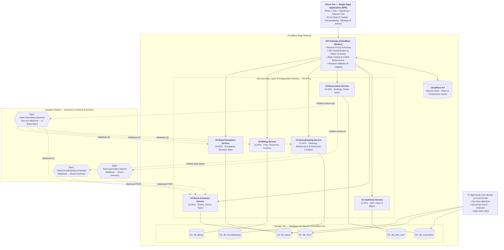
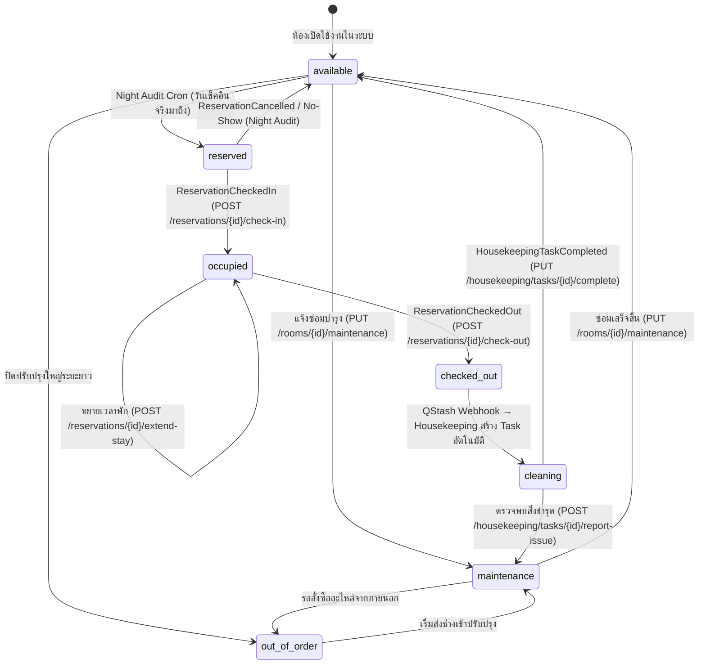
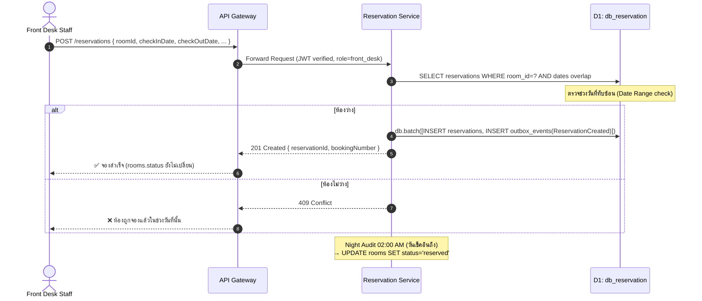
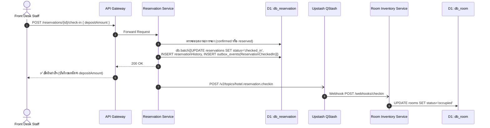
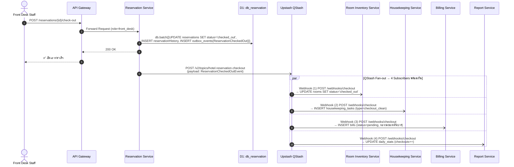
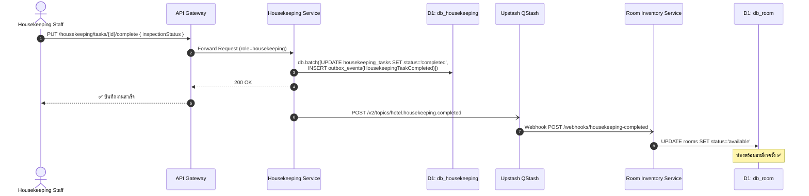
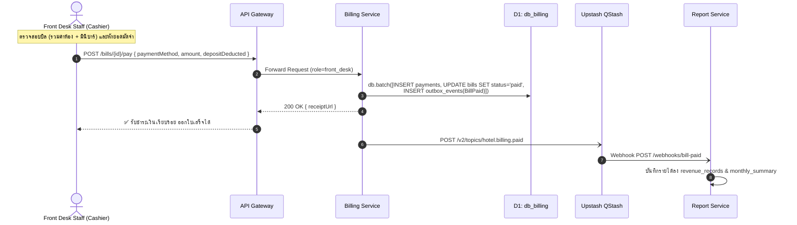
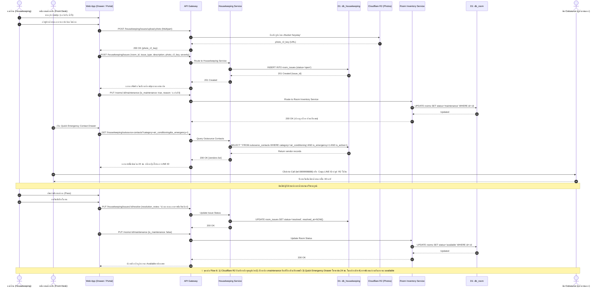

# 🖥️ Hotel Management System — System Architecture & Design Specification (`systemdesign.md`)

> **เอกสารสถาปัตยกรรมระบบ การออกแบบเชิงวิศวกรรมซอฟต์แวร์ และข้อกำหนดทางเทคนิค (System Design Specification)**  
> **โครงงาน:** ระบบบริหารจัดการภายในสำหรับโรงแรมขนาดเล็ก 5–10 ห้อง (Small-Scale / Boutique Hotel Operations & Back-Office)  
> **อ้างอิงไฟล์แม่:** `README.md` (root ของ repo)

---

## 📚 สารบัญ (Table of Contents)

1. [ภาพรวมสถาปัตยกรรมระดับระบบ (System Architecture Overview)](#1)
2. [การแบ่งขอบเขตไมโครเซอร์วิส 6 เซอร์วิส (Microservices Decomposition)](#2)
3. [สถาปัตยกรรมฐานข้อมูลแยกอิสระ (Database-per-Service Architecture)](#3)
4. [ระบบส่งข้อความแบบกระจายและ Outbox Pattern (Upstash QStash & Outbox)](#4)
5. [วงจรชีวิตสถานะห้องพัก (Room Lifecycle State Machine)](#5)
6. [แผนภาพลำดับการทำงานหลัก 6 กระบวนการ (Core Sequence Diagrams)](#6)
7. [ตารางความสัมพันธ์ Event Bus ข้ามเซอร์วิส (Cross-Service Event Mapping)](#7)
8. [รายการ API ทั้ง 105 Endpoints จำแนกรายเซอร์วิส](#8)
9. [ความทนทาน ความปลอดภัย และความสอดคล้องของข้อมูล](#9)

---

## 1. ภาพรวมสถาปัตยกรรมระดับระบบ (System Architecture Overview)

ระบบบริหารจัดการโรงแรมหลังบ้านได้รับการออกแบบด้วยสถาปัตยกรรม **Microservices Architecture บน Serverless Stack ของ Cloudflare + Upstash QStash** โดยมุ่งเน้นความเร็วระดับ Edge, การแยกความรับผิดชอบอย่างเด็ดขาด (Decoupling) และความทนทานต่อความล้มเหลว (Fault Tolerance)



---

## 2. การแบ่งขอบเขตไมโครเซอร์วิส 6 เซอร์วิส (Microservices Decomposition)

| เซอร์วิส (Service) | หน้าที่หลัก (Domain Responsibility) | ข้อมูลที่ดูแล (Data Owned) | เจ้าของ |
|---|---|---|---|
| **1. Auth/User Service** | ยืนยันตัวตน, จัดการโทเค็น JWT, ควบคุมสิทธิ์การเข้าถึง (RBAC 4 Roles), บริหารผู้ใช้ | Users, Roles, Sessions, Password Tokens | เขต |
| **2. Room Inventory Service** | คลังห้องพัก, ประเภทห้อง, ชั้น, สิ่งอำนวยความสะดวก, สถานะห้องจริง ณ ปัจจุบัน | Rooms, Room Types, Floors, Amenities | บุญ |
| **3. Reservation Service** | การจองล่วงหน้า (Date Range), Walk-in, Check-in, Check-out, ประวัติการจอง | Reservations, Guests, Booking History | เดียร์ |
| **4. Housekeeping Service** | งานทำความสะอาด, ตารางกะแม่บ้าน, มอบหมายงาน, แจ้งสิ่งของชำรุด, สมุดเบอร์ติดต่อและคู่ค้า Outsource (ช่าง/คนสวน/งานบริการภายนอก) | Staff, Tasks, Issues, Schedules, Outsource Contacts | บุญ |
| **5. Billing Service** | จัดการบิลและค่าใช้จ่ายเสริม (มินิบาร์, ซักรีด), ชำระเงิน, ออกใบเสร็จ/ใบแจ้งหนี้ | Bills, Bill Items, Payments, Invoices | เดียร์ |
| **6. Report/Analytics Service** | รวบรวมสถิติ, คำนวณ Occupancy Rate, รายได้รายวัน/รายเดือน, ประสิทธิภาพงาน | Daily Stats, Monthly Summaries, Audit Logs | เขต |

> ⚠️ **Front Desk (เดียร์)** ดูแลทั้ง `reservation` + `billing` เพราะการเช็คเอาท์และคิดเงินเกิดในขั้นตอนเดียวกันหน้าเคาน์เตอร์

---

## 3. สถาปัตยกรรมฐานข้อมูลแยกอิสระ (Database-per-Service Architecture)

แต่ละเซอร์วิสมีฐานข้อมูล **Cloudflare D1 (Serverless SQLite)** ของตนเองโดยสมบูรณ์:
- **ห้ามมี Cross-Database Foreign Key:** ไม่อนุญาตให้สร้าง FK ข้ามฐานข้อมูล D1
- **Soft Reference ผ่าน UUID:** การเชื่อมโยงข้อมูลระหว่างเซอร์วิสจะใช้ `String UUID v4` และ Denormalized Data บางส่วน (เช่น `room_number`, `guest_name`) เพื่อลดความจำเป็นในการเรียกข้าม Service
- **Outbox Table ประจำทุก Producer:** เซอร์วิสที่เป็น Producer ของ Event ต้องมีตาราง `outbox_events` ในฐานข้อมูลของตนเองเสมอ

```sql
-- DDL ตาราง outbox_events ในทุกฐานข้อมูล D1 ที่เป็น Event Producer
CREATE TABLE IF NOT EXISTS outbox_events (
    id TEXT PRIMARY KEY,
    event_type TEXT NOT NULL,
    aggregate_id TEXT NOT NULL,
    aggregate_type TEXT NOT NULL,
    payload TEXT NOT NULL,
    status TEXT NOT NULL DEFAULT 'pending', -- pending, published, failed
    retry_count INTEGER NOT NULL DEFAULT 0,
    error_message TEXT,
    published_at TEXT,
    created_at TEXT NOT NULL DEFAULT CURRENT_TIMESTAMP
);
CREATE INDEX IF NOT EXISTS idx_outbox_status ON outbox_events(status);
CREATE INDEX IF NOT EXISTS idx_outbox_created ON outbox_events(created_at);

-- DDL ตาราง outsource_contacts ในฐานข้อมูล db_housekeeping (Master Data คู่ค้า/ช่างซ่อมบำรุง/คนสวนภายนอก)
CREATE TABLE IF NOT EXISTS outsource_contacts (
    id TEXT PRIMARY KEY,
    name TEXT NOT NULL,                         -- ชื่อช่าง หรือ ชื่อบริษัท/ร้าน (เช่น ช่างแอร์สมเกียรติ, บจก.สยามเซอร์วิส)
    category TEXT NOT NULL,                     -- ประเภทงานช่าง/บริการ (air_conditioning, plumbing, electrical, carpentry, general_maintenance, locksmith, pest_control, gardening, laundry, transport, cleaning, other)
    service_type TEXT NOT NULL,                 -- คำอธิบายบริการสั้นๆ (เช่น ล้าง/ซ่อมแอร์, ซ่อมท่อประปา-สุขภัณฑ์, ซ่อมไฟฟ้า)
    phone_primary TEXT NOT NULL,                -- เบอร์โทรหลัก (คลิกโทรออกได้ tel:...)
    phone_secondary TEXT,                       -- เบอร์โทรสำรอง
    line_id TEXT,                               -- LINE ID สำหรับส่งรูปหน้างานหรือแผนที่
    is_emergency INTEGER NOT NULL DEFAULT 0,   -- เป็นเบอร์ฉุกเฉิน 24 ชม. หรือไม่ (สำหรับ Front Desk ดึงขึ้นมาเด่นสุดตอนดึก)
    available_hours TEXT DEFAULT '24 ชั่วโมง',  -- เวลาทำการ เช่น '08:00 - 18:00' หรือ '24 ชั่วโมง'
    price_rate_note TEXT,                       -- อัตราค่าบริการเบื้องต้น (เช่น เริ่มต้น 500 บาท/ครั้ง)
    rating REAL DEFAULT 5.0,                    -- ประเมินความพึงพอใจหรือโน้ตคุณภาพงาน (1.0 - 5.0)
    address TEXT,                               -- ที่อยู่ / พิกัดร้าน
    notes TEXT,                                 -- หมายเหตุเพิ่มเติม (เช่น โทรแจ้งล่วงหน้า 30 นาที)
    is_active INTEGER NOT NULL DEFAULT 1,       -- สถานะเปิดใช้งาน (1=ใช้งาน, 0=ระงับ/ยกเลิกสัญญา ตามนโยบาย Admin)
    created_by TEXT,                            -- User ID ของ Admin ผู้บันทึกข้อมูล
    created_at TEXT NOT NULL DEFAULT CURRENT_TIMESTAMP,
    updated_at TEXT NOT NULL DEFAULT CURRENT_TIMESTAMP
);
CREATE INDEX IF NOT EXISTS idx_outsource_category ON outsource_contacts(category);
CREATE INDEX IF NOT EXISTS idx_outsource_is_active ON outsource_contacts(is_active);
CREATE INDEX IF NOT EXISTS idx_outsource_is_emergency ON outsource_contacts(is_emergency);
```

---

## 4. ระบบส่งข้อความแบบกระจายและ Outbox Pattern (Upstash QStash & Outbox)

### 4.1 ทำไมต้องใช้ Upstash QStash แทน Cloudflare Queues

Cloudflare Queues เป็นคิวแบบ **Competing Consumers** หากมี Worker หลายตัวฟังคิวเดียวกัน Worker ตัวแรกที่ดึงข้อความไปจะลบข้อความออกจากคิว ทำให้เซอร์วิสอื่นไม่ได้รับข้อความ (Message Loss)

**Upstash QStash** แก้ปัญหานี้ด้วย **True Pub/Sub Fan-out**: Producer ยิง HTTP POST เข้า Topic ครั้งเดียว QStash จะกระจาย Webhook POST ไปยัง Subscriber ทุกตัวพร้อมกัน พร้อม Auto-Retry (Exponential Backoff) และ Dead-Letter Queue (DLQ) ในตัว

### 4.2 Transactional Outbox Pattern ด้วย `db.batch()`

> ⚠️ **ห้ามใช้ `db.transaction()` บน Cloudflare D1** เพราะ D1 ทำงานแบบ HTTP/Isolate การใช้ async interactive transaction อาจพบปัญหา Database Lock Timeout

ใช้ **`await db.batch([stmt1, stmt2, stmt3])`** ของ Drizzle ORM แทน เพราะ D1 รองรับ Batch Statements แบบ Atomic Transaction 100% ในเที่ยวเดียว (Single Round-trip):

```typescript
// ✅ ตัวอย่าง Atomic Outbox ด้วย db.batch() — Reservation Service (Check-out)
await db.batch([
  // 1. อัปเดตสถานะการจอง
  db.update(reservations)
    .set({ status: 'checked_out', actualCheckOut: new Date().toISOString() })
    .where(eq(reservations.id, reservationId)),

  // 2. บันทึกประวัติการเปลี่ยนแปลง
  db.insert(reservationHistory).values({
    id: crypto.randomUUID(),
    reservationId,
    action: 'checked_out',
    performedBy: currentUserId,
  }),

  // 3. บันทึก Outbox Event — QStash Producer จะดึงไปส่งต่อ
  db.insert(outboxEvents).values({
    id: crypto.randomUUID(),
    eventType: 'ReservationCheckedOut',
    aggregateId: reservationId,
    aggregateType: 'Reservation',
    payload: JSON.stringify(checkoutPayload), // ดู Event Contract ใน packages/events
    status: 'pending',
  }),
]);
// หลัง batch สำเร็จ → QStash Producer Worker อ่าน outbox (status=pending) แล้ว
// POST ไปที่ https://qstash.upstash.io/v2/topics/hotel.reservation.checkout
```

### 4.3 กลไก Idempotency ฝั่ง Webhook Consumer

Consumer Service ทุกตัวต้องตรวจ `upstash-message-id` (Header จาก QStash) ในตาราง `event_log` ก่อนประมวลผล เพื่อป้องกันข้อมูลซ้ำกรณี QStash ส่ง Webhook ซ้ำ (At-Least-Once Delivery):

```typescript
// apps/services/housekeeping/src/webhooks/qstash-consumer.ts
import { Receiver } from '@upstash/qstash';

export async function handleQStashWebhook(req: Request, env: Env) {
  // 1. Verify Signature — ป้องกัน Spoofed Webhooks
  const receiver = new Receiver({ currentSigningKey: env.QSTASH_CURRENT_SIGNING_KEY, nextSigningKey: env.QSTASH_NEXT_SIGNING_KEY });
  await receiver.verify({ signature: req.headers.get('upstash-signature')!, body: await req.text() });

  const messageId = req.headers.get('upstash-message-id')!;

  // 2. Idempotency Check
  const alreadyProcessed = await db.select().from(eventLog).where(eq(eventLog.messageId, messageId)).get();
  if (alreadyProcessed) return new Response('OK', { status: 200 }); // Skip duplicate

  // 3. Process event + mark as processed (db.batch)
  const payload = ReservationCheckedOutEventSchema.parse(JSON.parse(body));
  await db.batch([
    db.insert(housekeepingTasks).values({ id: crypto.randomUUID(), roomId: payload.roomId, type: payload.cleaningType, status: 'pending' }),
    db.insert(eventLog).values({ id: crypto.randomUUID(), messageId, eventType: payload.eventType, processedAt: new Date().toISOString() }),
  ]);

  return new Response('OK', { status: 200 });
}
```

---

## 5. วงจรชีวิตสถานะห้องพัก (Room Lifecycle State Machine)

### 5.1 กฎสำคัญ: `rooms.status` vs การจองล่วงหน้า

| สถานการณ์ | วิธีตรวจสอบ | ห้าม |
|---|---|---|
| ตรวจห้องว่างสำหรับวันที่ต้องการ | Query `reservations` ตรวจช่วงวันที่ทับซ้อน | แก้ `rooms.status` ล่วงหน้า |
| สถานะห้องปัจจุบัน (Real-time) | อ่านจากคอลัมน์ `rooms.status` | ดึง status จาก reservations |
| วันเช็คอิน → ปรับเป็น `reserved` | **Night Audit Cron** ทุกวัน 02:00 น. | ทำด้วยมือทีละห้อง |

### 5.2 State Machine (7 สถานะ)



### 5.3 Night Audit Cron Worker (`0 2 * * *` — ทุกวัน 02:00 AM)

```typescript
// apps/services/reservation/src/cron/night-audit.ts
export async function runNightAudit(env: Env) {
  const today = new Date().toISOString().split('T')[0]; // YYYY-MM-DD

  await Promise.all([
    // 1. Mark No-shows: การจองที่มีกำหนดเช็คอินเมื่อวาน แต่ยังเป็น 'confirmed'
    markNoShows(env, today),

    // 2. Set reserved: ห้องที่มีการจอง check_in_date = today → rooms.status = 'reserved'
    activateTodayArrivals(env, today),

    // 3. Rollup daily stats → db_report
    computeDailyStats(env, today),
  ]);
}
```

---

## 6. แผนภาพลำดับการทำงานหลัก 6 กระบวนการ (Core Sequence Diagrams)

### 6.1 Flow 1: การจองห้องพักล่วงหน้า (Advance Booking)

> ⚠️ Advance Booking **ไม่เปลี่ยน `rooms.status` ทันที** ห้องจะเปลี่ยนเป็น `reserved` วันเช็คอินจริงโดย Night Audit Cron



### 6.2 Flow 2: การเช็คอินเข้าพัก (Check-in)



### 6.3 Flow 3: การเช็คเอาท์ + QStash Fan-out 1:4 (Check-out)



### 6.4 Flow 4: แม่บ้านทำความสะอาดเสร็จสิ้น (Housekeeping Complete → Room Available)



### 6.5 Flow 5: การชำระเงินและสรุปรายได้ (Bill Settlement — Front Desk Cashier)



### 6.6 Flow 6: การแจ้งซ่อมห้องพักและประสานงานช่าง Outsource ฉุกเฉิน (Room Issue & Emergency Outsource Maintenance)



---

## 7. ตารางความสัมพันธ์ Event Bus ข้ามเซอร์วิส (Cross-Service Event Mapping)

| # | Event Name | Producer | Trigger Endpoint | Outbox DB | QStash Topic | Subscriber(s) | รายละเอียด |
|:---:|---|---|---|---|---|---|---|
| 1 | `ReservationCreated` | Reservation | `POST /reservations`<br/>`POST /walk-in` | `db_reservation` | — (ไม่มี Fan-out, บันทึก outbox เท่านั้น) | — | Night Audit จะอัปเดต rooms.status วันเช็คอิน |
| 2 | `ReservationCheckedIn` | Reservation | `POST /reservations/:id/check-in` | `db_reservation` | `hotel.reservation.checkin` | Room Inventory (1) | ปรับ `rooms.status` → `occupied` |
| 3 | `ReservationCheckedOut` | Reservation | `POST /reservations/:id/check-out` | `db_reservation` | `hotel.reservation.checkout` **(Fan-out 1:4)** | • Room Inventory<br/>• Housekeeping<br/>• Billing<br/>• Report | **Room Inventory:** → `checked_out`<br/>**Housekeeping:** สร้าง Task ทำความสะอาด<br/>**Billing:** สร้างบิลรอรวมยอดมินิบาร์<br/>**Report:** เพิ่มสถิติ checkout |
| 4 | `ReservationCancelled` | Reservation | `POST /reservations/:id/cancel` | `db_reservation` | `hotel.reservation.checkin` | Room Inventory (1) | คืน `rooms.status` → `available` |
| 5 | `HousekeepingTaskCompleted` | Housekeeping | `PUT /housekeeping/tasks/:id/complete` | `db_housekeeping` | `hotel.housekeeping.completed` | Room Inventory (1) | ปรับ `rooms.status` → `available` พร้อมขาย |
| 6 | `BillPaid` | Billing | `POST /bills/:id/pay` | `db_billing` | `hotel.billing.paid` | Report (1) | รวมยอดชำระเงินเข้าสถิติรายได้รายวัน/เดือน |

> **Event Contracts (Zod Schema)** อยู่ใน `packages/events/src/` — ดูรายละเอียดใน `docs/อ่านก่อนทำงาน.md`

---

## 8. รายการ API ทั้ง 105 Endpoints จำแนกรายเซอร์วิส

> **RBAC 4 Roles:** `admin` · `manager` · `front_desk` (รวม Cashier/Billing) · `housekeeping`  
> **DTO Rule:** ทุก Request/Response ส่งเป็น string เท่านั้น Backend parse ด้วย `z.coerce.number()` / `.transform()`

### 🔐 8.1 Service #1: Auth/User Service (12 APIs) — เจ้าของ: เขต

- `POST /register` — ลงทะเบียนผู้ใช้งานระบบ (Admin Only)
- `POST /login` — ตรวจสอบรหัสผ่านและออก Access Token (JWT) + Refresh Token
- `POST /logout` — ยกเลิก Refresh Token และทำลาย Session ใน KV
- `POST /refresh-token` — ออก Access Token ชุดใหม่โดยใช้ Refresh Token
- `GET /users` — ดึงรายชื่อพนักงานทั้งหมดในระบบ (Admin/Manager, รองรับ Pagination & Role Filter)
- `GET /users/:id` — ดึงรายละเอียดโปรไฟล์ผู้ใช้รายบุคคล
- `PUT /users/:id` — แก้ไขข้อมูลส่วนตัวผู้ใช้ (ชื่อ, นามสกุล, เบอร์โทร)
- `DELETE /users/:id` — ระงับการใช้งานบัญชีผู้ใช้ (Soft Delete, Admin Only)
- `PUT /users/:id/role` — เปลี่ยนแปลงสิทธิ์และบทบาทของผู้ใช้ (Admin Only) — 4 roles: admin, manager, front_desk, housekeeping
- `GET /users/:id/permissions` — ดูรายการสิทธิ์ Resource Actions ทั้งหมดของผู้ใช้
- `POST /forgot-password` — สร้าง Password Reset Token ส่งทางอีเมล
- `POST /reset-password` — ตรวจสอบ Reset Token และตั้งรหัสผ่านใหม่

### 🛏️ 8.2 Service #2: Room Inventory Service (18 APIs) — เจ้าของ: บุญ

- `GET /rooms` — รายการห้องพักทั้งหมดพร้อมสถานะปัจจุบัน
- `GET /rooms/:id` — ข้อมูลรายละเอียดห้องพักรายห้อง
- `POST /rooms` — เพิ่มห้องพักใหม่เข้าสู่ระบบ (Admin/Manager)
- `PUT /rooms/:id` — แก้ไขข้อมูลห้องพัก (หมายเลขห้อง, ประเภทห้อง, ชั้น)
- `DELETE /rooms/:id` — ปิดใช้งานหรือลบห้องพักออกจากระบบ (Admin)
- `GET /rooms/:id/status` — ตรวจสอบสถานะปัจจุบันของห้องพัก (Real-time today only)
- `PUT /rooms/:id/status` — อัปเดตสถานะห้องพักโดยตรง (Manual Override — Admin/Manager)
- `GET /room-types` — รายชื่อประเภทห้องพักทั้งหมด (Standard, Deluxe, Suite ฯลฯ)
- `POST /room-types` — เพิ่มประเภทห้องพักใหม่พร้อมกำหนดราคาฐาน
- `PUT /room-types/:id` — แก้ไขราคาฐานและคำอธิบายประเภทห้องพัก
- `DELETE /room-types/:id` — ลบประเภทห้องพัก
- `GET /rooms/available` — ค้นหาห้องว่างตาม **Date Range** (ตรวจ `reservations` table ไม่ใช่ `rooms.status`)
- `GET /floors` — รายชื่อชั้นทั้งหมดในอาคารโรงแรม
- `GET /floors/:id/rooms` — รายการห้องพักทั้งหมดประจำชั้นที่ระบุ
- `PUT /rooms/:id/maintenance` — ปรับห้องพักเข้าหรือออกจากโหมดซ่อมบำรุง
- `GET /rooms/:id/history` — ตรวจสอบประวัติการเปลี่ยนสถานะของห้องพัก
- `POST /rooms/:id/amenities` — เพิ่มสิ่งอำนวยความสะดวกในห้องพัก
- `DELETE /rooms/:id/amenities/:amenityId` — ลบสิ่งอำนวยความสะดวกออกจากห้องพัก

### 📋 8.3 Service #3: Reservation Service (24 APIs) — เจ้าของ: เดียร์

- `GET /reservations` — รายการการจองทั้งหมด (รองรับ Filter สถานะและวันที่)
- `GET /reservations/:id` — รายละเอียดเชิงลึกของการจอง
- `POST /reservations` — สร้างการจองห้องพักล่วงหน้า (Advance Booking, ตรวจ Date Range overlap)
- `PUT /reservations/:id` — แก้ไขรายละเอียดการจอง
- `DELETE /reservations/:id` — ลบรายการจอง (เมื่อสร้างผิดพลาด)
- `POST /reservations/:id/check-in` — เช็คอินเข้าพัก บันทึก `depositAmount`, เวลาจริง → ส่ง Event ไป QStash
- `POST /reservations/:id/check-out` — เช็คเอาท์ → ส่ง `ReservationCheckedOut` เข้า QStash (Fan-out 1:4)
- `POST /reservations/:id/cancel` — ยกเลิกการจองและส่ง Event คืนห้องว่าง
- `PUT /reservations/:id/modify-dates` — เปลี่ยนแปลงวันเช็คอิน/เช็คเอาท์ (ตรวจ overlap ใหม่)
- `GET /reservations/by-guest/:guestId` — ประวัติการจองทั้งหมดของแขกรายบุคคล
- `GET /reservations/by-room/:roomId` — ประวัติการจองทั้งหมดของห้องพักที่ระบุ
- `GET /reservations/today-checkins` — รายการแขกที่มีกำหนดเช็คอินวันนี้
- `GET /reservations/today-checkouts` — รายการแขกที่มีกำหนดเช็คเอาท์วันนี้
- `POST /guests` — บันทึกประวัติแขกใหม่เข้าสู่ระบบ
- `GET /guests` — รายชื่อแขกทั้งหมดพร้อมประวัติการเข้าพัก
- `GET /guests/:id` — ข้อมูลโปรไฟล์แขกรายบุคคล
- `PUT /guests/:id` — แก้ไขข้อมูลติดต่อของแขก
- `DELETE /guests/:id` — ลบประวัติแขก
- `POST /reservations/:id/extend-stay` — ขอขยายเวลาการเข้าพัก (ตรวจ overlap ก่อน)
- `POST /reservations/:id/upgrade-room` — ขออัปเกรดประเภทห้องพัก
- `GET /reservations/calendar` — ข้อมูลการจองในรูปแบบปฏิทิน (Timeline View)
- `POST /walk-in` — จองและเช็คอินแขก Walk-in หน้าเคาน์เตอร์ทันที (สร้าง reservation + check-in พร้อมกัน)
- `GET /reservations/:id/invoice-preview` — ดูตัวอย่างบิลล่วงหน้าก่อนเช็คเอาท์
- `POST /reservations/:id/apply-discount` — กำหนดส่วนลดพิเศษสำหรับการจอง (Manager/Admin)

### 🧼 8.4 Service #4: Housekeeping Service (21 APIs) — เจ้าของ: บุญ

- `GET /housekeeping/tasks` — รายการงานทำความสะอาดทั้งหมด
- `GET /housekeeping/tasks/:id` — รายละเอียดงานทำความสะอาดรายรายการ
- `POST /housekeeping/tasks` — สร้างงานทำความสะอาดแบบกำหนดเอง (Manual Task)
- `PUT /housekeeping/tasks/:id` — แก้ไขรายละเอียดงานหรือระดับความสำคัญ
- `DELETE /housekeeping/tasks/:id` — ลบงานทำความสะอาด
- `PUT /housekeeping/tasks/:id/assign` — มอบหมายงานให้พนักงานแม่บ้าน
- `PUT /housekeeping/tasks/:id/complete` — บันทึกว่าทำความสะอาดเสร็จสมบูรณ์ → ส่ง Event ไป QStash
- `GET /housekeeping/rooms-to-clean` — รายชื่อห้องพักทั้งหมดที่ต้องทำความสะอาด (status=checked_out/cleaning)
- `GET /housekeeping/staff-assignments` — สรุปงานที่แม่บ้านแต่ละคนกำลังถือครอง
- `GET /housekeeping/staff` — รายชื่อพนักงานแม่บ้านทั้งหมด
- `POST /housekeeping/staff` — เพิ่มพนักงานแม่บ้านเข้าระบบ
- `PUT /housekeeping/staff/:id` — แก้ไขข้อมูลพนักงานแม่บ้าน
- `GET /housekeeping/staff/:id/tasks` — รายการงานทั้งหมดของแม่บ้านรายบุคคล
- `PUT /housekeeping/staff/:id/zone` — กำหนดโซนหรือชั้นรับผิดชอบของแม่บ้าน
- `POST /housekeeping/tasks/:id/report-issue` — แจ้งปัญหา/สิ่งของชำรุดในห้องพัก
- `GET /housekeeping/schedule` — ตารางการทำงานและวันหยุดของแผนกแม่บ้าน
- `GET /housekeeping/outsource-contacts` — ดึงรายชื่อคู่ค้าและช่าง Outsource ทั้งหมด (filter: category, is_emergency, is_active)
- `GET /housekeeping/outsource-contacts/:id` — ดึงรายละเอียดคู่ค้า Outsource รายบุคคล/บริษัท
- `POST /housekeeping/outsource-contacts` — เพิ่มคู่ค้า/ช่าง Outsource ใหม่เข้าระบบ (Admin Only)
- `PUT /housekeeping/outsource-contacts/:id` — แก้ไขข้อมูลคู่ค้า Outsource (Admin Only)
- `DELETE /housekeeping/outsource-contacts/:id` — ระงับการใช้งานคู่ค้า Outsource (`is_active = 0`) (Admin Only)

### 🧾 8.5 Service #5: Billing Service (16 APIs) — เจ้าของ: เดียร์ (เข้าใช้งานได้โดย role=`front_desk`)

- `GET /bills` — รายการบิลทั้งหมดในระบบ
- `GET /bills/:id` — รายละเอียดบิลรายใบ (รวมยอดมัดจำที่เก็บไว้)
- `POST /bills` — สร้างบิลใหม่ (ปกติสร้างอัตโนมัติจาก QStash Webhook ตอน checkout)
- `PUT /bills/:id` — ปรับปรุงรายละเอียดบิล
- `POST /bills/:id/items` — เพิ่มรายการค่าบริการเสริม (มินิบาร์, ซักรีด, รูมเซอร์วิส)
- `DELETE /bills/:id/items/:itemId` — ลบรายการค่าใช้จ่ายออกจากบิล
- `POST /bills/:id/pay` — บันทึกการชำระเงิน (หักยอดมัดจำ `depositDeducted` ก่อนคิดยอดสุทธิ)
- `GET /bills/:id/receipt` — พิมพ์หรือดูตัวอย่างใบเสร็จรับเงิน
- `GET /bills/by-reservation/:reservationId` — ค้นหาบิลจากการจอง
- `POST /bills/:id/refund` — ดำเนินการคืนเงินให้แขก
- `POST /bills/:id/discount` — เพิ่มส่วนลดท้ายบิล (Manager ต้องอนุมัติถ้าเกินเกณฑ์)
- `GET /payment-methods` — ช่องทางการชำระเงินที่เปิดให้บริการ
- `POST /payment-methods` — เพิ่มช่องทางการชำระเงินใหม่
- `GET /invoices` — รายการใบแจ้งหนี้ทั้งหมด
- `GET /invoices/:id` — ข้อมูลใบแจ้งหนี้รายใบ
- `POST /invoices/:id/send-email` — ส่งใบแจ้งหนี้ให้แขกทางอีเมล

### 📊 8.6 Service #6: Report/Analytics Service (14 APIs) — เจ้าของ: เขต (Manager/Admin เท่านั้น)

- `GET /reports/occupancy-rate` — ข้อมูลอัตราการเข้าพักตามช่วงเวลา
- `GET /reports/revenue-daily` — สรุปรายได้ประจำวัน
- `GET /reports/revenue-monthly` — สรุปรายได้ประจำเดือน
- `GET /reports/revenue-by-room-type` — รายได้แยกตามประเภทห้องพัก
- `GET /reports/top-rooms` — รายการห้องพักที่สร้างรายได้สูงสุด
- `GET /reports/avg-stay-duration` — ระยะเวลาเข้าพักเฉลี่ยของแขก
- `GET /reports/cancellation-rate` — สถิติและอัตราการยกเลิกการจอง
- `GET /reports/housekeeping-performance` — รายงานเวลาและความเร็วในการทำความสะอาด
- `GET /reports/checkin-checkout-stats` — สถิติจำนวนเช็คอินและเช็คเอาท์รายวัน
- `GET /reports/guest-demographics` — สถิติสัญชาติและกลุ่มประชากรผู้เข้าพัก
- `GET /dashboard/summary` — ตัวเลขสรุปภาพรวมสำหรับ Executive Dashboard (KPI: Occupancy, ADR, RevPAR)
- `GET /reports/export/pdf` — ส่งออกรายงานที่ระบุเป็นไฟล์ PDF
- `GET /reports/export/csv` — ส่งออกข้อมูลรายงานเป็นไฟล์ CSV
- `GET /reports/custom` — ดึงรายงานแบบกำหนดช่วงเวลาและตัวชี้วัดเอง

---

## 9. ความทนทาน ความปลอดภัย และความสอดคล้องของข้อมูล

### 9.1 ความปลอดภัย (Security Architecture)

- **JWT with Short Expiration:** Access Token มีอายุ 15 นาที Refresh Token มีอายุ 7 วัน จัดเก็บใน Cloudflare KV พร้อมกลไก Revocation
- **RBAC 4 Roles:** `admin`, `manager`, `front_desk` (รวม Cashiering), `housekeeping` — API Gateway ตรวจสอบก่อนส่งต่อ ไม่มี Role `billing` แยกต่างหาก
- **QStash Webhook Signature Verification:** ทุก Webhook Consumer ต้อง verify `upstash-signature` header ด้วย `@upstash/qstash` ก่อนประมวลผล ป้องกัน Spoofed HTTP calls
- **Input Validation:** ใช้ Zod validate Request Body ทุก endpoint — DTO เป็น string เท่านั้น

### 9.2 ความสอดคล้องแบบ Eventual Consistency

- เมื่อมีการกระทำข้ามเซอร์วิส ข้อมูลจะสอดคล้องกันผ่าน QStash Webhook ภายในไม่กี่วินาที
- กรณีผู้รับ Webhook ล้มเหลว QStash จะพยายามส่งซ้ำแบบ Exponential Backoff (สูงสุด 3 ครั้ง) หากยังไม่สำเร็จจะถูกส่งเข้า Dead-Letter Queue (DLQ)

### 9.3 การป้องกันข้อความซ้ำ (Idempotency)

Consumer Service ทุกตัวต้องตรวจสอบ `upstash-message-id` ในตาราง `event_log` ก่อน หากเคยประมวลผลแล้วจะข้ามทันที (ดูตัวอย่างโค้ดในหัวข้อ 4.3)

### 9.4 การป้องกันการจองซ้อน (Double Booking Race Condition)

- **ระดับแอปพลิเคชัน:** ตรวจสอบ Date Range overlap ภายใน Atomic `db.batch()` Statement เดียวกับการ INSERT reservation
- **ระดับฐานข้อมูล:** Partial Unique Index บนตาราง `reservations`:

```sql
-- ป้องกัน Double Booking ระดับ DB
CREATE UNIQUE INDEX IF NOT EXISTS idx_no_double_booking
  ON reservations(room_id, check_in_date, check_out_date)
  WHERE status NOT IN ('cancelled', 'no_show');
```

### 9.5 Night Audit Cron (02:00 AM ทุกวัน)

| ขั้นตอน | รายละเอียด | DB ที่แก้ไข |
|---|---|---|
| 1. No-show detection | ค้นหาการจองที่ `check_in_date = yesterday` และ `status = confirmed` → เปลี่ยนเป็น `no_show` | `db_reservation` |
| 2. Activate arrivals | ค้นหาการจองที่ `check_in_date = today` และ `status = confirmed` → อัปเดต `rooms.status = 'reserved'` | `db_room` |
| 3. Daily stats rollup | คำนวณ Occupancy Rate, ADR, RevPAR ประจำวันก่อน → INSERT/UPDATE `daily_stats` | `db_report` |
